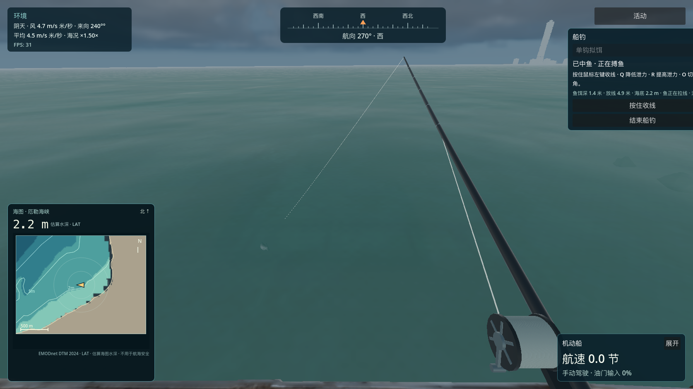

# P6.4.5 船钓搏鱼运动、鱼嘴挂钩与反馈报告

## 修改内容

- `scripts/boat_fishing_casting_system.gd`：把 participant 的游动方向和速度接入钩组运动；单钩钩位沿固定线长球面移动，Sabiki 各支线独立摆动；按鱼种平滑转向；用鱼种嘴部锚点定位鱼体；修正船边提鱼时鱼和对应钩位一起移动；增加张力驱动的鱼竿弯曲、爆发抽动、按实际线速驱动的卷线器音效，以及只读几何快照。
- `scripts/fish_species_profile.gd`、`resources/fish_species/{herring,sea_trout,needlefish}.tres`：增加可编辑的鱼种局部嘴部锚点和转向速度。
- `scripts/fishing_rod_system.gd`：允许船钓按实际线速控制共享循环音效强度；船钓事件由船钓呈现处理，不启动拖钓自动演出。
- `scripts/boat_hud.gd`、`scripts/fishing_player_panel.gd`、`scripts/fishing_debug_panel.gd`、鱼种翻译资源：显示简洁收放线状态、泄力反馈和 F3 搏鱼遥测。
- `tests/test_p6_4_5_boat_fishing_visual_motion.gd` 及 P6.3.1/P6.3.2 集成测试：覆盖游动约束、嘴钩几何、单钩/串钩搏鱼、鱼竿可见性和回归。
- `P6_4_5_FIGHT_VISUAL_CAPTURE.png`：Forward+ 主场景、浅水海鳟测试搏鱼截图。

## 根因与实现

中钩后鱼保持静止的直接原因是 participant 原本只提供挣扎方向和速度数据，船钓视觉没有将它们变成钩位运动；每帧再将鱼体放回固定钩位，会抵消鱼的位移。现在单钩钩位在鱼竿竿尖为球心、权威放线长度为半径的球面上沿切线移动；Sabiki 则让各钩位在自身支线长度和 52°摆动锥内独立转动。鱼力和渔轮泄力仍由既有 solver 决定出线；低于泄力的鱼仍可挣扎，但纯侧向挣扎不会修改 `_line_paid_out_length_m`。

鱼体姿态使用 participant 的挣扎阶段、游动方向、鱼种转向速度和既有尾摆频率。转向逐步完成，位置连续积分；船体内向分量被去除，鱼体各段还会检查船型尺寸推导的安全椭圆。该椭圆是保守避让代理，不是实际水下船壳碰撞网格。

单钩亮片使用真实钩尖位置，Sabiki 使用对应支线钩尖；鱼模型根位置按

`fish_origin_world = hook_world - scaled_fish_basis * mouth_anchor_local`

反算，使鱼种局部嘴部锚点变换后落在钩尖。鲱鱼、海鳟、针鱼分别在各自 `.tres` 中配置锚点，不共用世界空间偏移。姿态更新、收放线和出水阶段都重复应用该约束，因此提鱼不再单独插值鱼体中心。

嘴部锚点依据现有 GLB 模型朝向与尺寸估定，属于初始视觉调校值。它不是模型艺术资产中已有的骨骼 Marker；后续如美术调整模型原点或朝向，应重新校准对应资源参数。

## 鱼竿、音效和调试

搏鱼中的竿弯由 solver 的张力比例平滑映射；participant 从非冲刺切入 burst 时叠加短促竿尖抽动，断线/会话清理时卸载弯曲。此视觉值不回写 solver。

卷线器仍依据实际线长变化旋转。收线、出线和泄力循环音分别读取 `reel_in_rate_mps`、`line_out_rate_mps` 和泄力状态；静止或结束时清除对应循环。FishingRodSystem 的外部音效 owner 接口提供速度强度，并保留拖钓原有状态机。

普通 HUD 只提示收线、放线、持线及泄力档位；F3 显示线长、线速、有效鱼力、张力/承载力、泄力阈值、危险计时，以及每条鱼的体力、挣扎状态、鱼嘴—钩位误差、鱼体和钩位坐标、船体安全边界间距。几何快照只在 F3 请求时计算。

## 验证结果

- `tests/test_p6_4_5_boat_fishing_visual_motion.gd`：通过。固定 10 m 线长、按鲱鱼 profile 更新 18 秒时，最大侧向位移为 **0.5945 m**；主动挣扎没有缩短或放长权威线长。30/60 FPS 终点差 **0.0192 m**。单钩球面线长、五条 Sabiki 支线独立摆动和方向限制均通过。
- 同一测试中嘴锚点变换公式误差为 **0 m**（解析计算）。`test_p6_3_1_single_jig.gd` 单钩搏鱼引擎快照的最大误差为 **0.000977 m**；`test_p6_3_2_sabiki_multi_catch.gd` 五钩流程的最大误差为 **0.002185 m**。本轮集成观测到的最大值约 **2.19 mm**。
- P6.3.1 单钩集成测试通过：自然/F3 海鳟搏鱼期间手持竿仍可见，张力弯曲有输出，断线后竿弯释放且玩家恢复操作；拖钓呈现没有接管船钓事件。
- P6.3.2 Sabiki 批量收获、P6.4.2 participant、P6.4.3 solver、P6.2.5 卷线器音效定向测试均通过。
- `git diff --check` 通过。
- 在 Apple M2 Pro / Godot 4.7.2 Forward+ 主场景中，以 F3 测试鱼进入浅水海鳟搏鱼并截帧：状态 `FIGHTING`、实际深度 **1.38 m**、鱼竿节点可见、当帧弯曲角 **2.71°**，嘴钩误差 **0 m**。见截图。鱼体在此视角下是较小的水下轮廓；单张图不能证明鱼的运动轨迹，因此鱼的可视游动仍以自动运动测试结果为依据，建议后续在不同水色和机位人工验收。
- 声音状态由线速映射和测试接口验证；本轮没有进行主观扬声器听感校准。渲染器在 headless 集成测试退出时仍报告一组 shader/RID 泄漏警告，测试断言通过；其是否来自场景中其他渲染节点尚未定位。

## 限制与后续校准

- 鲱鱼固定线长下的 profile 驱动侧向范围约 0.59 m，是受 participant 速度、方向变化和固定线长几何共同限制的结果；不是每种鱼、每次挣扎都保证达到的距离。
- 鱼嘴锚点、尾摆强度、转向速度和鱼竿响应均为首轮参数，需结合真实玩家视角逐鱼校准。
- 船体防穿模采用船长/船宽推导的安全椭圆与沿鱼身采样，不替代实际船壳碰撞；对复杂船艏、横倾及波浪下水线仍需人工复核。
- 截图能确认第一人称搏鱼时鱼竿没有消失；不能据此宣称所有鱼种、串钩满钩、不同船体和断线瞬间的画面均已完成视觉验收。

