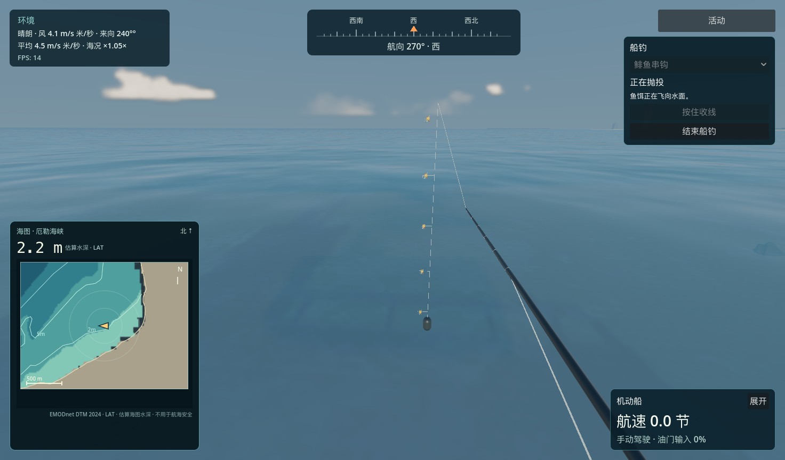
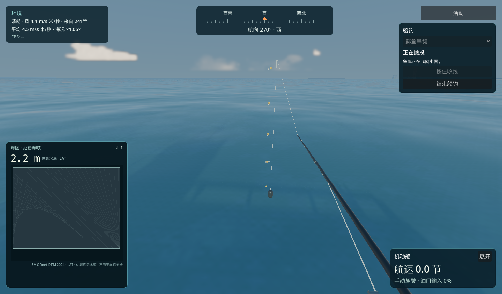
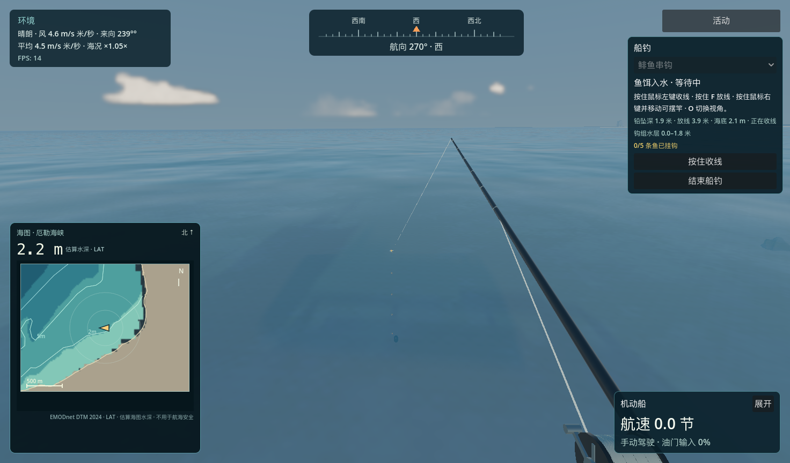
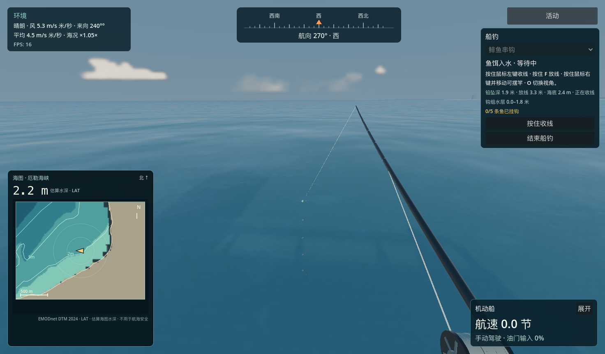

# P6.4.6.0.3 — Sabiki 鱼线运行时复现与修复报告

## 结果摘要

在 `scenes/main.tscn` 中通过正常船钓 UI 启动实际 `BoatFishingCastingSystem`，逐帧运行抛投、WAITING、手动收线和最终回收，并从运行时生成的 `ImmediateMesh` 反算鱼线中心线。复现确认了两个问题：

1. Sabiki 外部主线和串钩主干在一根折线网格的连接点处形成急转。连接位置本身正确，错误在于网格只沿离散锚点直接连接，没有把方向变化分布到可见线形中。
2. 抛投期间线已经画到钓组，但 `_line_paid_out_length_m` 直到抛投结束才更新。旧运行时测得线长与放线长度差约 3.91–3.99 m。这个共享状态不一致也影响 Single Jig。

修复后，抛投的主线几何长度与权威线长误差不超过 0.011 m；Sabiki 连接处进出方向峰值约 32.3–32.7°，收线约 14.7–15.2°。位置连续误差保持在约 2 mm。鱼线仍可以真实转向，没有强制共线。

## 运行时复现方法

新增的 `tests/test_p6_4_6_0_3_runtime_line_geometry.gd` 实例化实际主场景，通过 HUD 开启船钓，使用正常 `begin_charge()`、`release_charge()` 和 `set_manual_reeling()` 接口，按逐帧循环运行状态机。测试覆盖 Sabiki 与 Single Jig 的 30、60 FPS 目标步长，Sabiki 收线连续经过水下、钩位出水、铅坠出水及最终回收阶段。

测试直接读取实际生成网格的三角形顶点，重构各线段中心线，并逐帧记录：Casting 状态、权威线长、外线网格路径长度、主线松紧、鱼竿尖端、线眼、铅坠、五个钩位、水面相对高度、接头方向和接头位置误差。采样同时记录到 `/tmp/p6_4_6_0_3_runtime_before.ndjson` 和 `/tmp/p6_4_6_0_3_runtime_after.ndjson`，截图已复制到仓库报告目录。

30/60 是测试设置的目标帧率；Headless 整场景运行的实际采样吞吐低于目标值，故报告的几何结果是实际状态机时间步结果，不把吞吐值当作稳定帧率或性能数据。

本次最终 Headless 矩阵的实际采样吞吐：Sabiki 30 FPS 目标下抛投约 27.6、收线约 28.5 samples/s；60 FPS 目标下约 35.1 和 46.8 samples/s。Single Jig 分别约 25.4/30.0 和 41.9/48.4 samples/s。它们是测试过程采样数除以墙钟时长，仅描述该测试环境。

## 根因与排除项

### 折角来自离散网格锚点急转

`_update_line_and_bait_visuals()` 在共同的外部主线端点之后，继续把 Sabiki 钩位和铅坠位置追加到同一 Mesh 路径。原路径逐段直线连接锚点，因此外线进入顶环后，下一段立即转向钩组主干。运行时 60 FPS 抛投最大夹角为 134.63°，30 FPS 为 132.45°；收线分别达到 60.98°和 60.38°。

外部主线末端与 Sabiki 顶环不是两个分离目标。旧网格顶点到 `_get_tackle_line_connection_world()` 的最大误差只有约 0.0014–0.0022 m；实机前后接头位置也基本重合。因此此前只改顶环位置不能消除折角。

现有 `_get_main_line_visual_state()` 负责共同松紧状态，`get_rig_hook_positions()` 负责沿串钩布局产生钩位锚点。两者都不是本次确认的折角来源。折角也不需要按五钩逐段做张力或长度求解。

### 抛投线长在状态机中滞后

旧抛投运行数据中，Sabiki 外线几何路径长度与 `_line_paid_out_length_m` 的最大差值为 3.91–3.98 m，Single Jig 也达到约 3.99 m。线 mesh 在 `CASTING` 状态已经显示从竿尖到运动中钓组的线，但权威长度在动画结束后才被写入。这是同一条主线的共享状态不同步，并非 Sabiki 专属物理。

### 为什么此前调整没有解决

之前的方向、松弛和姿态调整没有改变逐锚点直线网格在顶环处急转的事实；当外线方向与近乎垂直的串钩主干相差很大时，改变其中一侧朝向只会移动转折点。另有静态曲线辅助函数测试没有跑完整 `CASTING → WAITING → RETRIEVING` 状态机，也不会观察当时实际构造的 Mesh。

## 本次修改

### 共同主线插值

在 `_update_line_and_bait_visuals()` 的自由水域主线路径上，保留竿尖、线眼、钩位、铅坠等原始几何锚点，并通过通用的 `calculate_smoothed_line_path()` 生成 16 段细分的 centripetal Catmull–Rom 中心线。插值经过原锚点，只改变渲染网格的采样路径；没有移动真实钩位或改写鱼线长度。

该路径对两种钓组都复用。Single Jig 末端只有其自身连接结构；Sabiki 沿相同路径额外包含钩位布局和铅坠。没有 Sabiki 专属主线曲线、线长、张力、求解器或强制垂直姿态。已有船舷避让路径超过两个点时，继续保留其人工避让锚点，不让平滑插值削弱船体净空。

这不是强制外线与主干共线。测试中只约束连接点实际位置误差、放线长度误差，以及线眼两侧方向不能重新形成旧式钝角折返；连接总夹角仍是非零值。

### 抛投期间更新唯一权威线长

`_update_cast_animation()` 在钓组离开竿尖后逐帧以竿尖到真实钓组线眼的距离更新 `_line_paid_out_length_m`。Casting 中保持 0 m 下限；抛投完成并进入 WAITING 时沿用现有 0.55 m 最小线长。没有新增第二份线长。

### 代码定位

- 抛投逐帧线长提交：`scripts/boat_fishing_casting_system.gd:3633`。
- 共用主线、Sabiki 锚点和网格路径：`scripts/boat_fishing_casting_system.gd:4521`。
- centripetal Catmull–Rom 路径细分：`scripts/boat_fishing_casting_system.gd:4691`、`scripts/boat_fishing_casting_system.gd:4713`。
- 共用松紧状态：`scripts/boat_fishing_casting_system.gd:4762`。
- 钩位锚点生成及真实线眼连接：`scripts/boat_fishing_casting_system.gd:898`、`scripts/boat_fishing_casting_system.gd:4823`。
- 实际状态机测试和 mesh 顶点中心线重构：`tests/test_p6_4_6_0_3_runtime_line_geometry.gd:21`、`tests/test_p6_4_6_0_3_runtime_line_geometry.gd:88`、`tests/test_p6_4_6_0_3_runtime_line_geometry.gd:318`。

### 修改文件

- `scripts/boat_fishing_casting_system.gd`：Casting 线长提交及共同主线 mesh 采样路径。
- `tests/test_p6_4_6_0_3_runtime_line_geometry.gd`：真实状态机运行时复现和前后几何验收。
- `reports/p6_4_6_0_3/`：实际图形场景前后截图。

未修改 Authority、pending catch、搏鱼 Solver、鱼钩位置、中鱼、钓获结算或拖钓逻辑。

## 运行数据对照

角度为鱼线网格在顶环附近的外线方向与钩组延伸方向最大夹角。该角度允许非零；测试要求避免基线中的大于 60°钝角折返。`连接误差`是实际网格中心线至真实线眼的最大距离。路径长度误差是外部网格路径长与 `_line_paid_out_length_m` 的最大绝对差。

| 钓组 / 阶段 | 目标步长 | 修复前：路径长度误差 | 修复后：路径长度误差 | 修复前：接头夹角 | 修复后：接头夹角 | 修复后：连接误差 |
|---|---:|---:|---:|---:|---:|---:|
| Sabiki 抛投 | 30 FPS | 3.978 m | 0.0083 m | 132.45° | 32.27° | 0.0020 m |
| Sabiki 抛投 | 60 FPS | 3.910 m | 0.0103 m | 134.63° | 32.65° | 0.0020 m |
| Sabiki 收线 | 30 FPS | 0.0258 m | 0.0267 m | 60.38° | 15.24° | 0.0022 m |
| Sabiki 收线 | 60 FPS | 0.0075 m | 0.0217 m | 60.98° | 14.72° | 0.0022 m |

收线阶段的线长差均在 0.05 m 内。60 FPS 收线误差从 0.0075 m 增至 0.0217 m，但仍处于验收范围，网格与线眼连接误差没有恶化。

Single Jig 用来确认共同路径未破坏：修复前抛投路径与权威长度差约 3.986–3.990 m；修复后 30/60 FPS 分别不超过 0.0060/0.0116 m。修复后 Single Jig 收线误差分别不超过 0.0126/0.0169 m。

局部 0.32 m 邻域曲率也写入运行记录，但没有拿它作为硬验收条件：该邻域包含第一个实际钩位后的方向变化，不能将其解释为顶环接头角度。30 FPS 初次复测中这一指标短时达到 49.96°，检查中心线采样后确认峰值落在接头后的钩位布局范围；随即将验收改为直接检查线眼进出方向夹角。修复后这一指标仍保留在记录中供后续视觉调校。

## GPU 截图

以下图片来自 Godot 4.7.2 图形运行场景，同一自动化玩家视角和 Sabiki 测试钓组。截图 HUD 有 14、16 和 `--` 三种显示；这只是整场景截图时的表现，不能据此归因于本次线网格插值，也不构成性能基准。

### 抛投

修复前：

修复后：

### 部分收线 / 近水面

修复前：

修复后：

截图与运行时角度测量都显示，原先集中在单一网格顶点的折返被分散到连续路径上。线眼到钩组的方向仍可改变，没有强行拉直整副钓组。

## 测试结果

- `godot --headless --path . --script res://tests/test_p6_4_6_0_3_runtime_line_geometry.gd`：通过，`failures=0`。真实抛投和收线覆盖 30/60 FPS 目标步长、Sabiki 和 Single Jig。Casting 路径误差限值 0.03 m；收线限值 0.05 m；Sabiki 眼位夹角必须小于 60°。修复前 30/60 FPS 抛投角度约 132–135°，相同断言会失败。
- `godot --headless --path . --script res://tests/test_p6_3_1_single_jig.gd`：通过，`failures=0`。包含 Single Jig、Authority 和拖钓隔离回归。
- `godot --headless --path . --script res://tests/test_p6_3_2_sabiki_multi_catch.gd`：通过，`failures=0`。包含五钩、批量收获和拖钓隔离回归。
- `git diff --check`：通过，退出码 0，无空白差异问题。

上述 Headless 测试退出时各报告一个 `RendererDummy...Shader` RID 清理警告；断言退出码为 0。P6.3.1 另有既有通用鱼类搏鱼配置警告。

## 限制与后续关注

- 网格中心线是视觉近似；没有增加悬链线或分段物理求解。实际主线长度仍由 `_line_paid_out_length_m` 和现有求解器管理。
- 16 倍路径细分增加每帧 Mesh 顶点写入量；本次未做独立性能基准。当前 5 边线管约按每中心线段 30 个顶点构建，测试显示 Sabiki 中心线约 235 个采样点，即约 7,000 个网格顶点/次更新。实际 GPU 帧率受完整场景影响，不能单独归因于此改动。
- 船舷避让路径保留原有折线锚点，不在其上应用平滑。若未来发现折角只在越过甲板的路线发生，应单独检验避让点是否符合净空约束。
- 鱼线与 Sabiki 主干之间仍允许有受力方向差异；当前目标是避免无依据的单点折返，不是让视觉变成一根刚性直杆。
