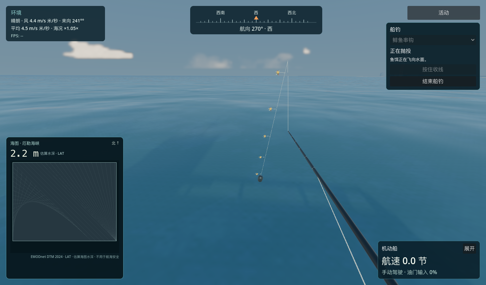
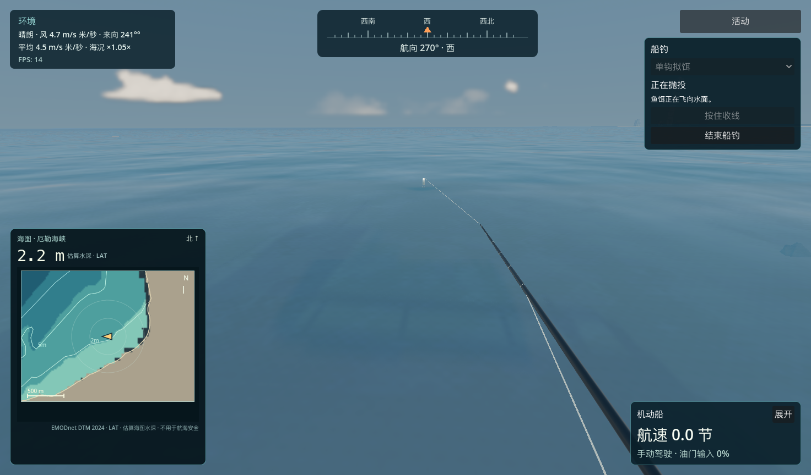
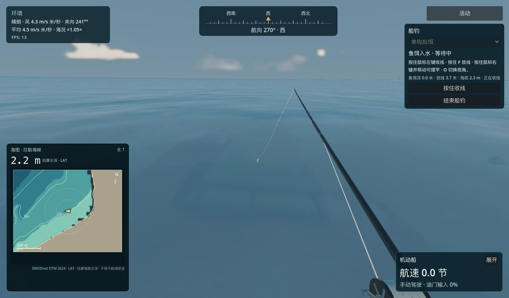
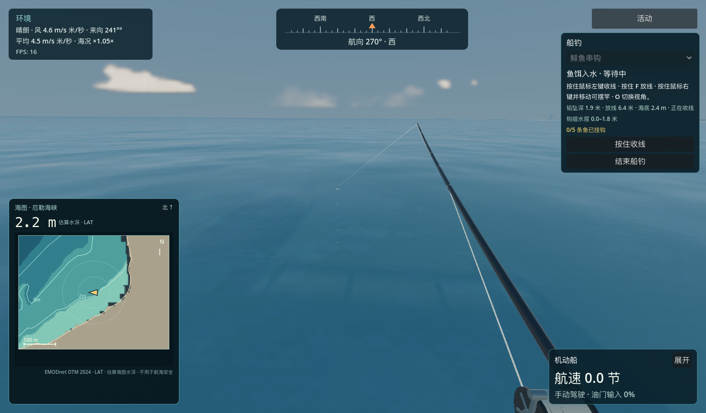
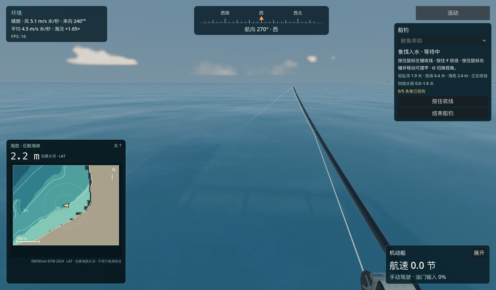

# P6.4.6.0.4 — Single Jig / Sabiki 主线调用链统一与折角根因修复

## 结论

Single Jig 和 Sabiki 现在从竿尖到各自的末端连接眼共用同一个主线渲染入口、松紧状态和 ImmediateMesh 管线。主线生成不再把 Sabiki 的五个钩位或铅坠当作路径锚点。Sabiki 的顶环以下主干、支线、钩子和铅坠作为末端钓组单独绘制。

运行时确认的旧架构问题是：外部主线 Mesh 曾把 Sabiki 钩位和铅坠锚点接在顶环之后，再整体做高倍 Catmull–Rom 插值；与此同时 Sabiki 主干也有自己的可见实现和姿态/更新路径。外部路径因此被末端钩组几何牵引，主线与末端结构的形状和更新时间不一致。单纯增加曲线细分只能平滑这条错误耦合的路径，不能统一两个几何职责。

本次修复消除了这类耦合和重复主干实现。实际 GPU 画面中，竿尖到顶环的外部主线现在独立连续地连接到线眼；顶环以下仍会有一个可见的方向转折（本次 Sabiki 收线测试测得约 67–76°）。它来自末端钓组在重力下保持的布局方向。按本任务约束，没有把该夹角强制为零，也没有把它解释为已经消失的视觉现象。若玩家认为任何这种转向都不可接受，需要另行明确末端柔性线的视觉要求；本次不添加会改变钩位或强制共线的补偿。

## 当前调用链与差异

| 阶段 | 两种钓组共用的主线行为 | 必要的末端差异 |
|---|---|---|
| 抛投 | `READY → CHARGING → CASTING` 使用同一 casting system、同一个 `_bait_world` 与 `_line_paid_out_length_m`。`_update_cast_animation()` 在钓组飞行期间按竿尖到实际连接眼的距离更新唯一权威线长。 | Single Jig 的连接眼由亮片姿态与亮片线眼偏移决定；Sabiki 的连接眼位于顶环。Sabiki 还有整副长钓组的入水/沉降处理。 |
| WAITING / 手动收放线 | 共用 `_update_waiting_bait()`、当前线长约束与等待态更新；搏鱼时共用 `BoatFishingFightSolver` 和唯一线长提交位置。 | Sabiki 的五个空钩独立参与候选与预约；Single Jig 只有一个钩位。 |
| 部分/完全出水 | `_get_main_line_visual_state()` 给共同主线生成相同的 `taut/slack_ratio/airborne` 状态；收线状态由同一个主线生成入口绘制。 | Sabiki 的水面资格查看整副钓组的 hook/连接点，以决定整组是否已入水或离水；该检查不创建第二条主线。 |
| 最终回收 | `_update_retrieve_animation()` 使用共同的末端连接偏移来确定回收目标，并更新同一个 `_line_paid_out_length_m`。 | 两种钓组的眼位相对铅坠/拟饵中心的几何偏移不同。 |
| 主线 Mesh | `_update_line_and_bait_visuals()` → `calculate_common_main_line_visual_path()` → `_rebuild_line_tube_mesh()`。 | Sabiki 另画顶环以下主干和五条支线；Single Jig 画亮片末端模型。 |

必要差异只影响末端结构、鱼钩数量、支线、铅坠、入/离水资格及捕获流程。不必要的差异——将 Sabiki 钩位塞入外部主线中心线、Sabiki 专属外线松弛曲线、重复刚性主干及姿态补偿——已从当前主线路径移除。

## 修改结构与代码位置

- 状态机每帧先更新 casting/reeling/fight 状态，再统一更新竿线导环、主线、末端钓组与声音反馈：[boat_fishing_casting_system.gd:1293](/Users/smixu1/dev/boat-life-simulator/scripts/boat_fishing_casting_system.gd:1293)。
- Casting 飞行期间提交 `_line_paid_out_length_m`：[boat_fishing_casting_system.gd:3632](/Users/smixu1/dev/boat-life-simulator/scripts/boat_fishing_casting_system.gd:3632)。该状态此前已在 P6.4.6.0.3 修正，本次保留；主线渲染不写入第二份线长。
- 共同线状态与几何入口：[boat_fishing_casting_system.gd:4526](/Users/smixu1/dev/boat-life-simulator/scripts/boat_fishing_casting_system.gd:4526)、[boat_fishing_casting_system.gd:4592](/Users/smixu1/dev/boat-life-simulator/scripts/boat_fishing_casting_system.gd:4592)、[boat_fishing_casting_system.gd:4786](/Users/smixu1/dev/boat-life-simulator/scripts/boat_fishing_casting_system.gd:4786)。共同路径由竿线导环前缀、竿尖、末端连接点和必要的船舷净空路线构成；几何函数不接收 `rig_type`、钩位或铅坠数组。
- Single Jig 线眼与 Sabiki 顶环位置集中于连接偏移函数：[boat_fishing_casting_system.gd:4855](/Users/smixu1/dev/boat-life-simulator/scripts/boat_fishing_casting_system.gd:4855)。
- Sabiki 末端主干由独立 `SabikiBackboneLine` ImmediateMesh 从顶环经过原五个钩位布局到铅坠：[boat_fishing_casting_system.gd:4767](/Users/smixu1/dev/boat-life-simulator/scripts/boat_fishing_casting_system.gd:4767)。鱼钩的权威空间位置仍由现有钩位函数产生；主线渲染不会覆盖它们。
- Sabiki 节点创建及五条支线：[boat_fishing_casting_system.gd:5223](/Users/smixu1/dev/boat-life-simulator/scripts/boat_fishing_casting_system.gd:5223)。
- 连续真实状态机复现与 A/B 测试：[test_p6_4_6_0_3_runtime_line_geometry.gd:21](/Users/smixu1/dev/boat-life-simulator/tests/test_p6_4_6_0_3_runtime_line_geometry.gd:21)。测试文件沿用前一阶段文件名，当前测试输出和断言标识为 P6.4.6.0.4。

共同路径的松弛视觉仅沿重力方向下垂，绷紧时沿 route span 的端点弦线；船舷避让仍由相同输入路线处理。Sabiki 主干网格与主线 Mesh 是两段职责不同的可见线材：外线最后一个采样点与实际顶环重合，主干首点与该顶环重合。测试也检查场景里恰有一个 `BoatFishingLine`、一个 `SabikiBackboneLine`、五条 `SabikiBranchLine`、零个旧 `SabikiMainline` 节点。因此没有把同一外线/主干重复绘制两次。

## 根因、修复与清理

### 已确认的根因

P6.4.6.0.3 的运行时日志指出，旧 `_update_line_and_bait_visuals()` 在外部线端点之后继续追加 Sabiki 钩位和铅坠锚点，再用 16 倍细分的 centripetal Catmull–Rom 生成整条路径。那让“竿尖到顶环的共同主线”依赖了末端五钩布局；Sabiki 主干又由另一个视觉对象/姿态路径表达。此前的平滑降低了某些测得的转角，但没有把共同主线与末端钓组分开，因此实机仍能看到不自然的接头形状。

抛投线长滞后也是旧的共同状态问题，已在 0.3 中通过每帧按竿尖到实际线眼距离同步修正；本轮复测确认该修正仍有效，并未新增线长状态。

### 本次处理

1. 主线 Mesh 仅生成到 `_get_tackle_line_connection_world()` 返回的线眼/顶环。
2. Sabiki 顶环以下的主干由一条独立末端线 Mesh 绘制；该 Mesh 仅取顶环、既有钩位布局和铅坠位置。
3. Single Jig 与 Sabiki 共用同一静态主线路径函数和同一线管重建函数。相同端点、前缀、净空路线及线状态输入得到逐点相同输出。
4. 保留 Casting 的唯一权威线长同步；不修改 Solver、鱼钩权威位置、Authority、pending catch 或捕获结算。
5. 移除 Sabiki 专属松线 Bezier 和其被钩组方向影响的调用路径、将钩位/铅坠并入外部主线路径的用法、旧重复 `SabikiMainline` 圆柱及过时字段/姿态切换分支。`calculate_smoothed_line_path()` 和 16 倍 Catmull–Rom 路径不再用于该系统，也无剩余调用。

Sabiki 末端轴仍有自己的模型布局方向，这是多钩末端结构的几何表示，不参与主线张力、主线状态或线长。Casting 时会响应钓组自身实际运动；等待/收线阶段沿当前重力与船流布局。一次曾尝试让它根据鱼竿视觉弯曲量转动，测试显示这会移动线眼并反馈到实际线长约束，因此已移除该路径；鱼竿视觉状态现在不驱动钓组几何。

## 自动测试

使用 Godot 4.7.2，真实主场景 `scenes/main.tscn`，经正常活动 HUD 启动真实 `BoatFishingCastingSystem`，运行正常充能、抛投、等待、手动收线、部分/完全回收状态。测试目标上限设置为 30 与 60 FPS；Headless 运行吞吐因整场景负载而变化，不能据此称为稳定帧率保证。

### 相同输入 A/B 与节点职责

- Single Jig 与 Sabiki 连接到同一指定世界线眼位置时，测试分别在绷紧、松弛两种状态调用生产函数 `calculate_common_main_line_visual_path()`，输出 PackedVector3Array 逐点一致。
- 运行时节点计数通过：1 条外部线、1 条 Sabiki 主干、5 条支线、0 条旧 `SabikiMainline`。
- 主线末点与线眼连接；Sabiki 主干从线眼开始并连接铅坠；主线 A/B 函数不读取钩位或铅坠。

### Headless 实际状态机结果

`Godot --headless --path . --script tests/test_p6_4_6_0_3_runtime_line_geometry.gd`：退出码 0，`failures=0`。

| 钓组 / 目标上限 | 抛投采样吞吐 | 抛投主线长度最大误差 | 收线采样吞吐 | 收线最大误差（400 ms 后） | 接头位置误差最大值 |
|---|---:|---:|---:|---:|---:|
| Sabiki / 30 | 27.87 samples/s | 0.0062 m | 27.97 samples/s | 0.0096 m | 0.0020 m |
| Sabiki / 60 | 36.97 samples/s | 0.0040 m | 39.90 samples/s | 0.0043 m | 0.0022 m |
| Single Jig / 30 | 25.62 samples/s | 0.0035 m | 29.86 samples/s | 0.0109 m | 0.0020 m |
| Single Jig / 60 | 40.04 samples/s | 0.0024 m | 46.78 samples/s | 0.0103 m | 0.0022 m |

Sabiki 60 上限收线有一个 0.1129 m 的瞬时最大测量误差样本；该样本被测试标记为路径测量无效样本，400 ms 后最大误差为 0.0043 m。测试保留并记录该异常峰值，没有把它从报告中隐藏。Sabiki 30 收线未稳定前最大误差为 0.0487 m，400 ms 后为 0.0025–0.0096 m（重复运行受状态采样时点影响）。Single Jig 全部稳定误差均低于 0.05 m。

另跑：

- `tests/test_p6_3_1_single_jig.gd`：退出码 0，`failures=0`。单钩中鱼、搏鱼、收线、断线、Authority 结算和拖钓隔离断言通过。
- `tests/test_p6_3_2_sabiki_multi_catch.gd`：退出码 0，`failures=0`。五钩独立挂鱼、玩家收线、批量结算及清理断言通过。
- `git diff --check`：本报告加入后执行。

这些 Headless 场景退出时均可能输出 Godot `RendererDummy...DummyShader` RID 清理警告；上述测试进程仍以退出码 0 结束。它属于测试进程 teardown 警告，不作为功能测试通过的依据。

## GPU 图形运行检查

已运行当前主场景图形版的自动抛投/收线场景，并保存当前构建截图。图片是实际 Godot 场景，不是示意图。组件隔离图通过临时隐藏主线或 Sabiki 主干 Mesh 取得；只改变测试期间的可见性，未修改正式运行行为。

| 场景 | 截图 |
|---|---|
| Sabiki 抛投（30 上限测试） |  |
| Sabiki 部分收线（30 上限测试） |  |
| Single Jig 抛投对照 |  |
| Single Jig 收线对照 |  |
| 只显示外部主线 |  |
| 只显示 Sabiki 末端主干 |  |
| 外线和主干一起显示 |  |

图形运行记录的实际 FPS 约 11–15，不等于 30/60 FPS；因此 GPU 场景没有验证目标帧率性能。GPU 数据中，Sabiki 主线与权威长度在稳定后误差约 0.003–0.005 m，线眼连接位置约 0.001–0.002 m。收线时外线与末端主干方向差仍约 67–76°，截图可看到线眼处的几何转向。组件隔离确认外线自身已结束在线眼，顶环后的转向属于末端主干布局，而非外线继续穿过钩位或第二根重复主线。

**视觉验收结论：**生产几何已按职责拆开，抛投线长和连接位置通过实测，重复主线已排除；但“玩家是否接受线眼处仍可见的自然转向”不能由无夹角目标的测试替玩家决定。因此本报告不宣称所有画面中的折角感已经消失。此前 `.0.3` 修复前/后的截图仍保留在 `reports/p6_4_6_0_3/` 供对照；本轮截图和组件隔离图在 `reports/p6_4_6_0_4/`。

## 修改文件

- `scripts/boat_fishing_casting_system.gd`：共同主线与末端结构分离、共同线 Mesh 更新、保留 Casting 权威线长提交和清理旧 Sabiki 路径/重复状态。
- `tests/test_p6_4_6_0_3_runtime_line_geometry.gd`：扩展为 P6.4.6.0.4 的真实状态机、A/B、几何和组件职责测试；文件名沿用既有测试路径。
- `reports/p6_4_6_0_4/`：图形运行截图和主线/末端组件隔离截图。
- 本报告。

未修改搏鱼 Solver、鱼种力量、鱼群 Authority、中鱼概率、pending catch、钓获结算或拖钓玩法。

## 尚存限制

1. 外线是轻量级视觉线形近似，不是弹性绳或悬链线求解。主线权威长度仍由既有线长状态/Solver 管理。
2. Sabiki 顶环与竖向主干之间在当前物件布局下会出现实际方向转折；本次未强行拉直，也未移动真实钩位。若后续要减少这个观感，需要先确定是否允许调整末端视觉几何，而不能再让五个钩位回到共同主线路径。
3. 图形场景实际帧率较低，测试目标的 30/60 FPS 只作为 `Engine.max_fps` 上限输入；本报告没有把它们当作实际渲染帧率结果。
4. Headless / GPU 自动测试 teardown 均有 RendererDummy Shader RID 警告；没有观察到测试断言失败。
