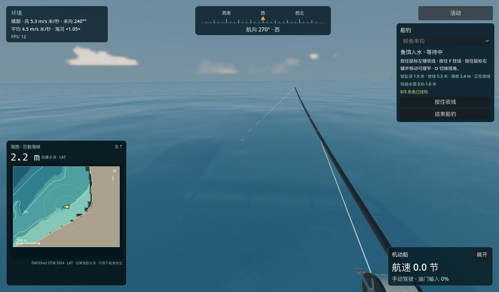
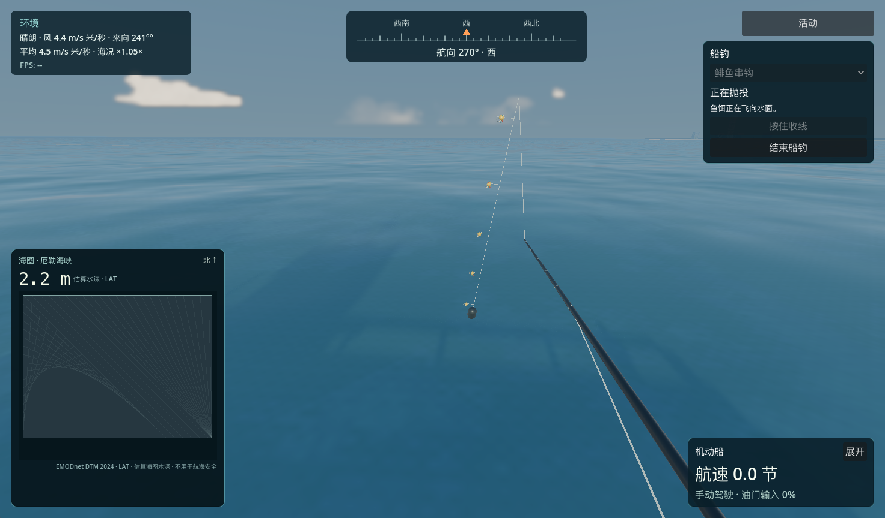
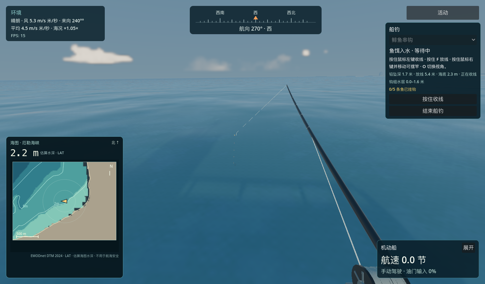

# P6.4.6.0.5 — Sabiki 末端主干运动与受力一致性修复

## 结果摘要

已修复确认的收线问题：Sabiki 主干在主线绷紧且已有明显线负荷时仍保持世界竖直，因而没有响应顶环承受的主线方向。现在末端钓组使用共同的受力姿态近似；实际钩位、顶环和主干 Mesh 都由同一姿态生成。外部主线函数、线长字段和搏鱼 Solver 均未改动。

受载收线的 GPU 运行数据表明，外线末端切线与 Sabiki 主干方向差明显下降。抛投中的一个极大角度样本出现在高速、离水、无张力的抛投段；它不是受载状态下的同一根因，因此没有通过强制指竿或共线来消除。完整的高速抛投姿态仍是本阶段的限制，详见下文。

## 修改文件

- `scripts/boat_fishing_casting_system.gd`
  - 以自然姿态下的顶环位置为基准，计算顶环朝竿尖的线方向，并让受载的 Sabiki 末端姿态按 `_rod_tension` 响应。
  - 保留自然重力/船体运动基准，并让所有钩位、顶环和主干 Mesh 复用同一姿态轴。
  - 在新鱼加入搏鱼会话、负荷姿态立即变化时，同帧重新锚定已挂鱼的嘴部到对应实际钩尖。
- `tests/test_p6_4_6_0_3_runtime_line_geometry.gd`
  - 修正 GPU 组件隔离截图暂停 casting 更新时的采样统计；暂停帧仍写入诊断文件，但不参与活动状态机的端点和连续性断言。
  - 对外线终点连续性只聚合有效主线路径样本。收线开始的首个旧 Mesh 样本仍记为无效样本。
- `reports/p6_4_6_0_5/before/`、`reports/p6_4_6_0_5/after/`
  - 保存修复前后真实运行截图及逐帧 NDJSON 数据。
- `P6_4_6_0_5_SABIKI_TERMINAL_RIG_MOTION_FIX.md`

## 原姿态计算链与根因

实际更新顺序是 casting 状态逻辑更新钓组位置/速度，随后 `_update_line_and_bait_visuals()` 更新主线和钓组，最后 `_update_sabiki_hooked_fish_visuals()` 更新已挂鱼显示。钓组视觉由 `_update_rig_visual_position()` 设置根节点位置与 Basis；`_update_sabiki_backbone_visual()` 用同一轴构建顶环、钩位站点和铅坠之间的主干。真实钩尖由钩节点 Transform 得到。

共同外部主线终点仍是 `_get_tackle_line_connection_world()`，也就是 `_bait_world + _get_tackle_line_connection_offset_world()`。Sabiki 的连接偏移、根节点、钩位和主干 Mesh 都读取 `_get_sabiki_up_direction_world()`。运行时没有发现外线、Sabiki 主干重复绘制，也没有发现主线端点连接到另一个独立坐标的情况。

修复前，`_get_sabiki_up_direction_world()` 从顶环/钓组指向竿尖得到 tether 方向，再按 `_should_keep_sabiki_tackle_aligned()` 与回收计时决定保持 tether 姿态，或向自然姿态插值。在实际受载收线分支中，该插值可以完全回到世界竖直方向；线负荷已经明显增加，但主干仍沿 `Vector3.UP`。因此问题不是端点断开，而是末端姿态路径没有消费当时的线负荷方向。

修复后用未受载姿态估计顶环：`neutral_line_eye = _bait_world + natural_up * attachment_height`。朝竿尖方向由该点计算，以免姿态轴通过已经旋转的顶环再次依赖自身。姿态方向为自然基准与顶环朝竿方向按 `line_load` 混合并归一化。`SABIKI_LINE_LOAD_AXIS_RESPONSE = 1.0` 是方向响应比例，不是张力系数，也不改变 Solver 力值。

这仍是轻量的视觉姿态近似，不是新的刚体或绳索受力求解器。

## 各状态使用的数据

| 状态 | 姿态依据 | 本次判断 |
|---|---|---|
| CASTING | 世界上方向、船体速度影响，以及钓组相对船体的水平运动方向；抛投期间不使用搏鱼 Solver 张力。 | 保留运动滞后姿态。高速抛投角度不能只按受载收线标准判断。 |
| WAITING | 自然上方向；非搏鱼时 `_update_waiting_bait()` 根据线段距离与权威放线长度计算 `_rod_tension`。松线状态会衰减姿态响应。 | 有负荷时响应线向，松线时回到自然姿态。 |
| RETRIEVING | 自然姿态加线负荷响应；主线视觉状态通常 taut，若已处于 airborne retrieval 则会衰减响应。 | 修复重点：受载收线时不再因为旧恢复插值固定为竖直。 |
| FIGHTING | `_rod_tension` 是 Solver 张力比例的平滑值；方向响应仍使用共同末端姿态函数。 | 沿用既有 Solver 数据，不改变搏鱼力学。 |

船体运动数据取自 `_boat_velocity_estimate_world`。现有场景没有在这里采样局部水流，也没有末端钓组质量、角动量或分段阻力数据；报告不把这些近似说成真实流体受力。

## 修复前后运行时证据

GPU 场景使用 `scenes/main.tscn`、正常 HUD 开始船钓、正常 `READY → CHARGING → CASTING → WAITING → RETRIEVING` 状态机。对比同为 30 FPS 上限的 GPU 运行记录，只统计 Sabiki 收线中主线 taut、`rod_tension_visual >= 0.4`、有效外线切线，且放线长度在 0.65–5.9 m 的样本：

| 指标 | 修复前 | 修复后 |
|---|---:|---:|
| 样本数 | 60 | 63 |
| 外线末端切线与主干方向差平均值 | 70.38° | 37.08° |
| 最大值 | 71.44° | 41.54° |
| 最小值 | 67.23° | 15.34° |
| 平均 `_rod_tension` | 0.689 | 0.686 |

也可对照相近的约 5.4 m 放线样本：修复前 5.392 m、负荷 0.766、夹角 68.93°、主干轴为世界上方向；修复后 5.488 m、负荷 0.646、夹角 41.54°、主干轴 `(0.099, 0.885, 0.454)`。两次负荷量级相近，主干已经向实际顶环线向转动。

GPU 最终运行还测得：Sabiki 顶环/主线连接误差最大约 0.0022 m；等待 0.4 秒后，受载外线路径长度与权威线长误差最大约 0.0059 m；Mesh 终点与顶环连接有效。五个主干站点与五个真实钩位全部吻合。收线启动首个样本有 1 个无效路径测量，后续连接检查通过。

### 抛投中的大角度样本

GPU 抛投记录里，最大方向差 163.17° 的样本发生于：线长/竿尖至顶环距离 0.522 m、五个钩位全在水面上方、钓组速度约 8.9 m/s、垂直速度约 5.23 m/s、垂直加速度约 -13.52 m/s²、`_rod_tension = 0`，且未进入 Solver 搏鱼。它处于快速飞行和重力减速中，不是持续受载的收线样本。这里外线和钓组主干可能暂时朝相反方向，不能据角度单独认定受力约束错误。该动作仍可能显得折转明显；本阶段没有通过硬性朝竿/共线来伪造消失。

临近回收、线长趋近零时，夹角也会数值退化。一个 GPU 样本的线长约 0.00009 m、竿尖至连接点约 0.00024 m，切线在视觉上没有稳定定义。其前一有效样本约 0.153 m 放线、主线 slack、所有钩位已出水，测得约 90.33°。这些低负荷、极短线段不能代表受载主干角度。

## 姿态、钩位及 Mesh 一致性

- `_update_rig_visual_position()` 给 Sabiki 根节点设置本次姿态轴；实际钩节点使用同一根节点局部坐标。
- `get_hook_attachment_world_positions()` 从这些钩节点的世界 Transform 取得实际钩尖。
- `_update_sabiki_backbone_visual()` 从顶环、真实钩位站点及铅坠位置构建可见主干。
- 外部主线仍连接同一顶环线眼，没有把五个钩位或铅坠加入共同主线路径。
- 本次方向变化会共同移动实际钩位和可见主干，不存在只转 Mesh、真实钩位留在旧位置的做法。
- 新鱼加入搏鱼会话时 `_rod_tension` 会立即使末端轴变化；同帧调用 `_reanchor_sabiki_hooked_fish_visuals_to_hooks()` 保持已挂鱼嘴部锚点与对应钩尖重合。此处只平移鱼视觉节点，保留鱼姿态和已有钩位，不改参与者或捕获状态。

## GPU 截图

修复前：

修复后，同一自动化相机场景：

其他分组件截图可查看 `reports/p6_4_6_0_5/after/` 中的 `mainline_only`、`terminal_rig_only` 与 `mainline_and_backbone`。

图形运行使用 Apple M2 Pro / Metal Forward+，窗口 960×540。虽然设置了 30 FPS 上限，实际场景采样约 10–15 FPS；这些图片能证明最终 GPU 画面已运行和采集，但不能证明目标帧率表现稳定。抛投段的高角度姿态仍应由玩家结合实际摄像机观察；本报告只确认受载收线的异常竖直姿态已按负荷响应。

## 测试结果

| 测试 | 结果 |
|---|---|
| `tests/test_p6_4_6_0_3_runtime_line_geometry.gd` headless，30/60 FPS 上限，完整主场景状态机 | 最终代码通过，失败数 0；Sabiki 与 Single Jig 抛投/收线、A/B 主线几何、连接点及五钩站点断言均通过。实际采样约：30 FPS 上限时 Sabiki 抛投 24.9、收线 22.3；60 FPS 上限时 Sabiki 抛投 28.2、收线 46.4 FPS。 |
| 同一运行时几何测试，GPU / Metal，30 FPS 上限 | 通过，失败数 0；GPU 实际样本约 10–15 FPS。生成修复后截图。 |
| `tests/test_p6_3_1_single_jig.gd` | 通过，失败数 0。 |
| `tests/test_p6_3_2_sabiki_multi_catch.gd` | 首次在末端姿态改变后暴露同帧鱼嘴偏移 0.140044 m；加入同帧锚定后重跑通过，最大嘴钩误差 0.000000 m，失败数 0。五钩、批次捕获及结算断言通过。 |
| `git diff --check` | 通过，退出码 0。 |

Godot 测试退出时有既有的 Renderer dummy/particle RID 泄漏提示；本轮没有据此修改渲染资源生命周期。

## 保持不变的部分

- `_line_paid_out_length_m` 仍是唯一权威船钓放线长度。
- `BoatFishingFightSolver`、张力、泄力、线速和断线规则未改。
- Single Jig 的钓组姿态和外线算法未改。
- 外部主线生成入口未改；仍只处理竿尖至末端连接眼。
- Authority、预约、中鱼、鱼群人口、捕获结算和拖钓均未改。
- 没有引入 Sabiki 主线 Solver、逐钩刚体或分段物理。

## 已知限制与后续建议

1. 末端方向是依据 `_rod_tension` 和顶环至竿尖方向的视觉近似，不包含钓组质量、角动量、绳线弯曲和局部水流。之后如要进一步改善高速抛投，应先为飞行中的主线/钓组定义可信的受力或松弛状态输入，再依据该输入调整，不应直接强制竖直或朝竿。
2. 抛投最高角度样本处在高速离水、无搏鱼张力状态；已保留它的运动姿态。截图展示该状态仍有明显方向转折，尚不能据本次受载收线修复宣称所有抛投折转都消失。
3. 接近回收完成时，主线长度趋近零，角度测量退化；共享线形在 slack/空中回收阶段仍可有约 0.4–0.5 m 的视觉路径长于放线长度。该共同主线近似不在本阶段修改。
4. GPU 自动场景低于目标帧率；已完成人工可视的自动化画面截图，但没有在真实玩家交互帧率下完成长时间视觉验收。
5. 本阶段未开始 P6.4.6.2。
