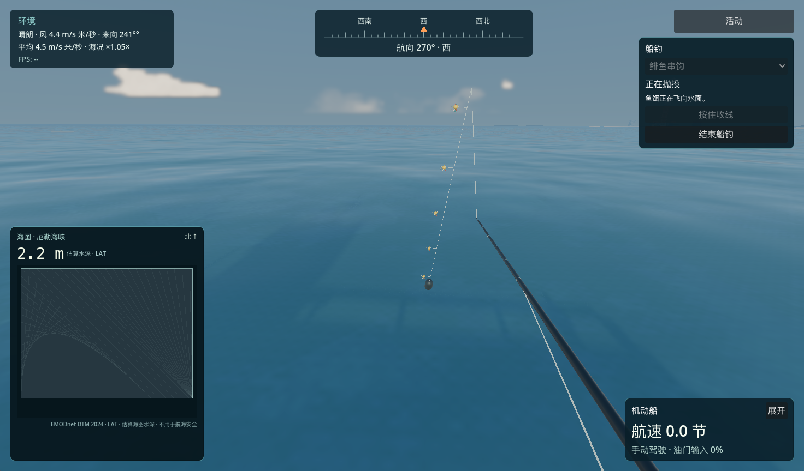
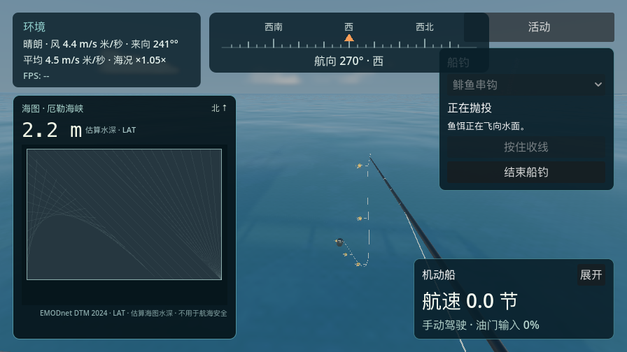
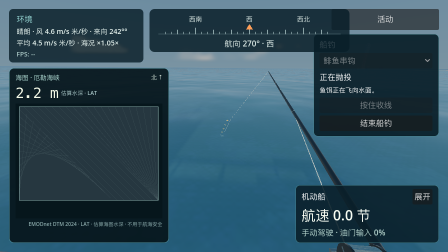
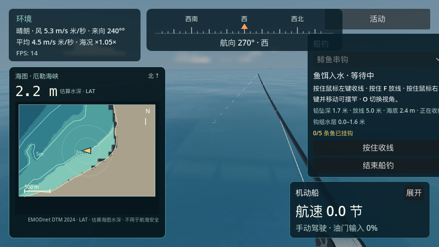
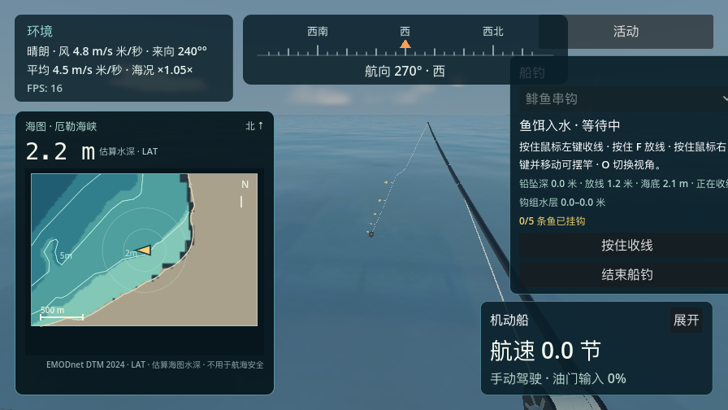
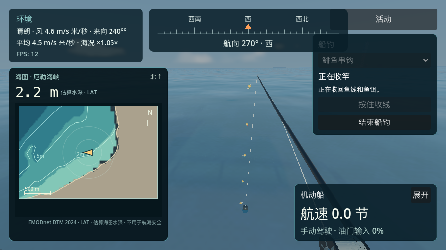
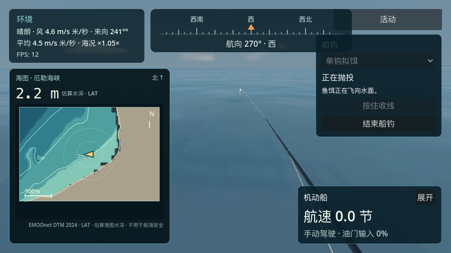
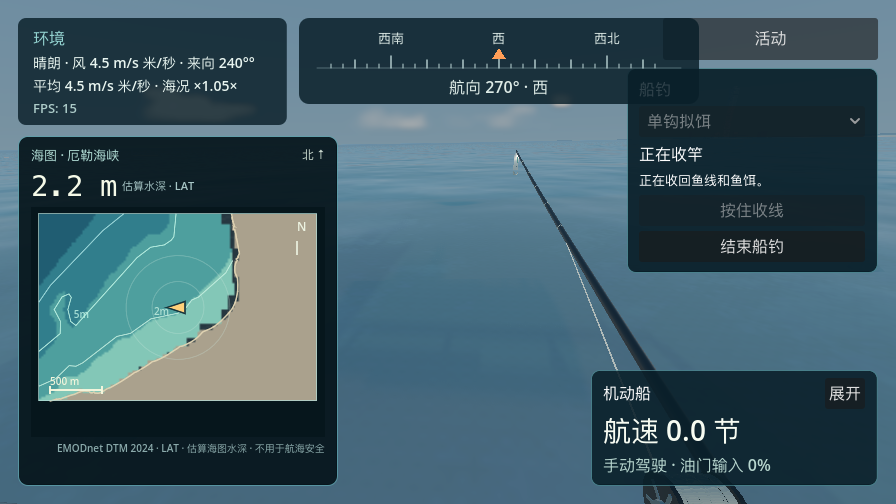

# P6.4.6.0.6 — Sabiki 空中姿态与可见鱼线修复

## 结果

Sabiki 空中主干现在随抛投方向伸展；收线时，主干在钩组离水后逐渐跟随外部主线，接近竿尖时再平滑回到原有收纳姿态。水下等待仍使用自然下垂，水下受载姿态沿用 P6.4.6.0.5。

GPU 运行复现了旧折返并验证了修复。修复前的 163.17° 是实际几何折返，不是方向向量定义相反造成的假象。主要原因是 Sabiki 线眼在短距离抛投时越过了竿尖；此外，CASTING/入水时的线眼偏移原先读取已放线长度，而该长度又按线眼位置更新，造成过渡期间一帧滞后。现在短距离时限制线眼沿钓组轴的几何伸出量，CASTING 的伸出量不再由 `_line_paid_out_length_m` 反算。RETRIEVING 接近收纳时仍按已放线长度渐退姿态权重，这是预期的状态过渡。

## 修改文件

- `scripts/boat_fishing_casting_system.gd`
  - 加入基于竿尖至坠子方向的空中姿态权重；只有与该方向相符的运动速度才作为轻量方向提示。
  - 抛投、入水、出水和收纳使用连续权重；部分钩位出水不会直接触发收纳姿态。
  - 短线眼位置根据当前竿尖—坠子跨度限幅，不再由放线长度反算。
  - 保留定长 2.06 m 的柔性主干视觉路径，五个钩位沿相同路径取样；它只生成末端视觉几何，不参与线长、张力或搏鱼计算。
- `tests/test_p6_4_6_0_3_runtime_line_geometry.gd`
  - 扩展为 P6.4.6.0.6 定向运行测试，增加线眼对放线长度的独立性检查，以及抛投、过水、全出水、收纳与 Single Jig 对照采样。
- `reports/p6_4_6_0_6/before/`、`reports/p6_4_6_0_6/after/`
  - 保存修复前后 GPU 画面和逐帧运行数据。

## 几何定义与修复

诊断统一按以下方向计算：

- `mainline_outward_dir`：竿尖指向 Sabiki 顶环。
- `rig_downward_dir`：顶环指向铅坠。

修复前 `reports/p6_4_6_0_6/before/runtime.ndjson` 的最大样本发生在抛投 0.294 s：竿尖约 `(13426.14, 1.611, 10457.04)`，顶环约 `(13426.17, 2.126, 10457.12)`，主线末端切线约 `(0.030, 0.988, 0.150)`，主干切线约 `(-0.089, -0.902, -0.423)`，夹角 163.17°。顶环实际位于竿尖上方约 0.52 m，外线先向上、主干再向下，故这是实际折返；向量方向定义没有反转。

修复后的姿态依据：

1. 以竿尖到坠子的径向方向为主要目标。慢速且反向的回弹不能覆盖有效径向方向；速度只在方向一致时轻微混合。
2. CASTING 有短释放渐入和飞行末段渐退；入水时按整副钓组相对水面的高度连续淡出。
3. WAITING 保持自然姿态。RETRIEVING 使用坠子高度与整副钓组的垂直跨度计算出水权重；钩位出水本身不会将钓组切换到收纳姿态。
4. 线长进入收纳范围后，姿态权重在最小收线长度与收纳起点之间平滑下降。
5. 线眼偏移上限为 `min(profile_length, rod_tip_to_sinker_distance)`。因此短距离时顶环不会越过竿尖；该几何不读放线长度，消除了同帧更新反馈。
6. 空中主干的可见曲线保持鱼种配置的主干弧长，钩位按弧长站点取样。Mesh、顶环、五个钩位、支线和铅坠使用同一帧姿态；现有鱼钩世界位置也由相同钩位更新。

外部主线仍只生成“竿尖 → 必要船舷避让点 → Sabiki 顶环”路径。Sabiki 钩位与铅坠不再进入外部主线几何。测试确认画面中仍只有一个外部主线 Mesh、一个末端主干 Mesh 和五条支线，没有重复绘制。

## GPU 运行数据

使用 Godot 4.7.2 Metal Forward+，加载 `scenes/main.tscn`，通过正常 HUD 开始船钓，并通过正常蓄力、松开抛竿、手动收线流程运行。主场景 GPU 捕获分辨率为 896×504；修复前保存图为 1472×864，因此图像适合检查姿态，不作为像素级差分。GPU 目标帧率设为 30，但实测采样约 8.3 FPS（抛投）、13.4 FPS（Sabiki 收线），不是 30 FPS 验证。

| 状态 | 放线长度 / 竿尖至线眼 | 出水情况 | 姿态权重 | 主线—主干方向差 |
|---|---:|---|---:|---:|
| 修复前抛投折返 | 0.522 m | 五钩在水面上 | — | 163.17° |
| 修复后稳定抛投 | 0.661 m | 五钩在水面上，坠高于水面 0.474 m | 0.94 | 3.69° |
| 修复后入水过渡样本 | 2.426 m / 2.426 m | 4 钩出水、1 钩在水下，坠在水下 0.232 m | 0.892 | 6.05° |
| 修复后部分出水 | 4.839 m / 4.832 m | 1 钩出水、4 钩在水下，坠在水下 1.685 m | 0.078 | 35.82° |
| 修复后全出水收线 | 1.206 m / 1.206 m | 五钩出水，坠高于水面 0.037 m | 0.92 | 4.39° |
| 修复后全出水阶段最大值 | 0.452 m / 0.452 m | 五钩出水 | 0.907 | 17.75° |
| 临近收纳过渡 | 0.268 m / 0.573 m | 五钩出水，坠高于水面 0.106 m | 0.420 | 72.90° |

入水、部分出水和收纳过渡不套用稳定空中 0–20° / 全出水 0–30°参考线。部分出水样本只让权重到 0.078；靠近收纳时方向逐渐退出空中约束。临近收纳样本仍有放线长度与端点距离差异（0.305 m），主线处于松弛视觉状态；这是现有手动收线/松线近似的限制，最后由原有收纳阶段完成，不在本轮增加第二个线长状态。

修复后抛投全阶段还会出现一个 177.27°诊断角度，但发生在外部线段仅 0.029 m 时，主线切线在该尺度不稳定；稳定空中验收限定外线长度大于 0.35 m，未把这个退化切线当成可见折返。修复后稳定空中样本中，线长最大误差 0.0066 m；主线终点到顶环的 Mesh 连接误差最大 0.0010 m。全出水收线样本中，方向差峰值 17.75°；等待 0.4 s 后主线长度误差峰值 0.0074 m。主干曲线通过铅坠端、线眼端及全部五个钩位站点的检查。

## GPU 截图

修复前，抛投初段可见顶环高过竿尖，串钩主干反向下折：

修复后刚离竿与稳定飞行，主线与主干朝同一方向延伸：

入水过渡：

部分出水与全出水回收：

收纳阶段及 Single Jig 对照：

修复前后截图由实际 GPU 主场景采集。两个运行的窗口分辨率不同，且水面、位置及瞬时状态不能逐像素对齐；画面与运行数据共同用于确认修复，不能据此声称已验证 30/60 FPS 的视觉效果。

## 定向测试

| 检查 | 结果 |
|---|---|
| `tests/test_p6_4_6_0_3_runtime_line_geometry.gd`，Metal GPU、30 FPS 上限，真实主场景状态机 | 通过，failures=0。Sabiki/Single Jig 抛投和收线、主线输入一致性、线眼连接、主干与钩位一致性均通过。GPU 实际约 8.3–14.8 FPS。 |
| 未落水 CASTING 中空中线眼伸出量与 `_line_paid_out_length_m` 独立性 | 通过；在相同姿态下改变测试 paid-line 值不会移动顶环。收纳渐退仍按玩家已收线长度工作。 |
| P6.3.1 Single Jig | 通过，failures=0。 |
| P6.3.2 Sabiki 多钩 | 通过，failures=0；多钩、Authority、鱼嘴钩尖与批次结算断言通过。 |
| `git diff --check` | 通过。 |

Godot 在测试退出时输出已有 Renderer/RID 释放告警；测试本身均以零失败结束，本轮未改动这些无关资源生命周期。

## 已知限制

- 姿态是轻量视觉约束，不包含绳索物理、水动力或钓组角动量。
- 部分出水阶段允许大于 30°的瞬时方向差；当时大部分钓组仍在水下，姿态权重低，GPU 截图显示为连续过渡。
- 临近收纳阶段，外部线会进入松弛视觉状态，实际端点距离可短时超过放线长度；这一行为由既有手动收线近似控制。
- Metal 实机自动场景帧率低于目标；没有完成真实 30 或 60 FPS GPU 验收。
- 本轮未修改水下自然悬挂、鱼群、Authority、收获、搏鱼 Solver、线强或拖钓。
