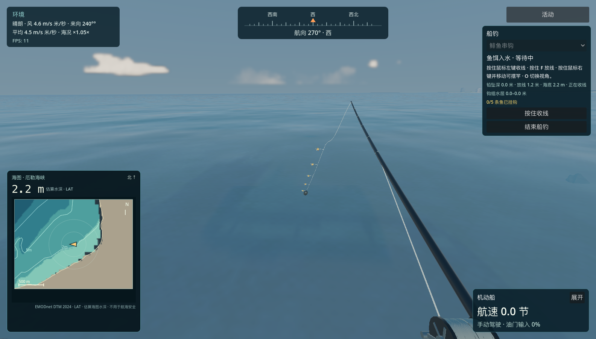
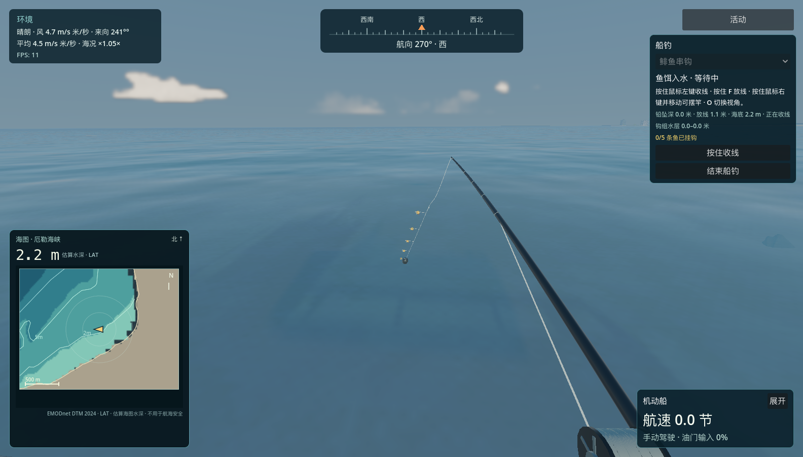

# P6.4.6.0.7 — 鱼竿弯曲方向与出水连接折角

日期：2026-11-05

## 结论

修复了共享鱼竿方向更新的数据来源不一致，并修正 Sabiki 手动收线时仅凭已放线长度提前进入收纳姿态的问题。Single Jig 和 Sabiki 继续使用同一鱼竿变形逻辑和共同主线入口。

GPU 对照中，Sabiki 完全出水并继续收线时，主线与顶环以下主干形成自然延续；抛投方向也未回退。收线进入最终收纳时，钓组会平滑恢复重力悬挂姿态，此时外部线段缩至约 0.3 m 以下，角度指标变得敏感，画面仍能看到一个小的末端转角。该最终收纳外观没有被伪报为完全消失。

## 1. 鱼竿方向问题及共享路径

Single Jig 与 Sabiki 均使用 `BoatFishingCastingSystem` 的同一个竿身 Shader 和 `_rod_bend_direction_local`。鱼竿骨架曲线由 `boat_fishing_rod_bend.gdshader` 根据弯曲角和局部弯曲方向生成；它没有针对钓组类型分支。

`calculate_bend_direction_local()` 将世界方向变换到鱼竿 Mesh 局部坐标，并投影到弯曲平面。根因不是一个可以安全地全局乘以 -1 的正负号错误：修复前的单钩 GPU 采样中，竿尖额外位移在拉力垂直分量上的投影为 **+0.198884 m**，方向映射点积为 **0.999999**，该帧方向本身正确。问题在两个调用点：

- 搏鱼表现用物理 Solver 的未弯曲竿尖 `_get_fight_solver_rod_tip_world()` 来计算 Shader 方向，但可见主线和显示竿尖使用已变形的 `_get_rod_tip_world()`。
- `WAITING` 的竿身受载姿态更新弯曲角，却没有同步更新局部弯曲方向，方向可能沿用默认值或上一状态。

现在搏鱼和 WAITING 都从当前可见竿尖指向实际钓组连接点计算方向，再用竿 Mesh 当前世界基变换到 Shader 局部方向。物理 Solver 仍使用未变形竿尖；这只影响视觉，不回写张力、线长或 Solver。

代码位置：[boat_fishing_casting_system.gd](scripts/boat_fishing_casting_system.gd#L3675)、[boat_fishing_rod_bend.gdshader](shaders/boat_fishing_rod_bend.gdshader)。搏鱼处在 `_advance_boat_fight()` 调用，等待状态在 `_apply_waiting_rod_pose()` 调用。

### 方向量测

| 实际 GPU 采样 | 鱼线方向到竿尖 | 竿尖相对直竿的位移 | 拉力平面方向投影 | 局部方向映射 |
|---|---|---|---:|---:|
| Single Jig 修复前 | `(0.502,-0.864,0.033)` | `(-0.032,-0.197,0.010) m` | `+0.199 m` | `0.999999` |
| Single Jig 修复后 | `(0.506,-0.862,0.033)` | `(-0.031,-0.177,0.014) m` | `+0.180 m` | `0.999567` |
| Sabiki 修复后，3 条鱼、拉线中 | `(24.615,-2.108,18.078)` | `(0.105,0.085,0.441) m` | 沿实际拉力方向约 `+0.340 m` | 同一共享映射 |

单钩修复前后的弯曲方向采样都朝向线拉力，所以不能声称改动把错误符号翻正。修复确保弯曲方向在等待、搏鱼以及弯曲后的可见竿尖之间持续一致，避免共享表现使用不同参考点。Sabiki GPU 采样的弯曲目标为 `30°`、显示负荷 `0.191`；竿尖位移在实际线拉力方向上为正。

## 2. 主线与 Sabiki 末端连接

两种钓组都由 `_update_line_and_bait_visuals()` 生成竿尖到线眼的共同主线，连接点来自 `_get_tackle_line_connection_world()`。Sabiki 的顶环、主干路径、五个钩位、支线和铅坠继续使用相同的钓组轴与几何结果；五个钩位不会加入外部主线路径。

修复前存在一个状态判定错误：Sabiki 在 `WAITING` 中手动收线时，已放线长度很短可能被当成“钓组已经到竿、应进入收纳”的证据，即使实际线眼尚未到达竿尖。短线长度和钓组收纳位置不是同一件事，这会过早降低空中延伸姿态，留下主线与仍伸展钓组之间的折角。

现在手动收线仍使用 `retrieval_emergence` 姿态；只有状态机进入真正的 `RETRIEVING` 最终回收阶段，才淡出到重力悬挂的收纳姿态。该淡出在整个最终回收动画内平滑完成。顶环连接位置、钩位与主干仍共享姿态，不单独旋转 Mesh。

代码位置：[Sabiki 姿态过渡](scripts/boat_fishing_casting_system.gd#L4901)、[末端连接点](scripts/boat_fishing_casting_system.gd#L5208)。

### 出水阶段量测

按“外部主线从竿尖指向顶环”的末端切线与“串钩主干从顶环指向铅坠”的起始切线计算方向差。测试不是强制所有状态夹角为零：

| 场景 | 修复后方向差 | 说明 |
|---|---:|---|
| Sabiki 抛投稳定、延伸权重有效 | 30 FPS 目标步长最大 `12.32°`；60 FPS 目标步长最大 `11.98°` | 最新运行分别有 5、6 个有效对齐样本；启动/入水阶段不代表稳定飞行 |
| Sabiki 全部钩位出水、持续收线 | 30 FPS 目标步长最大 `15.19°`；60 FPS 目标步长最大 `17.63°` | 最新运行分别有 24、25 个高延伸权重样本；重复运行测值有变化，因实际采样帧率未锁定 |
| 最终收纳过渡 | 最新 30/60 目标运行最高 `96.61°` / `95.46°` | 发生在最终姿态淡出，主线已缩至约 `0.3 m` 以下；短线切线数值不稳定，画面进入重力悬挂收纳姿态。截图仍可见小转角，属于已知限制 |

修复前 GPU 的 Sabiki 全出水回收截图能看到主线中段转向突变；修复后全出水回收帧中，主线从竿尖延伸至顶环，顶环以下主干沿线方向展开，没有原先明显的反向折返。Single Jig 的主线 Mesh 入口未改变；它的线眼很靠近末端模型，因此相同量级的末端方向变化不明显。

## 3. GPU 实际截图

截图来自 Godot 4.7.2、Apple M2 Pro、Metal Forward+、`scenes/main.tscn` 正常 HUD 和船钓状态机。基准与修复截图来自相同主场景测试设施，但属于不同运行采样帧，不是逐像素固定相机的摄影棚对照。

| 状态 | 修复前 | 修复后 |
|---|---|---|
| Sabiki 全出水继续收线 |  |  |
| Sabiki 接近回收 |  |  |

其他修复后实机截图：[抛竿离竿](reports/p6_4_6_0_7/after/sabiki_cast_launch.png)、[抛投中段](reports/p6_4_6_0_7/after/sabiki_cast_midair.png)、[入水过渡](reports/p6_4_6_0_7/after/sabiki_cast_water_entry.png)、[部分出水](reports/p6_4_6_0_7/after/sabiki_partial_emergence.png)、[最终收纳](reports/p6_4_6_0_7/after/sabiki_final_retrieval.png)、[Sabiki 受力搏鱼](reports/p6_4_6_0_7/after/sabiki_loaded_fight.png)、[Single Jig 受力搏鱼](reports/p6_4_6_0_7/after/single_jig_loaded_fight.png)。截图 HUD 读数显示 GPU 实际帧率约 10–19 FPS；这不是 30/60 FPS 验收结果。

## 4. 测试

- `tests/test_p6_4_6_0_3_runtime_line_geometry.gd`：真实主场景状态机，30/60 FPS 目标步长，Sabiki 与 Single Jig 抛投、收线、出水、回收；最终运行通过，`failures=0`。Headless 实际采样约 17–48 FPS，因此不能称为锁定帧率测试。退出时 Godot 报告一个 RendererDummy Shader RID 泄漏，未伴随断言失败。
- 同一测试的鱼竿确定性场景：Single Jig 映射点积 `0.980628`、竿尖拉力平面位移 `+0.252952 m`；Sabiki 点积 `0.997919`、位移 `+0.256955 m`；两种钓组均通过正向和映射断言。
- 同一测试的短线姿态场景：`paid line=0.08 m` 时仍为 `retrieval_emergence`，姿态权重 `0.92`，线眼距竿尖 `0.032 m`。通过，确认不会因手动收线的短线值提前切换收纳。
- `tests/test_p6_3_1_single_jig.gd`：Headless 通过，`failures=0`；GPU 主场景通过，包含竿可见、鱼力驱动弯曲、泄力、收线、提鱼及断线清理。
- `tests/test_p6_3_2_sabiki_multi_catch.gd`：Headless 通过，`failures=0`；GPU 主场景通过，包含三鱼/五钩、独立钩位、搏鱼几何和批次结算。额外 GPU 受力样本为 `30°` 弯曲目标，鱼竿显示负荷 `0.191`，线向投影约 `+0.340 m`。Sabiki GPU 截图约 19 FPS；测试结束时 Godot 报告少量渲染 RID/Shader 泄漏警告，断言均为零失败。
- `git diff --check`：通过。

## 5. 修改文件与边界

- [scripts/boat_fishing_casting_system.gd](scripts/boat_fishing_casting_system.gd)：共享可见竿尖拉力方向更新；WAITING 共用方向刷新；Sabiki 手动收线与最终收纳状态区分并平滑渐变。
- [tests/test_p6_4_6_0_3_runtime_line_geometry.gd](tests/test_p6_4_6_0_3_runtime_line_geometry.gd)：扩展本阶段方向、短线姿态、状态机和几何断言。文件沿用上一阶段名称，输出标记为 P6.4.6.0.7。
- `reports/p6_4_6_0_7/`：实际 GPU 截图及修复前/后对照。

未修改搏鱼 Solver、断线物理、Authority、鱼群、捕获结算、拖钓或唯一权威线长。旧的线眼连接数据流和 P6.4.6.0.6 抛投延伸姿态保留。

## 6. 未解决限制

最终收纳阶段会让串钩轴线从拉线延伸方向恢复到重力方向；当外部主线只剩极短一段时，夹角在数值上会升至接近直角，最终截图仍可辨认轻微转角。这里不把不稳定的短线切线当成稳定搏鱼/出水段折角，但它仍是可见的末端收纳过渡。其余采样帧未发现线眼断开或钩位与主干 Mesh 不一致。若仍需完全消除最终收纳帧的这个小转角，需要进一步定义玩家期望的“收纳时钓组轴向”，本轮没有将 Sabiki 强制改成朝向竿尖或维持整副钓组共线。
