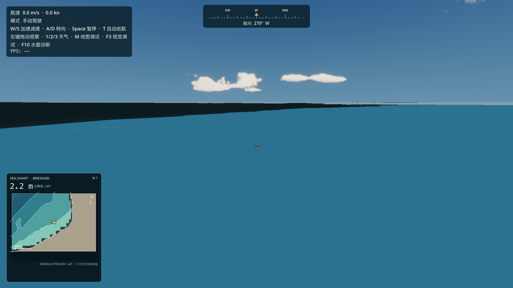
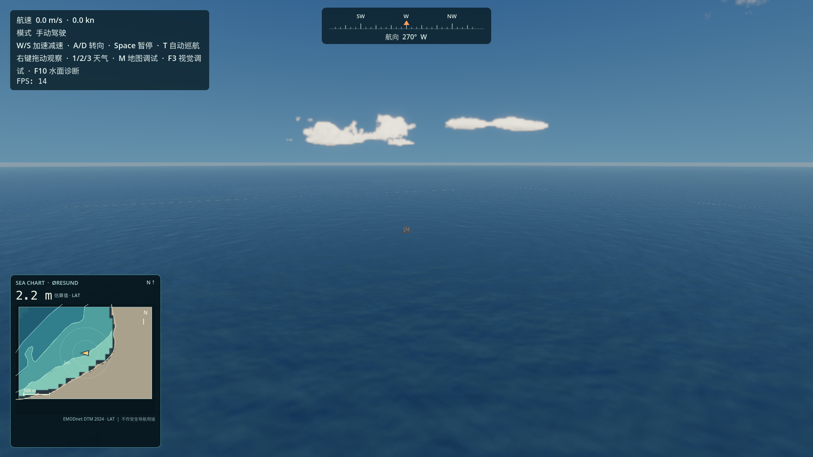
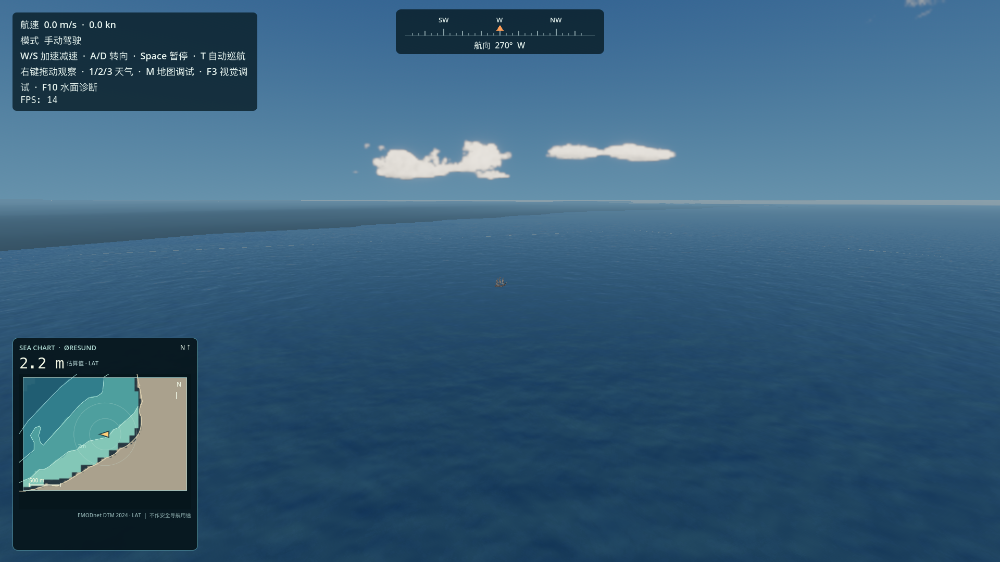
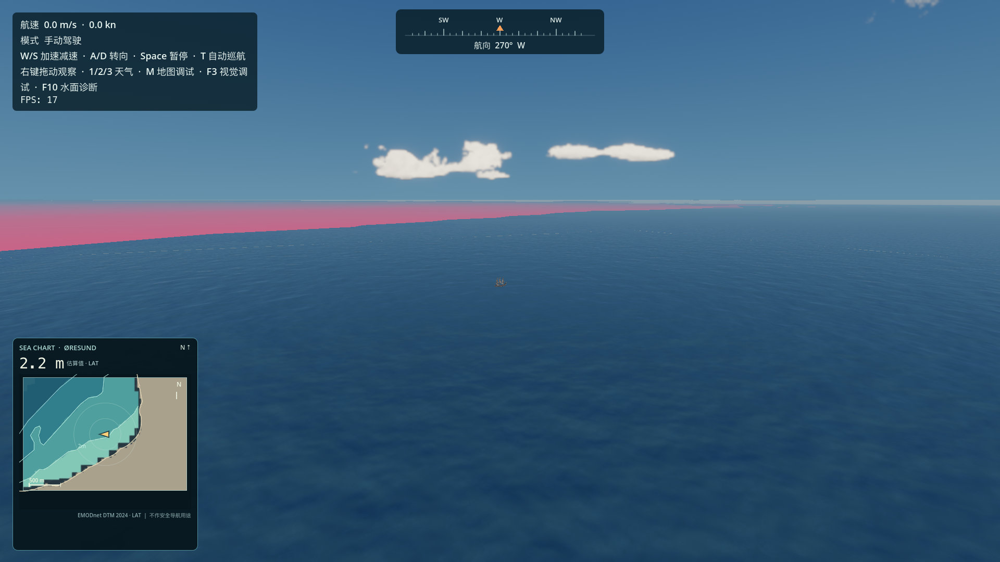

# 远景海面暗区诊断

## 结论

这次宽视角中的大块暗色斜区不是海面颜色、波浪、反射、雾、水深纹理或海洋 LOD 的接缝。它是 `OresundRegion/TerrainChunks` 中真实陆地网格的可见轮廓。当前固定镜头朝向 Malmö 南侧低海岸，地形遮住了屏幕上部的一部分海面；因此没有修改 Ocean Shader、海水颜色、雾或天气来掩盖它。

同一镜头下隐藏 `OresundRegion` 后，暗区消失；关闭地形投影阴影后暗区仍在；将地形临时染成洋红色后，同一斜区变成洋红色。由此可确认是地形表面本身，而不是阴影。

## 固定测试条件

- Godot 4.7.2 stable，Forward+ / Metal，Apple M2 Pro。
- High 画质，1920×1080。
- 清除动态航行与摄像机更新，冻结水面时间相位。
- 固定宽视角：船位偏移 `(72, 32, -136)` 米，FOV 68°。
- 同一场景、天气、太阳方向和镜头用于以下诊断图。

## 对照图

**A — 正常海面、雾和地形基准**

**B — 平坦水色、关闭雾**：暗区仍然存在，排除海水着色、反射和雾作为暗区成因。

**C — 同一镜头隐藏地图地形**：暗区消失，水面连续。

**D — 地形不投射阴影**：暗区仍然存在，排除地形投影阴影。

**E — 地形几何临时染色**：原暗区的轮廓完全变成洋红色，确认它由地形网格覆盖。

另有 [LOD 网格可视化](ocean_seam/diagnostic_lod_shells.png)。远平面与近处环形 LOD 连续覆盖；诊断没有发现斜向暗区对应海面 LOD 边界。

## 代码与几何证据

- 主场景海面参数为 4 级 LOD、60 km `far_edge`，摄像机跟随节点按 8 m 对齐：[main.tscn](../scenes/main.tscn:44)。海面由环形近场网格和两段远平面组成；没有第二套水面。
- 海面 Shader 以世界坐标计算 Gerstner 波、距离和水深采样：[sea_water.gdshader](../shaders/sea_water.gdshader:233)。材质的波形淡出为 1.4–1.8 km，透明距离淡出为 3.6–4 km：[sea_water_material.tres](../materials/sea_water_material.tres:44)。将透明淡出诊断性移到约 60 km 后，暗区仍在；这排除了当前镜头范围内淡出距离是其成因。
- `OresundRegion` 从 58 个本地地形块加载仅覆盖陆地的网格，并给每块创建 `MeshInstance3D`：[oresund_region.gd](../scripts/oresund_region.gd:80)。它把低于 0.5 m 的陆地顶点抬到 0.5 m，并使用地形顶点色材质：[oresund_region.gd](../scripts/oresund_region.gd:146)、[oresund_region.gd](../scripts/oresund_region.gd:172)。这些块源自 OSM 陆地掩膜和 Mapzen / Tilezen 高程数据，100 m 网格间距，详见 [TERRAIN_DATA.md](TERRAIN_DATA.md)。
- 对本镜头投影到地平线暗带的地形顶点做离线抽样，命中 `chunk_e+10_n-20`：相机深度约 263–4,224 m，局部东向约 10.1–14.8 km、北向约 −14.5 至 −10.7 km，高程约 0.5–13.8 m。这个低海岸处于船位南侧视野内，视觉上落在地平线附近。
- 关闭地形后仍能看到一条细的海天交界线；将水面透明淡出移到约 60 km 后它也仍在。它随天空与水面交界的位置出现，是当前镜头下的地平线，不是 LOD 缺口。水面淡出参数可能影响其它镜头的远景覆盖，但不是本次暗斜区的根因。
- `QualityManager` 会改变海洋的网格分辨率和 LOD 数，不修改 `OresundRegion` 的地形网格。因此这片陆地轮廓不会因海洋质量档位而消失；本次没有逐档捕获截图。

## 修改与性能

没有修改正式海洋、地形、天气或画质设置。新增的 `tools/capture_ocean_seam_diagnostics.gd` 仅用于离线诊断和截图；它不被主场景引用。截图阶段 HUD 的瞬时 FPS 在初始化期间波动，不能作为有效性能基线；由于正式运行代码与渲染资源未改，不增加 Draw Calls、三角形、Pass 或 GPU 成本。

## 验证边界与后续

- 已在 M2 Pro / Metal 下运行诊断场景并保存上述截图；隐藏地形、关闭阴影、材质染色、基础水色、雾开关、水面淡出及 LOD 可视化均用于同镜头归因。
- 未制作“修复后”截图，因为没有水面接缝可修，也没有对真实陆地进行隐藏或重着色。用户最初描述的暗区是该视角中的低海岸轮廓；移除它会丢失地图的真实陆地显示。
- 这轮不改太阳或雾。若后续希望远岸更柔和，需要单独评审地形的远景材质/大气融合；若希望宽镜头只看开阔海面，需要选择朝外海的镜头方向。
- Godot 退出时出现 Sunshine Clouds / RenderingDevice RID 泄漏警告；诊断截图本身无场景或 Shader 加载错误。该警告与本次海面诊断无关。
