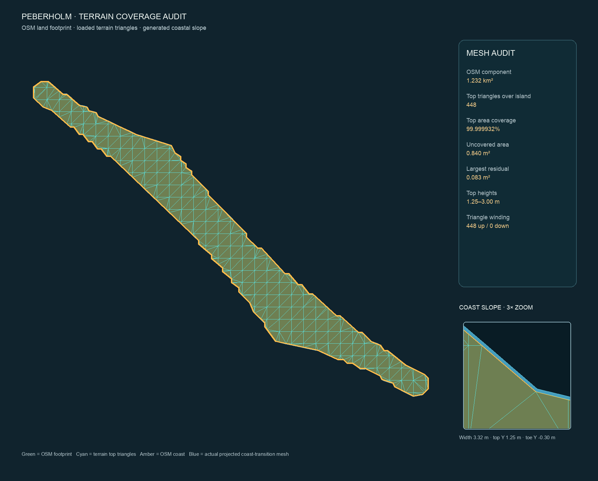

# Peberholm terrain coverage audit

> 2026-10-18 更正：Forward+ 独立网格着色已确认原岛顶绕序与 CULL_BACK 不匹配；先前露出的大片实际上是水下封底。此前“没有可确认的剔除错误”的判断已被实测推翻。已局部修正顶面材质剔除并撤掉 OSM 海面裁切，见 [岸线渲染修复报告](PEBERHOLM_SHORE_RENDER_FIX.md)。

## Result

The generated terrain contains a continuous top surface across the Peberholm OSM land polygon, and the full game scene loads that surface at the expected coordinates. This rules out a missing interior in the source mesh. It does **not** yet establish why the normal Forward+ view looks hollow; that needs a visual comparison using the runtime diagnostic materials below. The issue should not be dismissed as camera angle before that comparison.

## Mesh checks

- The selected rendered land component covers 98.36% of the configured Peberholm outline. The component area is 1.232 km².
- 448 generated top triangles overlap the component. Their union covers 99.99993186% of its area. The remaining 0.840 m² is quantization residue; the largest individual residual is 0.083 m².
- All 448 checked face windings point upward. Interior vertex normals have Y ≥ 0.9998, and the terrain vertex colors are opaque.
- The 227 top vertices inside the island have heights from +1.25 m to +3.00 m.
- The 202 coast transition vertices matched to the island boundary have top Y=+1.25 m, toe Y=-0.30 m, and a generated horizontal width of 3.320–3.321 m.
- The terrain origin matches `GeoReference`: latitude 55.7°, longitude 12.75°; axes are X=east, Y=up, Z=south.
- The runtime loader instantiated 58 terrain chunk meshes and loaded the coast transition as 95,472 static triangles. Generated terrain does not switch LODs; `mesh_lod_index` only controls the legacy fallback land mesh.

## Runtime checks

Godot 4.7.2 headless instantiated the full `main.tscn`, enabled the diagnostic split, and inspected its live nodes:

- The normal loader creates 58 runtime terrain `MeshInstance3D` chunk nodes. The fallback `Land` mesh remains hidden. The generated chunk meshes are new `ArrayMesh` objects built directly from the manifest’s `.bin` files, so they do not use an imported mesh resource cache.
- Before enabling diagnostics, all 58 chunk nodes and the single coast transition instance were visible. `OresundRegion` has an identity world transform; the top and coast diagnostics report matching local/world coordinate bounds. The legacy fallback `Land` instance is hidden, so it is not covering the generated top.
- The live Peberholm selection contains 448 top triangles from `chunk_e-10_n-20.bin`, `chunk_e+0_n-20.bin`, and `chunk_e-10_n-10.bin`. Its world AABB is X `-1507.533..1717.467`, Y `1.25..3.00`, Z `9851.353..12431.353`.
- The live coast selection contains 1,212 triangles from `coast_transition.bin`. Its world AABB is X `-1510.853..1720.788`, Y `-0.30..1.25`, Z `9848.032..12434.354`. The top and slope meet at Y=+1.25m; the slope extends about 3.32m out from the top footprint.
- Comparing the runtime meshes at Y=+1.25m, all 202 unique top-boundary X/Z vertices also occur in the coast mesh (coordinates quantized to 1 mm): `202 / 202` shared. This verifies the top-to-slope join in the loaded geometry, not only in the offline source data.
- The top and transition nodes use render layer 1. The active game camera cull mask is 1,048,575, which includes that layer. The source top and coast materials are opaque `StandardMaterial3D` materials using vertex colors with back-face culling; neither uses a transparent terrain shader.
- Runtime debug replaces the selected triangles inside their original chunk meshes, leaving the rest of each chunk intact. It does not draw a duplicate surface over the original. Debug materials are opaque, unshaded, and two-sided. The actual shortcut handler was exercised against the full scene: enabling it hid only the three affected original chunks, and disabling it restored all 58 original chunks, the coast source mesh, and zero visible diagnostic meshes.

The full-scene audit ran headless (`No rendering device on load`), so it inspected live runtime meshes but did not rasterize them through Forward+. A separate GUI capture attempt returned macOS `Connection invalid` and produced no game frame; the editor scene viewport is not a substitute for the running game. Therefore neither the normal nor green/red appearance has been visually verified. The in-game toggle remains available for that check. Headless shutdown logged one dummy-renderer shader RID leak warning; no GDScript parse or runtime errors appeared.

## What is and is not established

The runtime scene does contain the full-height island top at the expected position. No stale imported mesh, hidden fallback overlap, wrong render layer, transparent source material, or local/world origin offset was found. The normal terrain material does back-face cull, which can hide the underside when viewed from below, but the available headless checks cannot establish that this is what makes the island interior appear empty from the player's sea-level view. The visual cause remains unconfirmed until the normal and green/red render modes are compared in a Forward+ game window.

## In-game diagnostic

In a debug build, press **F3** to open the visual debug panel, then click **开启顶面 / 岸坡颜色诊断**. On a Mac keyboard configured to use media keys, hold **Fn** while pressing **F3**. Use **Shift+F5** first if you want to cycle to the Peberholm bridge end. Green marks the runtime top surface; red marks the runtime coast transition. The sea remains unchanged. A status panel reports source files, triangle counts, world bounds, heights, and render layers. Click the toggle again to restore the original meshes and materials.

## Coverage view

The main panel shows the entire OSM footprint and generated top triangles. The inset shows the actual projected coast-transition mesh at 3× zoom.

## Scope

No terrain geometry or height code was changed. The diagnostic only splits the already loaded runtime meshes while enabled; disabling it restores the original instances. No additional island top mesh is generated.
