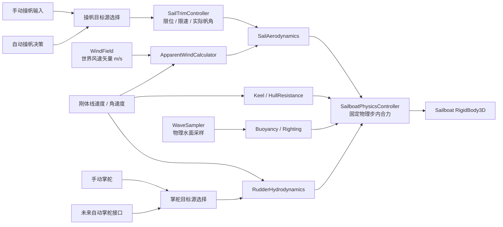

# S1-A：帆船模拟物理架构审计与设计

审计范围：当前 Sea Prototype 的船舶控制、波浪/浮力、风场、自动巡航、输入与单位约定。此文档只记录审计和建议；本阶段没有修改运行代码、物理参数或场景。

## 结论摘要

当前动力船不是物理刚体。`Boat.tscn` 的船体运动节点是 `Node3D`，`BoatController` 用一个有符号标量速度和船首方向直接推进位置；`BoatBuoyancy` 只给视觉节点添加上下浮动、横摇和纵摇。项目目前没有可供帆力直接施加的船体质量、惯量或刚体速度。

因此推荐给帆船建立独立的 `RigidBody3D` 船体与力学控制器。可以复用正式 `WindField`、`WaveSampler`、船舶相机和部分 UI/音频适配，但不能把动力船的 `speed_mps`、油门、转向角速度或自动巡航速度命令当作帆船物理。这样可以保留现有动力船行为。

核心约定：手动操帆与自动操帆只产生同一种“目标帆角”；`SailTrimController` 负责限速和机械限位；之后唯一的帆气动力模型读取实际帆角并向刚体施力。掌舵模式与操帆模式独立。

## 1. 现有架构审计

### A. 船体与运动

- [`scenes/Boat.tscn`](../scenes/Boat.tscn#L16) 的节点关系是 `Boat: Node3D → MotionRoot: Node3D → VisualRoot: Node3D`。`MotionRoot` 挂载 [`scripts/boat_controller.gd`](../scripts/boat_controller.gd#L1)，`VisualRoot` 挂载 [`scripts/boat_buoyancy.gd`](../scripts/boat_buoyancy.gd#L1)。该船场景没有 `RigidBody3D`、`CharacterBody3D` 或明确的船体碰撞形状。
- `BoatController` 没有刚体质量、惯性张量、线速度向量或角速度向量。船速是 `speed_mps: float`；推进只沿水平船首方向移动位置：`global_position += forward * speed_mps * delta`（`boat_controller.gd:144-169`）。
- 船首方向为本地 `-Z`，且模型被放在单独的 `BoatModelFrame` 中校正（`boat_controller.gd:6-9`、`Boat.tscn:30-33`）。船的航行参考坐标不随模型的资源朝向变化。
- 油门和制动直接把标量 `speed_mps` 向目标速度做 `move_toward`；松油门采用固定 `coast_deceleration_mps2`。转向则直接增加 `rotation.y`，其速率由设定的转向速率和 `abs(speed_mps)` 缩放（`boat_controller.gd:172-193`）。没有推进力、阻力或舵力积分。
- 动力船移动和控制在 `_process(delta)` 更新，不在 `_physics_process()` 或 `_integrate_forces()` 中（`boat_controller.gd:144`）。没有通过 `linear_velocity`、`angular_velocity`、`apply_force()`、`apply_torque()` 驱动该船。
- `main.tscn:259-262` 直接实例化当前 `Boat.tscn`；场景注释将起始朝向描述为向东，节点绕世界 Y 轴设为 90°。这只是起始世界朝向；船的局部船首仍是 `-Z`。
- [`resources/vessels/starter_cargo_boat_draft.tres`](../resources/vessels/starter_cargo_boat_draft.tres) 有吃水、货物能力、航速估值和外形尺寸，没有船体质量或惯性。`draft_for_cargo_weight()` 只计算吃水估计。当前没有可用于帆船的排水量/压舱物数据。
- [`resources/vessels/test_sailboat_draft.tres`](../resources/vessels/test_sailboat_draft.tres) 只是名为“测试帆船”的吃水配置；没有长度、宽度、桅杆、帆面积、龙骨或质量数据，也没有被 `main.tscn` 的船场景引用。`resources/wake_profiles/SailboatWake.tres` 是尾流表现资源，不构成帆船物理实现。

**审计判断：**现有船体不适合直接施加帆力。若把帆力接到当前 `BoatController`，就必须把力重新翻译成速度和位置改动，最终仍会绕过力学；这会与唯一物理底层原则冲突。

### B. 浮力与海浪

- [`scripts/boat_buoyancy.gd`](../scripts/boat_buoyancy.gd#L55) 每个渲染帧用四个船体附近采样点查询 `WaveSampler`：前左、前右、后左、后右。当前 `Boat.tscn:24-28` 将前后采样距离设为 2.7 m、半船宽设为 1.1 m。
- 每个点调用 `WaveSampler.sample_surface(world_point, wave_time_seconds)`，读取水面高度。脚本从四个高度计算目标升沉、俯仰和横摇，再由阻尼弹簧平滑追踪（`boat_buoyancy.gd:59-103`）。滚转角限制为 ±6°，俯仰角限制为 ±8°，默认响应频率 0.85 Hz、阻尼比 0.92。
- `BoatBuoyancy` 只改 `VisualRoot.position.y` 和 `VisualRoot.rotation`；父级 `MotionRoot` 的导航位置及朝向仍由 `BoatController` 控制。它没有按浸水体积计算浮力，没有重力平衡，也没有把浮力力矩反馈给船体。当前实现不计算船体浸水比例、吃水下沉后的排水体积或压舱物扶正效果。
- 它会为音频暴露升沉速度、俯仰角速度、横摇角速度；这是读取视觉弹簧状态，不是刚体运动状态（`boat_buoyancy.gd:115-123`）。
- [`scripts/wave_sampler.gd`](../scripts/wave_sampler.gd#L356) 是 CPU 端 Gerstner 波浪采样器，返回水面 `height`、近似 `normal` 和 `displacement`，并与海面 Shader 共用配置/时间。当前 `resources/sea_waves.tres` 配置 5 组波浪；采样器设计上最多处理 8 组。
- `sample_surface()` 对水平位移做 4 次反演迭代，再进行一次最终波场计算（`wave_sampler.gd:359-404`）。每次波场计算会遍历波组计算位移/法线，并计算波谷包络。以当前四个浮力点、5 组波浪估算，视觉浮动每帧约执行 20 次波场计算、约 200 次波组循环项；这只是由代码循环结构推算的工作量，不是性能实测。
- 采样器的波浪淡出 `_vertex_wave_fade()` 使用活动相机距离（`wave_sampler.gd:473-487`），这是为匹配当前海面视觉 Shader。新船的浮力若直接使用这条相机相关结果，物理结果可能因观察相机/距离而变化。未来宜提供相机无关的物理采样入口，共用同一组波浪、强度和时间，但让物理采样明确选择是否应用视觉距离淡出。
- `WaveSampler` 没有返回水体轨道速度或海流速度。第一版船体阻力只能把局部水体假定为静水，或以后再明确增加只读水流接口。不可把海浪表面高度误当作水流速度。
- `WaveSampler.wave_time_seconds` 当前由 `_process(delta)` 推进，再写入 Shader 的 `WaveTime`（`wave_sampler.gd:88-98`）。帆船的受力应在固定物理步采样；因此 S1-B 需要明确物理采样读取的波浪时间锚点，避免物理步在渲染帧之间重复/跳读波相位。最稳妥的接口是显式传入同一权威波浪时间，视觉 Shader 按该时间插值呈现。

**横倾评估：**现有浮力系统不能承受帆船横倾力矩。它只根据波面高差设置一个受限的视觉角度，且每帧覆盖视觉旋转；若把帆力作用在该节点上，不会产生刚体横倾，也不能由浮力自然扶正。必须让船体倾斜本身进入物理状态，并由横向分布的浮力、低重心压舱和角阻尼共同响应。

### C. WindField 与天气关系

- [`scripts/wind_field.gd`](../scripts/wind_field.gd#L1) 明确项目坐标为 X=东、Y=上、Z=南，单位为米；风向字段使用“气象来向”，真北顺时针角度。
- 正式查询 `get_wind_at(world_position)` 返回世界空间空气速度向量，单位 m/s，**向量指向空气实际流动的去向（wind-to）**；不是气象来向角（`wind_field.gd:53-64`）。向量是水平的，Y 分量为 0。`get_wind_at_height()` 目前仍是高度均匀的保留接口。
- 内部方向转换在 `wind_field.gd:347-358`：例如 `wind_from=0°`（北风）产生向南的速度向量 `+Z`；`wind_from=90°`（东风）产生向西的向量 `-X`。拿到 `get_wind_at()` 后，不要再为了获得“空气流向”反转它；若需要“风从哪边来”，才取速度向量的反方向。
- 阵风按位置与独立阵风时钟，通过 FastNoiseLite 连续计算；同一物理帧内查询使用缓存的阵风时间（`wind_field.gd:45-56`、`300-327`）。适合每个物理步只在帆的气动中心查询一次，之后复用这一帧采样。
- [`scripts/weather_state_controller.gd`](../scripts/weather_state_controller.gd#L4) 拥有正式天气身份和风况目标，初始化、转场及天气更新时调用 `WindField.apply_formal_weather_settings()`（第 81-84、115-123 行）。WindField 不直接读取 WeatherController。
- F12 调试面板调用 WindField 的临时覆盖接口；正式 WeatherStateController 可以在覆盖期间继续更新正式目标。解除覆盖后 WindField 平滑回到最新正式风况（`wind_field.gd:147-183`）。因此单机帆船从 `get_wind_at()` 得到的是当前“有效”风，包括本地 F12 覆盖；这应只用于本地体验/测试，不应成为多人服务器上的玩家可写权威状态。

### D. 控制、自动巡航与船型

- 项目输入映射在 `project.godot:33-63`：W/S 前进/制动、A/D 转向、Space 暂停船体运动、T 切换自动巡航。`BoatController.manual_input_enabled` 控制手动输入；ESC 菜单关闭手动输入但不暂停世界（`game_menu.gd:76-97,128-130`）。
- [`scripts/autopilot_controller.gd`](../scripts/autopilot_controller.gd#L133) 以 `BoatController` 为静态类型，并要求路线管理、水深提供器。它沿预定义路线求前视目标，计算期望航向，再向 `BoatController.submit_autopilot_command(steering, target_speed_mps)` 发布“转舵量 + 目标速度”（`autopilot_controller.gd:317-345,420-424`）。控制更新默认间隔 0.1 s（`autopilot_controller.gd:21,111-117`），水深检查约 0.5 s（`autopilot_controller.gd:124-126`）。
- 自动巡航接入还要求速度非负、目标巡航速度有效、航线可用和初始航向误差不超过默认 70°（`autopilot_controller.gd:133-175`）。船到终点按路线距离和 `speed_mps <= 1.5` 判定到达（第 290 行）。其路径模型假定船可以受控地朝目标方向前进，并可向动力船控制器直接设定速度。
- 当前没有在船型切换层发现通用船舶工厂/注册接口；`main.tscn` 直接放置唯一的 `Boat.tscn`。`BoatAudioController.bind_vessel()` 是声音绑定，不是船舶物理切换机制。

**复用边界：**可复用 W/S/A/D 的玩家意图、相机、路线几何、水深安全判断、风场和海浪数据。不要复用动力船的油门→目标速度、船首立即转向、`submit_autopilot_command(speed)` 或基于正向巡航速度的进港/靠泊假设。自动操帆与自动掌舵必须在帆船中是两个独立输入源。

### E. 单位和坐标

- [`scripts/geo_reference.gd`](../scripts/geo_reference.gd#L1) 规定项目局部坐标与地理切平面关系：世界 X=东、Y=上、Z=南（北为 `-Z`），1 个 Godot 世界单位=1 m。
- 船舶局部轴：船首 `-Z`、船尾 `+Z`、右舷 `+X`、左舷 `-X`、上方 `+Y`。因此船体纵向滚转轴是本地 Z 轴；本地 X 轴是横向，Y 轴为偏航轴。
- 建议统一：距离 m、时间 s、质量 kg、速度 m/s、角速度 rad/s、力 N、力矩 N·m、角度内部 rad，UI 度。
- `project.godot` 未显式配置 `physics_ticks_per_second`；当前动力船控制也不使用固定物理步。本轮未改项目物理设置。帆船应在固定物理步内读取输入命令、风和水面并应用力，不能把渲染帧 delta 用作权威积分步长。

## 2. 主要风险

| 风险 | 级别 | 代码依据 / 影响 | 设计处理 |
|---|---|---|---|
| 当前船体不是刚体 | 阻断 | `BoatController extends Node3D`，直接积分位置/朝向，无质量、惯性和刚体速度 | 新建独立帆船 `RigidBody3D`，动力船保持原样 |
| 浮力只改视觉节点 | 阻断 | `BoatBuoyancy` 的受限弹簧角度不反馈父体 | 为帆船建力式浮力点与横向浮力分布；不复用为物理浮力 |
| 当前阻力/制动是人工速度插值 | 高 | 油门/松油门控制速度变化，不读取环境水流 | 帆船用水动力阻力和固定物理步，不写目标船速 |
| 当前转向是直接旋转船体 | 高 | `rotation.y += steering * turn_rate * speed_factor * delta` | 帆船掌舵只改变舵角；舵力在水流和船速下产生偏航力矩 |
| WaveSampler 有视觉距离淡出 | 高 | `sample_surface()` 的高度/法线取决于活动相机距离 | 物理查询使用与 Shader 同源、但相机无关的明确入口 |
| 浮力资源没有质量/压舱/几何 | 高 | DraftProfile 只包含吃水、载荷、外形估值；测试帆船资源缺少外形尺寸 | S1-B 前需要一条目标帆船的排水量、重心、压舱和水线数据；缺失项先作为可调测试值标记 |
| 自动巡航假设任意期望航向都可达 | 高 | Route autopilot 输出 heading steering 与正向 target speed，排斥负速度 | 未来帆船航线规划需另处理迎风禁航区、换舷/tack、航线可达性和 ETA；S1-A 不接管它 |
| 浪采样用于多船会倍增 | 中 | 当前一船四点、每渲染帧反演；多船物理会重复执行 | 每船每物理步缓存一次采样；可对同一位置、时间去重，不要重复采样海浪公式 |
| Godot 刚体跨平台位级确定性 | 中 | 内建 3D 刚体解算不应默认视为跨 CPU/GPU 位级一致 | 多人版以服务器为权威；同步状态/输入，不要求所有客户端独立重算后逐位一致 |

## 3. 推荐架构和数据流

避免把每个计算器都做成 Node。首版由一个刚体协调器和少量数据资源/纯计算对象组成即可。



### 模块职责建议

1. **`SailboatController` / `SailboatPhysicsController`**：挂在新帆船刚体上；每个物理步读取一份控制命令、一次局部风场和所需水面采样，协调所有力并调用刚体力接口。持有物理状态快照；不读 HUD、不读天气符号、不从输入直接改速度。
2. **`SailboatParameters` Resource**：船体质量/惯性/浮力点、帆面积/压力中心、龙骨和舵参数、阻力参数。按船型配置，避免将一条船的声学或物理常数写在全局管理器里。
3. **`ApparentWindCalculator`**：纯函数，输入世界风速矢量、船体世界速度，输出相对空气速度、视风速及来向角。
4. **`SailAerodynamics`、`KeelHydrodynamics`、`RudderHydrodynamics`、`HullResistance`**：纯计算或 `RefCounted` 模块，返回世界力/作用点，不直接改变刚体状态。
5. **`SailTrimController`**：保存每面帆的实际角和目标角，应用机械限位、最大角速度、平滑切换。手动和自动只换目标源，不重置实际角。
6. **`AutoSailTrim`**：只消费帆船物理快照/视风并产出目标帆角。不能调用 `apply_force`、不能写船速、船位或舵角。
7. **掌舵源**：手动和未来自动掌舵共享一份目标舵角接口。它与 `SailTrimController` 分开，允许四种组合互不耦合。
8. **只读适配器**：HUD、尾流、发动机/环境音效读取统一快照。动力船仍可保留原 `BoatController`，不强制继承帆船刚体。

推荐控制契约：

```text
ManualTrimInput 或 AutoSailTrim
    -> target_sail_angle_rad（每面帆）
    -> SailTrimController 限幅/限速
    -> actual_sail_angle_rad
    -> SailAerodynamics
    -> SailboatPhysicsController 应用真实力
```

切换手动/自动时保留 `actual_sail_angle_rad`，只更换目标来源。未来主帆/前帆各有自己的 target/actual 角，但共享视风和计算底层。

| 操帆模式 | 掌舵模式 | 关系 |
|---|---|---|
| 手动 | 手动 | 玩家提供帆角和舵角 |
| 自动 | 手动 | AutoSailTrim 只输出帆角；玩家掌舵 |
| 手动 | 自动 | 玩家操帆；自动掌舵只提供舵角/目标航向 |
| 自动 | 自动 | 两个自动决策并行；物理只读取两个目标，经同一模型积分 |

## 4. 简化实时物理模型

以下是供 S1-B/C 调试的基础模型，不是已校准船型数据。常量和系数应由 Resource 配置；所有力均最终进入刚体求解器。

### 4.1 真风与视风

定义：

- `V_air_world`：`WindField.get_wind_at(sail_cp_world)` 返回的世界空气流动速度（m/s，指向 wind-to）。
- `V_boat_world`：`RigidBody3D.linear_velocity`（m/s）。
- `V_current_world`：局部水体速度（m/s）；当前 WaveSampler 没有此输出，首版可明确设为零。
- `V_app_world = V_air_world - V_boat_world`：空气相对船体的速度，指向空气相对船体的运动方向。
- 气象“视风来向”是 `-V_app_world` 的水平投影方向。若 `V_app` 接近零，角度无定义：保留上一有效角度，或返回 `valid=false`；不要归一化零向量。
- 转到船体坐标：`V_app_local = body_basis.inverse() * V_app_world`。本地 `-Z` 是前方，`+X` 是右舷。

船速变化自然改变视风；WindField 阵风已包含在 `V_air_world` 中，不再另外随机一次风速。

### 4.2 帆的攻角、升阻力和帆力

令 `c` 为帆弦方向（船体局部 XZ 平面单位向量，由帆相对船体的实际角决定），`w_from = -V_app_local.xz` 为视风来向。攻角可用带符号圆周角定义：

```text
alpha = wrap_angle(atan2(cross2d(c, w_from), dot(c, w_from)))
q_air = 0.5 * rho_air * |V_app|^2
F_lift = q_air * sail_area_m2 * CL(alpha) * lift_direction
F_drag = q_air * sail_area_m2 * CD(alpha) * flow_direction
F_sail = F_lift + F_drag
```

- `rho_air` 初始参考约 1.225 kg/m³；后续可以保留为场景/环境参数。`q_air` 是 Pa=N/m²，乘面积后得到 N。
- `CL(alpha)` 用平滑查表或有界曲线；小攻角近似线性，达到失速区后饱和并逐步损失升力。`CD(alpha)` 至少包含基础阻力并随升力/大攻角提高。第一版不应让系数无限线性增长。
- `lift_direction` 取相对气流方向的垂直方向，符号由 `alpha` 和帆的受风侧确定。需要用左右舷测试固定符号，避免换舷时力方向反转错误。
- 低视风速时以 `q_air → 0` 自然消力；设置一个数值阈值仅用来避免除零/不稳定角度，不用人为给零风“最低帆力”。
- 一面帆的合力应用在其世界压力中心 `r_cp` 上：`tau_world = r_cp × F_sail`，或在刚体偏置上施力。帆中心高于重心，横向气动力因此产生绕本地纵轴的横倾力矩；主帆和前帆的纵向作用点差可产生偏航力矩。
- 主帆/前帆各自计算，压力中心位置和有效面积不同。首个可运行原型可只做主帆，后续再增加前帆。

### 4.3 自动形成迎风禁航区

不能按航向直接注入“航速”。在迎风方向，帆受限于可收帆角及风向边界；帆弦无法形成有利攻角时进入 luffing（失风）区域，升力衰减；舵、龙骨水动力会随船速变小。船就不能有效向上风推进，禁航区来自帆几何、系数曲线和船体侧滑阻力，而不是一个固定速度阈值。

首次调试可加入明确的 luffing 区域曲线，但其宽度应是待调船型参数，不能把所有船固定成未经验证的角度。自动操帆不得把帆推入机械范围之外，也不能通过瞬间旋转帆来消除禁航区。

### 4.4 龙骨、舵和船体阻力

船相对水速度：`V_hull_water = V_boat_world - V_current_world`。转入船体坐标，分解为纵向 `u`、横向 `v`、垂向 `w`。

- **龙骨：**其作用是限制侧滑，并对横向水流产生侧力和阻力。可用 `q_water = 0.5*rho_water*|V_local|²`，`rho_water` 初值约 1025 kg/m³，`F_keel ≈ q_water*A_keel*CY(beta)`；`beta = atan2(v, max(|u|, epsilon))`。`CY` 有界并在失速/大侧滑时饱和，力方向与横向侧滑相反。龙骨/压舱物的重力位置另行决定静态扶正，不能把龙骨侧向阻力当作压舱。
- **船舵：**舵点船体相对水速度为 `V_body_at_rudder = V_com + omega × r_rudder - V_current`；舵叶所见的入流水速度方向为其反向 `V_inflow = -V_body_at_rudder`。把 `V_inflow` 转到船体坐标，再与实际舵角组合计算有界侧力；舵位于船尾，`tau_yaw = r_rudder × F_rudder` 自然产生偏航力矩。水速趋近零时动压趋近零，舵效自然降低；不要用直接旋转船体的转向速率补足。
- **船体阻力：**沿船体纵向/横向分别设置阻力：`F_drag = -c1*V_local - 0.5*rho_water*Cd*A*|V_local|*V_local`，纵横向参数可不同。线性小速度项帮助低速稳定，二次项表达较高速阻力。静水、零船速时阻力为零；阻力本身不驱船。
- **角阻尼：**对横摇/俯仰/偏航角速度施加有限水动力阻尼，单位 N·m·s/rad。不要用过强统一阻尼掩盖龙骨或舵模型错误。

### 4.5 浮力和扶正

将浮力点放在船体水线/舱底相关位置，按局部浸水深度估算分点排水量。简化力：

```text
submergence_i = smooth/clamp(water_height_i - point_height_i + draft_offset_i)
F_buoyancy_i = rho_water * g * displaced_volume_i * UP
F_damping_i = -c_i * point_vertical_velocity_i * UP
F_i = F_buoyancy_i + F_damping_i
tau_i = r_i × F_i
```

- 分点位置横向铺开后，一侧下沉会增加该侧浮力，合力矩提供水线几何扶正；将压舱物低置会降低重心，改善稳性。
- `sum(displaced_volume_i)` 的饱和上限要与船体排水量匹配；静态水面应满足总浮力约等于 `mass*gravity`。仅靠四个视觉高度差不能得到这个平衡。
- 若开发期只能用浮力弹簧，需要有明确的水线误差、弹簧刚度和阻尼参数，并通过自由浮动/倾斜释放测试校准。最好由横向分布的浮力提供主要扶正，而非同时叠加未校准的“魔法扶正扭矩”。
- 若之后采用船型 GZ 曲线（扶正臂），它和分布式浮力不能重复计入同一扶正力矩。模型需选定一个权威来源。

### 4.6 无风、低速与数值稳定

- 无风、静水、静止时：`V_app=0`、帆力为零；阻力为零；浮力平衡重力。不得有最小推进力或最低船速。
- 除 `atan2`/向量归一化处对速度设小 epsilon 外，低速不做除以速度。力系数以有界曲线处理；船舵和龙骨因动压 `~V²` 在静止时自然失效。
- 舵停船无明显转向是正确物理结果。可通过帆力/水流先产生运动，之后舵才建立效能。
- 所有控制输入在物理步开始采样，所有风、波、力在同一 fixed physics tick 内保持一致。渲染动画/音效使用只读快照插值，不反向驱动刚体。
- 多人模式以权威服务器积分为主。即便输入、风场种子和物理步固定，也不承诺跨平台刚体解算逐位一致。

## 5. 参数来源与清单

当前代码中没有帆船的完整物理数据。下表区分需要船型数据的项目与可先用于调试的假设。

| 参数 | 单位 | 来源/状态 | 用途 |
|---|---:|---|---|
| 空船/满载排水质量、压舱质量 | kg | **需目标船数据**；当前 DraftProfile 未提供 | 刚体质量、静态浮力和稳性 |
| 重心位置/惯性张量 | m / kg·m² | **需测量/估算后校准** | 横摇/纵摇/偏航惯性、压舱低重心 |
| 水线长、船宽、吃水、船体水下体积曲线 | m / m³ | 吃水目前只有游戏估计；船型几何数据缺失 | 浮力点、阻力参考面积 |
| 主帆/前帆面积 | m² | **需目标帆型数据** | 空气动力面积 |
| 帆压力中心/桅杆高度/纵向位置 | m | **需目标帆型数据或先用测试点** | 倾覆/偏航力矩 |
| 帆角机械范围、操帆速度 | rad、rad/s | 没有现有配置；首轮可作为调试参数 | 手动和自动共同使用 |
| 帆 `CL/CD` 曲线、luffing/失速角 | 无量纲、rad | 先用简化有界曲线，再靠测试船校准 | 升力、阻力及迎风禁航 |
| 龙骨面积、展长、中心、压舱质量 | m²、m、kg | **需目标船数据** | 侧滑阻力与静态稳性 |
| 舵面积、舵角范围、舵臂 | m²、rad、m | **需目标船数据或先用测试值** | 舵力、偏航力矩 |
| 水阻系数/参考面积 | 无量纲、m² | 先用可调测试值 | 纵向/横向阻力 |
| 浮力点坐标/体积/阻尼 | m、m³、系数 | 先按船体外形建立，静水与倾斜测试校准 | 浮力、波浪响应及扶正 |
| 空气/海水密度与重力 | kg/m³、m/s² | 可用物理常数作初值，明确为模型假设 | 动压和浮力 |
| 风场位置、波浪水面 | m、秒 | 可复用 WindField/WaveSampler | 局部气流和波面 |

首个物理原型开始前建议选定一条实际测试帆船，补齐其质量/压舱、船宽/吃水、帆面积和作用点。没有这些数据时仍能做“可运行测试艇”，但必须标记为游戏调参值，不能声称对应真实船型性能。

## 6. 分阶段开发计划

### S1-B：独立帆船刚体与浮力基线

- 新建 `scenes/SailboatLab.tscn` 和 `RigidBody3D` 帆船原型，保持 `scenes/Boat.tscn` 与当前动力船控制代码不变。
- 新建船型参数 Resource，明确试验艇的质量、COM/惯性、浮力采样点、阻尼、舵/帆占位几何。没有来源的值标记 `prototype/tuning`。
- 以 fixed physics tick 读取同一个 `WaveSampler` 的波浪设置与时间；使用相机无关的物理水面采样语义。先只做浮力/重力/阻力，不加帆力。
- 每个采样点每个物理 tick 最多采样一次；把结果共享给浮力、调试显示和水面状态快照。
- **验收：**静水时质量稳定浮在目标吃水；无输入不会自行移动；倾斜释放后能扶正；正常浪和 F3 海况下不爆振、不穿底；动力船 main 场景行为未改。

### S1-C：视风、手动操帆和真实受力

- 接入 WindField 有效风速向量；每个物理 tick、帆气动中心采样一次。实现 `V_app=V_air-V_boat` 并展示 world/local 向量诊断。
- 先实现单主帆，添加操帆角目标和实际帆角、机械范围、最大角速度。手动输入只改变目标帆角。
- 实现有界 `CL/CD` 简化曲线、压力中心施力、龙骨侧力、舵水动力、纵横向船体阻力和角阻尼。
- 舵输入变成舵角目标，不直接旋转船体；只让水动力产生偏航。
- 以同一个物理核心测试无风、顺风、横风、近迎风、左右换舷和不同速度。
- **验收：**无风静止不会自行加速；顺/横风能由帆力起航；近迎风帆力明显下降且不能直接朝风源穿越；侧滑受到龙骨约束；舵效随水速变化；力矩确实产生船体横倾/偏航，且没有直接写位置/速度。

### S1-D：自动操帆源与手动/自动模式独立

- 新增 AutoSailTrim 的只读输入/目标输出接口；它读取视风、实际帆角和行驶状态，仅输出目标帆角。
- 手动/自动切换不重置帆角，两个模式共用限位、限速与同一个气动力函数。
- 单独保留掌舵模式接口，至少支持手动舵角与未来自动舵角/航向命令源。无需把现有动力船 AutopilotController 直接绑定到帆船。
- 为主帆/前帆预留每帆独立 target/actual，但首个交付可以只支持主帆；四种操帆/掌舵组合要能在控制层表示。
- **验收：**同一刚体状态和相同实际帆角在手动/自动来源下产生完全相同的气动力；自动操帆不调用刚体受力 API；切换时无角度跳变；关闭自动后可立即手动接管；调试目标角有机械限位。
- 自动路线跟随、换舷路径规划和自动靠港另行立项。帆船航线规划不能只把当前 AutopilotController 的 `target_speed_mps` 命令复用过来。

## 7. 测试建议

| 用例 | 观察重点 |
|---|---|
| 无风 + 静水 + 零速度 | 帆力、舵力、阻力均为零；浮力平衡重力；位置没有自行增长 |
| 无风 + 初始带速 | 阻力使船自然减速；不出现固定最低速度 |
| 顺风 | 帆角变化造成的纵向力变化连续；速度来自积分后的力而不是目标航速 |
| 横风/左右舷受风 | 视风方向、帆力、偏航/横倾符号正确；两舷表现对称合理 |
| 近迎风和迎风禁航区 | 帆进入 luffing/低效区，船不能直接驶向风源；没有隐藏的前向速度驱动 |
| 龙骨侧滑 | 侧向速度产生相反侧力并逐渐降低 leeway；静止时无除零/爆力 |
| 船舵转向 | 舵角导致随水速增加的侧力和偏航矩；静止时不凭空原地旋转 |
| 横倾和扶正 | 帆力作用点产生横倾；分布浮力与低重心产生稳定恢复；不存在角度硬钳覆盖力矩 |
| 手动/自动操帆 | 同一实际角、同一物理状态产力一致；模式切换保留帆角；自动只写 target |
| 四种操帆/掌舵组合 | 操帆源和舵源独立，不互相抢写或改变对方模式 |
| 海浪及 F3 极端海况 | 浮力/横倾稳定，物理海面查询不依赖观察相机距离；浪采样次数受控 |
| F12 风场覆盖 | 本地试验下帆力跟随有效覆盖；退出后跟随最新正式风，不修改正式天气 |
| 多物理帧设置 | 使用固定 physics tick；同一输入下行为随渲染 FPS 改变不明显；记录必要的收敛/震荡指标 |
| 动力船回归 | main 中现有动力船仍走原 BoatController，不被新的 SailboatController 接管 |

自动化测试优先验证纯计算：风矢量约定、视风相对速度、`CL/CD` 有界、帆角限速、零风力、力矩叉乘、龙骨反侧滑、模式切换不改实际角。刚体/波浪稳定性还需要在真实 Godot 物理场景中做人工验收。

## 8. 复用与禁止项

**可复用：**`WindField.get_wind_at()`、WeatherStateController 管理的正式天气风况、WindField 的阵风与本地 F12 覆盖、WaveSampler 的 Gerstner 参数/时间和水面高度数据、GeoReference 的米制坐标、相机和 HUD 读取适配。

**不要复用为帆船物理：**`BoatController.speed_mps` 目标速度动力学、动力船的油门/制动、直接 yaw 旋转、`BoatBuoyancy` 的视觉弹簧作为浮力、当前 AutopilotController 对可达期望航向和目标巡航速度的假设。

## 9. 本轮交付状态

- 审计对象：当前 main 船场景/控制、浮力与波浪采样、WindField/天气写入关系、玩家输入/ESC 菜单、自动巡航和船型参数资源。
- 运行代码/场景/参数：未修改。
- Godot 运行、自动化或视觉测试：未运行；本阶段是静态代码审计，不以未运行的测试作通过结论。
- 主要前置数据：S1-B 前需要确定一条原型帆船的质量/压舱、几何和帆参数；缺失数据可以先用显式测试值，但必须在资源中标识。
- 建议下一步：确认本架构后进入 S1-B，先完成独立帆船刚体和静水/波浪浮力基线，不接主游戏动力船。
