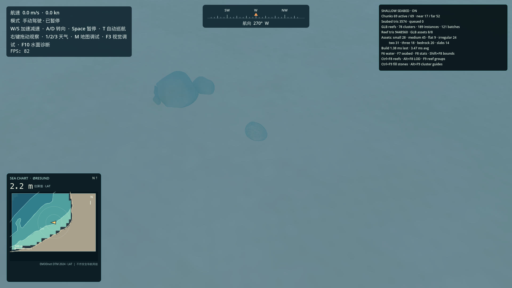
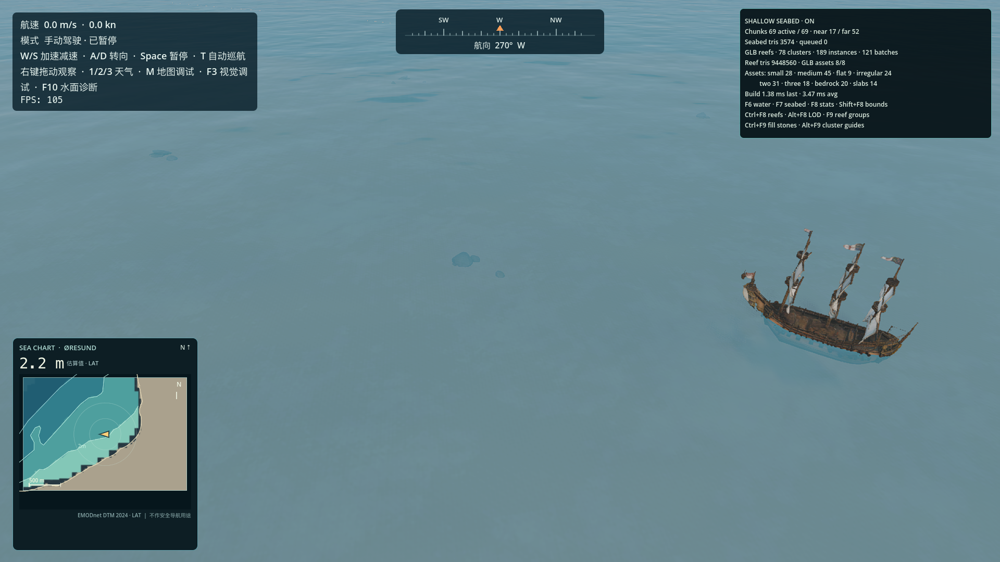
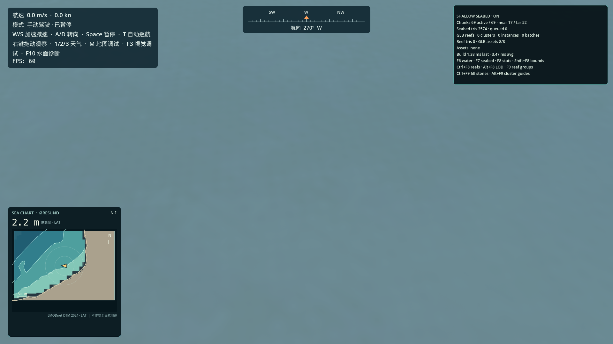
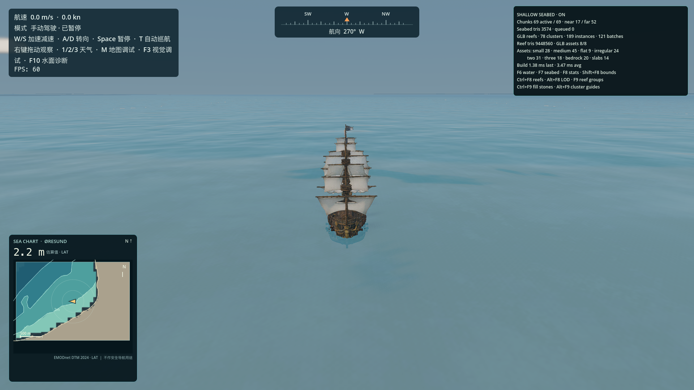
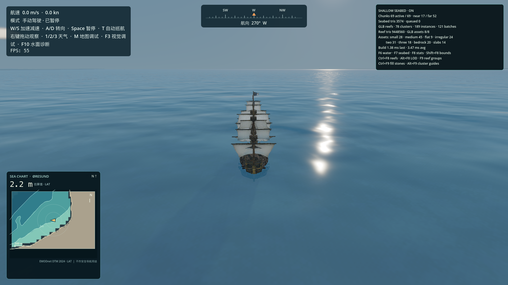
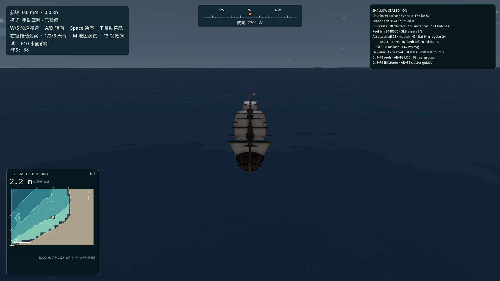

# 浅海海床系统

本系统在正式 `main.tscn` 中以 `ShallowSeabedManager` 作为可关闭的子系统运行。它读取项目现有的 `GeoReference` 与本地 EMODnet DTM 2024 水深缓存，不创建第二套 GPS、水深或海洋系统。

## 坐标与数据

- 游戏坐标沿用 `GeoReference`：X 向东、Y 向上、Z 向南，1 单位为 1 m；海床区块索引用 `(east, north)`，其中 north = `-world_z`。
- 地理坐标转换使用 `GeoReference.world_to_geodetic()`，水深使用 `BathymetryManager.get_depth_at_world_position()`。
- 输入水深来自 `assets/geodata/processed/bathymetry/grid_metadata.json` 指向的 EMODnet Digital Bathymetry DTM 2024 ERDDAP 数据。垂直基准是 LAT；有效水深为 LAT 以下负高程取反后的正值。来源网格为 0.0625 角分，Malmö 附近约 65 m 东西向、116 m 南北向。网格的来源、许可及下载记录见 `docs/TERRAIN_DATA.md`。
- 海床高程用 `-(depth_m + water_surface_above_lat_m) + visual_relief` 对齐游戏水面。默认 `water_surface_above_lat_m = 0.5 m` 是视觉对齐量，不是测绘改正，也不改变海图读数。水深无效、含陆地或超出覆盖范围时不建立三角形。
- 视觉网格延伸到水深 9 m，为现有 6 m 透视范围提供隐藏退场边距；9 m 不是导航深度边界。模型没有底壁，避免 6 m 处出现竖直切口。超过该深度不生成海床或礁石。

## 区块、LOD 与缓存

- 区块为 128 × 128 m，按固定世界坐标取整，内容不依赖加载顺序。
- 船周围 300 m 以内使用近 LOD，最多显示到 600 m；卸载半径为 704 m，并有 32 m 的 LOD 滞回。中心区块每 0.5 秒检查一次，只在船跨入新区块后更新需求。
- 近、远顶点间距默认分别为 16 m 与 32 m。当前 DTM 的有效水平分辨率约 65–116 m，网格对其作连续插值并承载小幅视觉起伏，不代表新增的实测地形细节。
- 每帧最多处理一个扫描/建网任务。已构建网格有 24 项 LRU 缓存；浅水扫描结果缓存上限 512 项。场景树添加、移除及 MultiMesh 操作均在主线程执行。
- 近/远 LOD 的区块边界共用远 LOD 的高度、深度和法线锚点，减少 T 接缝。所有视觉 relief 使用连续世界坐标噪声，因此跨区块稳定。

## 海床与材质

- 每块浅水区从真实水深采样建立 `ArrayMesh`，用有限差分估计法线。缺失、陆地或超深数据会阻止相应三角形生成，不会被当成 0 m 水深。
- 着色器通过连续权重混合沙地、泥地和岩地；规则由深度、坡度及低频世界坐标噪声确定，避免区块各自随机造成棋盘边界。细节纹理是程序化美术近似，不是真实底质分类。
- 微地形振幅默认宽尺度 0.15 m、细尺度 0.04 m。它仅改变海床外观，不影响 `BathymetryManager`、水深仪或船舶安全判定。
- `ShallowReefGenerator` 从 `resources/shallow_reef_assets.tres` 一次载入并缓存 GLB 网格，再按资产/网格部件分批生成 `MultiMeshInstance3D`。组合礁石保留 GLB 内部的子网格相对变换。缺失或损坏的资产会跳过并输出警告，不会用程序多面体替代。
- 礁石簇由稳定的 34 m 世界坐标候选格、全局种子 92841 与最多 10 m 的确定性中心偏移生成；实际水深、坡度和连续世界坐标岩性噪声共同决定簇密度。当前半径档为 3–5 m、5–8 m、8–15 m；大而偏岩质的簇可有多个组合模块，外缘布置单石填充。近景密度为 1.0，远景为 0.32，礁石只放在有效浅水且 5.8 m 以内。调整参数和视觉/性能比较见 [浅海礁石群规模调整](SHALLOW_REEF_SCALE_TUNING.md)。
- 当前没有实测海床底质分类数据。材质与礁石分布属于风格化近似；密度、簇半径、资产权重、允许的 LOD 和埋入比例均可通过 `ShallowSeabedManager` 与资产资源调节。

## 主场景控制

`scenes/main.tscn` 已加入 `ShallowSeabedManager`。默认海床和礁石启用；调试 UI 默认隐藏。

| 操作 | 效果 |
| --- | --- |
| F6 | 开关现有海面材质的浅海透视 Uniform |
| F7 | 开关海床区块系统 |
| F8 | 显示/隐藏浅海统计面板 |
| Shift+F8 | 显示/隐藏区块边界 |
| Ctrl+F8 | 开关 GLB 礁石 |
| Alt+F8 | 开关近/远 LOD 着色诊断 |
| F9 | 开关 GLB 礁石簇 |
| Ctrl+F9 | 开关礁石簇周围的小型 GLB 石块 |
| Alt+F9 | 显示/隐藏礁石簇中心和范围 |
| F11 | 开关程序化海草床 |
| Shift+F11 | 开关 GPU 海草摆动 |
| Ctrl+F11 | 循环 Sparse / Normal / Dense |
| Alt+F11 | 显示斑块边界与密度统计 |

统计面板报告激活/加载块、LOD 分布、已加载三角形、岩石和植株实例、海草覆盖估算、队列长度及平均/最近一次区块构建 CPU 时间。该面板仅供开发调试，不显示在默认玩家界面。

程序化海草床现已集成到同一生命周期中，详情、空间分布规则、密度档位、截图及独立性能记录见 [浅海海草床系统](SHALLOW_SEAGRASS_SYSTEM.md)。海草地图布局使用固定世界坐标与版本化种子；密度档位影响绘制的植株数量，不缩放斑块的地理范围。

## 验证

> 本节中的礁石数量和早期图形记录是 GLB 资产接入前的历史基线。它记录的是当时的程序化原型，不代表当前游戏仍会生成那些岩石。当前运行版本只显示配置好的 GLB 资产；缺失资产会跳过，不生成替代石块。

- 图形验证脚本：`godot --path . --script res://tools/capture_shallow_seabed.gd`。它实例化正式主场景，冻结船只/世界时间，使用 Malmö 起始位置与真实离线水深，并保存对照图到 `docs/shallow_seabed/`。
- 区块卸载/返回确定性验证：`godot --headless --path . --script res://tools/test_shallow_seabed_streaming.gd`。脚本把暂停船只移动到起点外 1.2 km，检查起点块已卸载，再返回比较区块网格与礁石坐标签名。
- 代码/资源检查：`godot --headless --editor --path . --quit`；主场景检查：`godot --headless --path . res://scenes/main.tscn --quit-after 120`；浅海透视回归场景：`godot --headless --path . res://scenes/ShallowWaterTest.tscn --quit-after 120`。
- 本轮图形检查环境为 Godot 4.7.2 Forward+ / Metal 3.2，Apple M2 Pro，1920 × 1080。海床稳定后采样 180 帧：正式船尾镜头 68.2 FPS / 14.66 ms 平均帧时；礁石近景 76.3 FPS / 13.10 ms。每块建网平均约 5.60 ms，最近一次约 3.31 ms。此为本机、此场景的单次样本，不是跨设备性能承诺或对照基准。
- 初始 Malmö 位置查询为 55.60587° N, 12.96300° E，实际 DTM 水深 2.2438 m LAT，有效且来自 EMODnet DTM 2024。最近拍摄的礁石约距船 27.1 m，查询水深 2.2260 m LAT。
- Headless 往返验证：起始区块 `(104, -82)` 被移到 `(104, -73)` 后卸载；返回时该块三角形数量和每个礁石位置签名一致。统计块数可能因卸载滞回在返回后多于最初数量，这是半径策略的预期结果。
- （历史基线，GLB 接入前）稳定状态初始邻域：69 块、17 近 LOD / 52 远 LOD、3,574 个已加载三角形、163 个程序化礁石实例，等待队列为 0。此数字及下方旧截图不代表当前版本的礁石实现。
- GUI 捕获工具正常结束时 Godot 在退出阶段输出 RenderingDevice RID 泄漏警告；本轮没有 Shader 编译或场景运行脚本错误。该退出警告尚未归因，不据此判断正常持续运行中的资源泄漏。

## GLB 礁石资产接入（2026-10）

本节记录当前实现；与上文明确标注为历史基线的程序化原型记录区分。

- 资产目录为 `assets/rocks/`，库配置为 `resources/shallow_reef_assets.tres`。八种资产为 `rock_small_round`、`rock_medium_round`、`rock_flat`、`rock_irregular`、`reef_two_rocks`、`reef_three_rocks`、`reef_low_bedrock`、`reef_layered_slabs`。每项的路径、种类、权重、目标高度、埋入比例、坡度和远景准入条件在资源里编辑；通过 `enabled` 可单独禁用。
- `tools/optimize_reef_glb_textures.py` 用于离线贴图压缩。原有 GLB 与贴图资源合计约 304.29 MiB，压缩后 GLB 加外置贴图为 22.25 MiB，减少约 92.7%。颜色贴图 Lanczos 缩到最长边 1024 px 后用 JPEG quality 90、4:4:4；法线和 ORM 贴图缩至最长边 1024 px 并保留 PNG。几何数据没有被这个贴图工具改写。原 4096 px 的导入缓存贴图无场景引用，已清理。
- GLB 以 `res://assets/rocks/<asset_id>.glb` 指向同目录的 `<asset_id>_albedo.jpg`、`<asset_id>_normal.png`、`<asset_id>_orm.png`。导入检查实际识别到每项一个可复用网格部件、合理的约 0.9–1.2 m 水平包围盒和 PBR 颜色/法线贴图；每个源网格约 49,968–50,000 个三角面。Godot 导入 sidecar 虽启用 `meshes/generate_lods`，运行时检查到这批 ArrayMesh 没有生成可用的表面 LOD。当前距离 LOD 主要通过区块网格精度、远景密度和资产准入控制，不应据此误称网格自身已有 LOD。
- GLB 材质的 Albedo、Normal、ORM 与原 PBR 参数保留。资产包没有找到可核实的作者/许可元数据；资源来源和商业再分发权仍需项目方确认。
- 程序化多面体礁石、缺失资产回退、旧版均匀散石记录及运行时 GLB/程序石切换已从游戏逻辑移除。缺少某个模型时该资源跳过，不会生成替代石块。单体/组合 GLB 均按稳定簇中心、种子和资产权重选择，模型 AABB 决定尺寸、埋入深度及海床接触点；超过资产允许坡度的放置被跳过。
- 复现检查：`godot --headless --path . --script res://tools/test_shallow_reef_asset_import.gd` 检查 8 个 GLB、包围盒、三角面和 PBR 贴图；`godot --headless --path . --script res://tools/test_shallow_seabed_streaming.gd` 检查离开区块后返回的簇和变换签名一致。
- 当前图形记录在 `docs/shallow_reef_assets/`：

| 视角 | 截图 |
| --- | --- |
| GLB 礁石簇近景 |  |
| GLB 礁石簇宽景 |  |
| 同镜头关闭礁石的 A/B |  |
| 船尾视角 |  |
| 傍晚回归 |  |
| 月夜回归 |  |

- `docs/shallow_reef_assets/performance_comparison.txt` 是 GLB 接入后、尺寸调节前的 1920×1080 固定镜头单次基线。最新同镜头数据和礁石分布对照见 `docs/SHALLOW_REEF_SCALE_TUNING.md`；原数字保留作历史对照，不代表当前密度。
- 区块构建最近约 1.38 ms，捕获期间平均约 3.47 ms；每帧仍限制处理一个区块任务。Godot 图形捕获退出时仍有泛型 RenderingDevice RID 泄漏警告（Pipeline/Compute/Shader/Texture 等）；该警告也出现在本轮关闭礁石的进程退出日志，尚未定位，不能归因于 GLB 礁石系统。
- 资产贴图已压缩，但源几何密度较高且运行时没有可用网格 LOD；若未来目标设备或实际海域的性能不达标，应先为这些模型制作低面数 LOD/替代网格并重新测量。另需确认资产许可来源。长时间航行时的多区块视觉与流式卡顿仍建议在主场景人工复核。

图形记录：

| 视角 | 截图 |
| --- | --- |
| Malmö 起始点船尾视角 |  |
| 斜俯视海床 |  |
| 近礁石视角（历史程序化原型，不代表当前游戏） |  |
| 水深有效性诊断 |  |
| 近/远 LOD 诊断 |  |
| 冬季深夜 |  |

## 扩展点与限制

以后接入真实底质分类时，替换 `_material_weights()` 的代理规则；接入更多礁石资产时，扩展 `ShallowReefGenerator` 的共享变体库和区域选择；其他生态内容应继续作为独立层读取同一套区块键、水深查询和确定性种子，不要塞入水深或海床网格生成代码。

当前水深分辨率较粗，岸边无效采样采取保守裁切，可能形成小缺口或相对海图海岸线略有偏移。水下画面仍受现有水面透视/光照效果影响；未制作真实折射、焦散、底质数据、碰撞礁石或搁浅判定。动态船只航行的长时间人工视觉验收仍需在游戏中完成。
