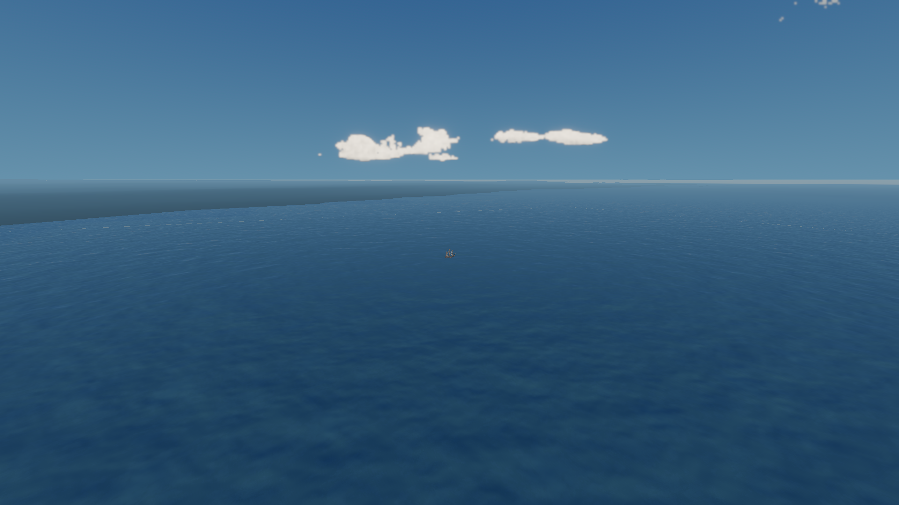
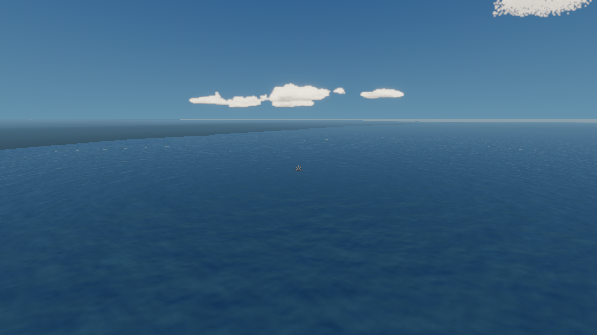
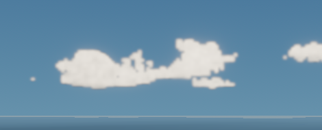
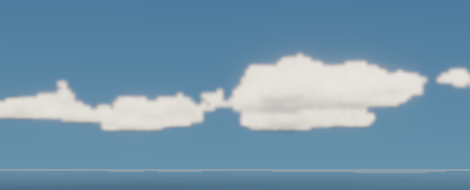
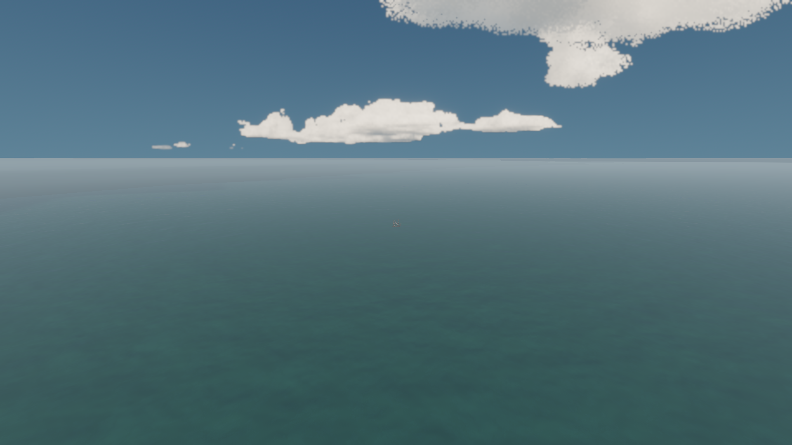
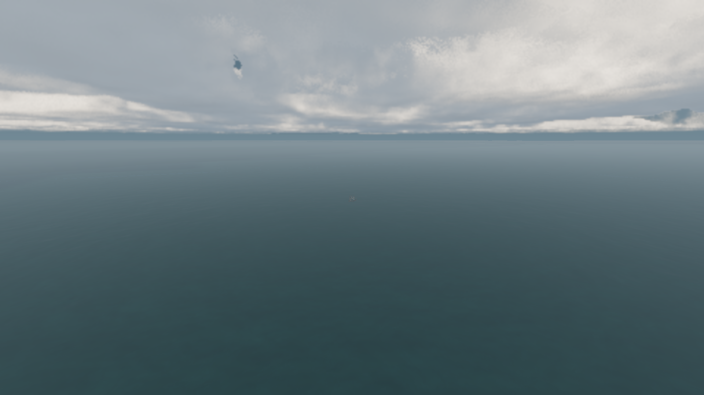
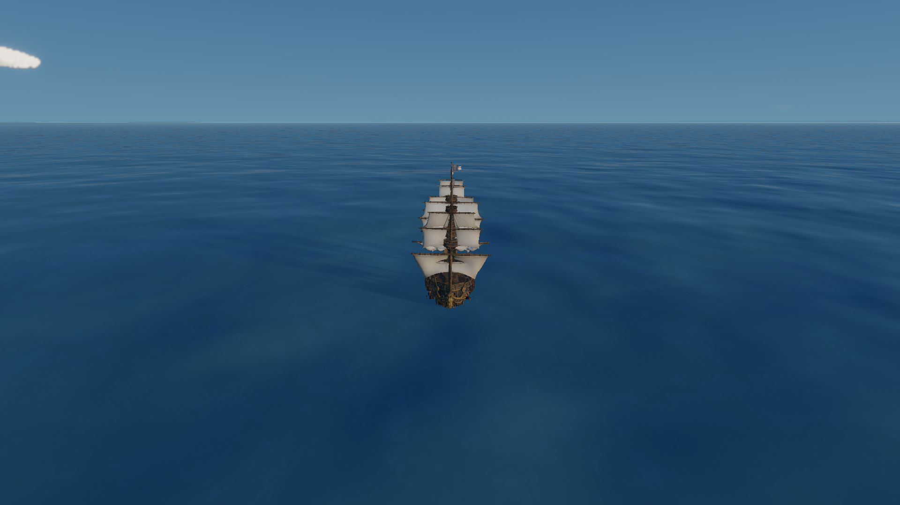

# 北欧夏日海景：体积云去噪与蓬松感

日期：2026-10-15  
项目：Godot 4.7.2 Stable / Forward+ / Metal 3.2，Apple M2 Pro   
截图：1920×1080，High，固定镜头对照时冻结海面相位、云层坐标和云抖动时间；FPS 采样时关闭 VSync 和帧率上限。

## 结论

这轮保留 Sunshine Clouds 2 和现有渲染架构，只改插件已公开的云参数及三种天气的体积光照密度。主要颗粒来源是密度场的中小尺度噪声与反复 Curl 扭曲；云体自阴影对轮廓颗粒的影响较小。调整后大云内部更连贯、边缘碎裂减少，主云顶部有更完整的隆起。小云仍略扁，这是本轮参数微调未完全解决的部分。

## 诊断依据

- `sampleScene()` 以低频大尺度场定轮廓，中频噪声补形，再用 `smallShape * height_gradient.g * pow(1 - mediumshape, clouds_detail_power)` 控制细节侵蚀。旧值 `clouds_detail_power=0.36` 让小尺度项较多地进入云体内部；提高该指数后，细节更多保留在边缘、致密云芯更完整。
- 小尺度噪声尺度原为 6,500 m，中尺度为 19,000 m；`curl_noise_strength=1,500` 时每个采样点还会连续三次扭曲世界坐标。这会把内部与边缘密度都打碎。
- 单独关闭 `lighting_density` 后，固定镜头对照的云轮廓变化很小，因此光照不是主要的碎边来源。插件的体积光照仍通过同一密度场做太阳方向采样，旧密度会在阴影中留下细碎明暗。
- High 档在 1920×1080 下把云计算缩至四分之一分辨率（约 480×270），使用蓝噪声步进抖动、`accumulation_decay=0.72` 的历史累积以及现有径向模糊。慢速转动镜头的截图序列没有看到明显跳变，但单帧截图不足以完全判断细微闪烁；低分辨率档的边缘颗粒和软化更明显。
- QualityManager 只调整云的分辨率与步数，不覆盖本次密度场美术参数。没有修改插件 Shader、纹理、Raymarch 步数或渲染分辨率。

## 参数变化

| 参数 | 原值 | 新值 | 作用 |
|---|---:|---:|---|
| `medium_noise_scale` | 19,000 m | 24,000 m | 降低中频起伏频率，让中尺度结构更宽、更少碎块 |
| `small_noise_scale` | 6,500 m | 10,000 m | 降低高频侵蚀频率，减少细碎颗粒 |
| `clouds_detail_power` | 0.36 | 0.60 | 抑制致密云芯中的小尺度侵蚀，同时保留边缘破碎 |
| `curl_noise_strength` | 1,500 | 700 | 减弱三次坐标扭曲，减少云缘撕裂 |
| `lighting_sharpness` | 0.18 | 0.24 | 收敛过碎的体积亮暗变化 |
| Clear / Partly `lighting_density` | 0.70 | 0.56 | 让亮暗过渡更连续，保留云底阴影 |
| Overcast `lighting_density` | 0.48 | 0.40 | 保留灰蓝云幕，同时减轻局部斑驳 |

覆盖率、密度、云层高度（1,200–6,400 m）、云体锐度（0.58）、模糊（0.75 / 质量 1）、累积（0.72）、High 档四分之一分辨率、160 个主步数和 12 个光照步数保持原值。没有增加 Shader 采样、渲染 Pass 或额外云特效。

## 固定视角截图

全景 A/B 来自相同 1920×1080 视点；C–F 是从对应全景相同坐标裁出的局部图，没有缩放或锐化。

| 编号 | 画面 |
|---|---|
| A | 修改前晴天全景： |
| B | 修改后晴天全景： |
| C | 修改前大积云： |
| D | 修改后大积云： |
| E | 修改前较扁小云： |
| F | 修改后小云： |
| G | 修改后 PartlyCloudy： |
| H | 修改后 Overcast： |
| I | 修改后船尾第三人称： |

诊断截图：小尺度密度减弱、关闭 Curl、关闭体积光照分别见 [detail 诊断](summer_clouds_refined/diagnostic_small_detail_reduced.png)、[Curl 关闭](summer_clouds_refined/diagnostic_curl_off.png)、[光照关闭](summer_clouds_refined/diagnostic_lighting_off.png)。

## 性能与质量回归

测量为同一主场景、固定宽视角、1920×1080、High、VSync 关闭且不限帧的两轮交错采样。云层移动和抖动在采样期间冻结；CPU/GPU 专用计时不可用。

| 配置 | FPS 样本 | 帧时间样本 | 两次平均 |
|---|---|---|---|
| 原参数 | 74.88、81.97 | 13.35、12.20 ms | 78.42 FPS / 12.78 ms |
| 新参数 | 85.45、81.73 | 11.70、12.24 ms | 83.59 FPS / 11.97 ms |

不同轮次的变化幅度较大；这组短测不能证明新参数提高了性能，只能说明没有出现可重复的明显回退。参数修改不改变每像素采样数量。

- Clear、PartlyCloudy、Overcast 三种预设均加载并显示出各自云量/氛围；天气控制器和过渡逻辑未修改。捕获脚本为便于快速取图把过渡时长缩至 0.05 秒，未在此脚本中重新测量正常 5 秒过渡动画。
- High、Medium、Low 截图中云场形状一致；低档的柔化/边缘颗粒更明显，符合较低云分辨率的表现。QualityManager 逻辑未改。
- 慢速镜头偏航序列（-7°、0°、+7°）期间启用了云层时间和移动，截图没有发现明显的云体跳变；仍需在真实游玩中观察连续画面。

## 运行与检查

项目运行：`godot --path /Users/smixu1/dev/boat-life-simulator`  
复现对照：`godot --path . --script res://tools/capture_cloud_softness_refined.gd`

捕获脚本在 Godot 4.7.2 / Metal 下完成并保存 1920×1080 图像；随后正式主场景以 Metal 启动并运行 120 帧，没有启动或 Shader 编译错误。捕获进程和 `--quit-after 120` 退出时 Godot 都打印 RenderingDevice 资源 RID 泄漏警告（Pipeline、Compute、Shader、Texture 等）。Headless 编辑器加载检查也通过，但 headless 不创建 RenderingDevice；它退出时另有一条未定位来源的通用 ObjectDB 泄漏警告。实际渲染验证由 Metal 窗口进程完成。上述退出警告没有在运行期间造成渲染错误，本轮未改插件资源生命周期。

## 已知问题

- 小型云仍偏水平拉长；参数调整让边缘更干净，但未重塑插件的垂直高度分布，也未编辑插件核心 Shader/噪声纹理。
- High 档的云计算分辨率仍低于屏幕分辨率，动态转镜头时可能残留细微采样颗粒。提高分辨率或 Raymarch 步数会增加成本，本轮没有启用。
- 本轮未在 3440×1440 外接屏测量 GPU 时间；性能数据只适用于记录中的 1920×1080 Mac 环境。
