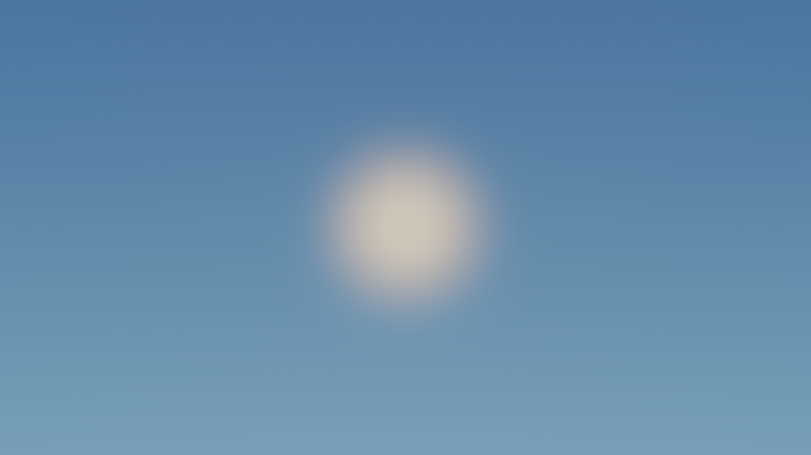
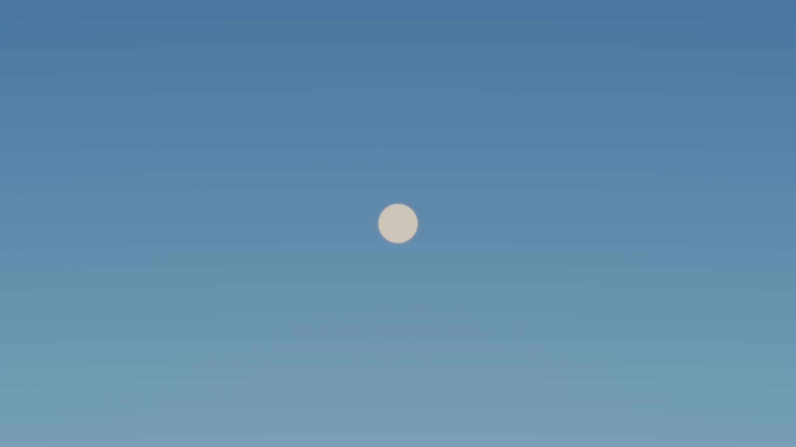
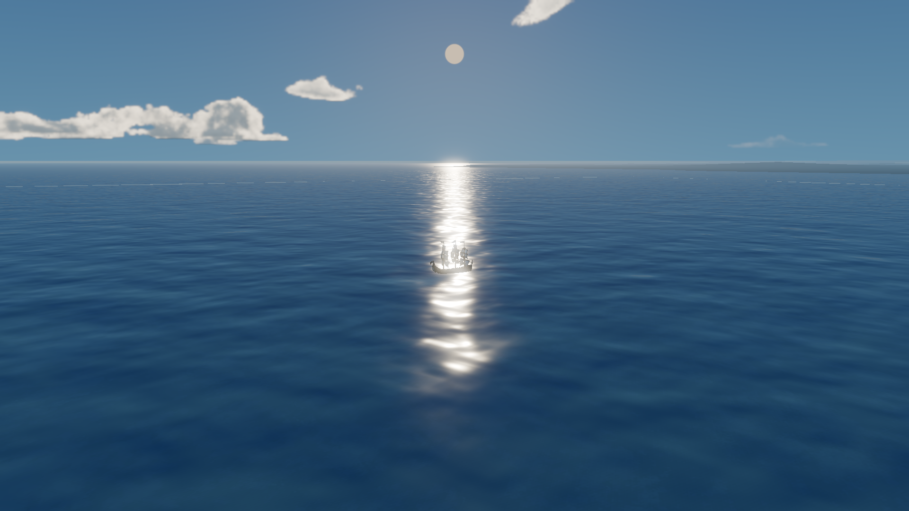
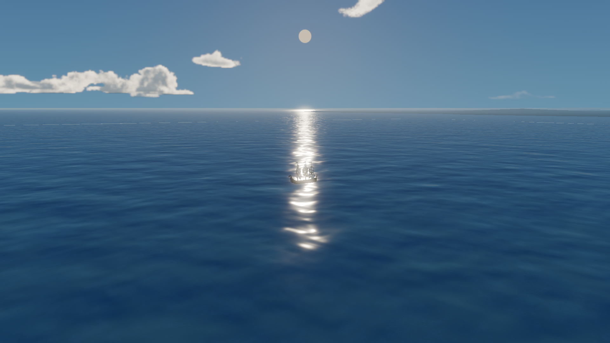
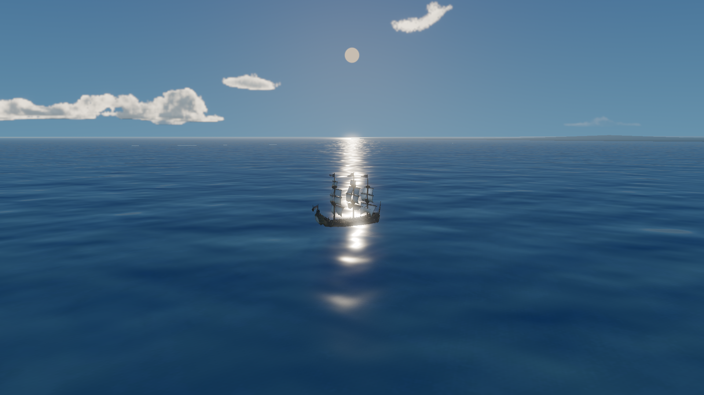
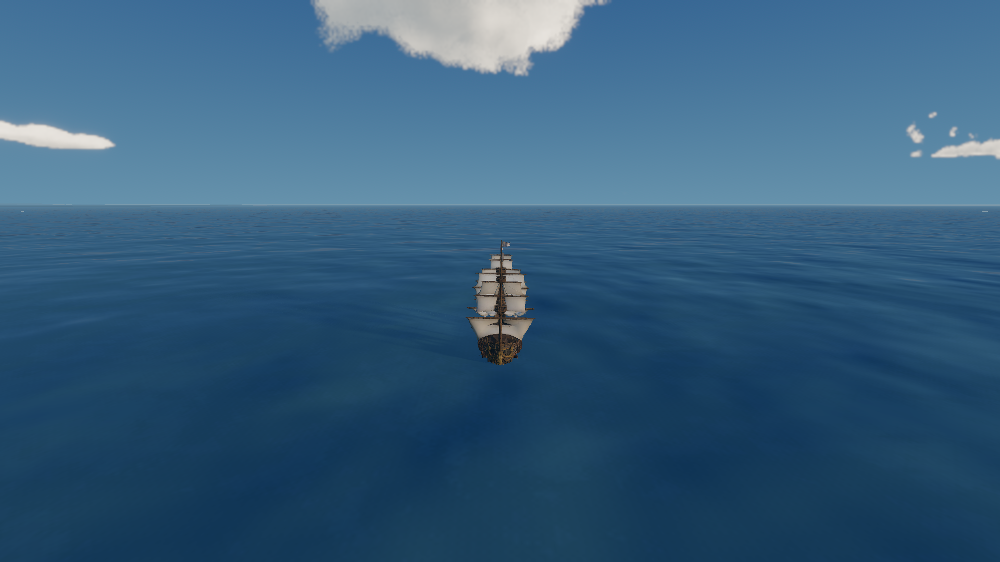
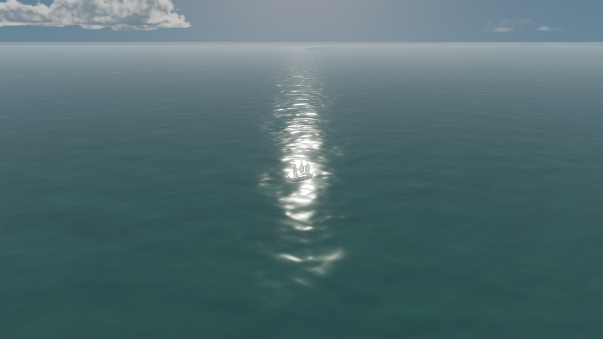
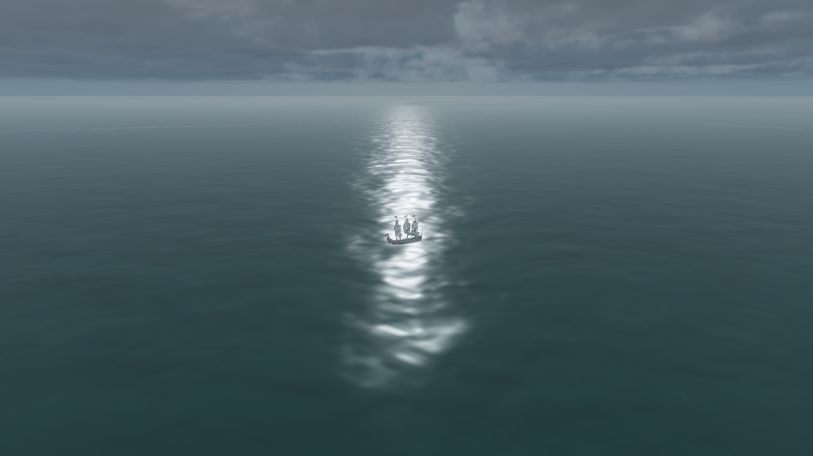

# 太阳圆盘与海面反光检查

日期：2026-10-15  
项目：Godot 4.7.2，Forward+ / Metal，Apple M2 Pro，High，1920×1080，3D scale 1.0。

## 结果摘要

- 天空使用 Godot 原生 `ProceduralSkyMaterial`。太阳模糊主要来自 `sun_angle_max = 12°`，不是 Glow 或 Fog。Godot 文档说明该属性控制太阳中心外完全淡出的角距离，并决定天空中太阳的大小。[ProceduralSkyMaterial 文档](https://docs.godotengine.org/en/4.7/classes/class_proceduralskymaterial.html)
- 海面反光主要来自水材质的 PBR 镜面高光及 Gerstner/细节法线的聚集。关闭 SSR、Glow 后反光路径仍存在；仅显示 Specular 时仍可见，Diffuse only 时消失。
- 将太阳盘角度缩至 `1.4°`，并降低各天气的 Specular、同时轻微收窄近远 Roughness 后，太阳盘更可辨，反光仍保留为从地平线延伸的离散闪光路径。
- 没有增加灯光、纹理采样、渲染 Pass、网格或后处理。

## 原因与调整

| 项目 | 修改前 | 修改后 | 说明 |
|---|---:|---:|---|
| ProceduralSkyMaterial `sun_angle_max` | 12.0° | 1.4° | 缩小宽阔的暖白模糊光团，保留窄边缘过渡；`sun_curve` 仍为 0.15。太阳方向和 Glow/Fog 参数未改。 |
| 水材质默认 Specular | 0.30 | 0.18 | 降低水面 PBR 镜面反射能量。 |
| Clear Specular | 0.24 | 0.18 | 减少晴天反光峰值。 |
| PartlyCloudy Specular | 0.22 | 0.16 | 保持多云天气较柔和。 |
| Overcast Specular | 0.14 | 0.10 | 进一步压低阴天高光峰值。 |
| 近景 Roughness（Clear） | 0.10 | 0.075 | 让闪光更集中、减少大片重叠的亮区。 |
| 远景 Roughness | 0.34 | 0.29 | 减少远处连续的宽亮带。 |
| PartlyCloudy / Overcast 近景 Roughness | 0.16 / 0.28 | 0.12 / 0.22 | 天气间保持平滑的反光强度层级。 |

`water_specular_near_multiplier = 0.72`、`water_specular_far_multiplier = 0.62`、`sun_glitter_intensity = 0.72`、`wave_normal_strength = 0.45`、`detail_normal_strength_near = 0.8`、`depth_color_strength = 0.6` 均保持不变。天气预设原有太阳能量（Clear 1.18、PartlyCloudy 0.85、Overcast 0.42）也未调整。

### 诊断依据

1. 原生太阳盘隔离时，Glow off 和 Fog off 对大光团影响很小；只缩小 `sun_angle_max` 后轮廓清楚。
2. 水面诊断模式对比了正常着色、Diffuse only、Specular only、平面法线 Specular、关闭 SSR。路径在 Specular only 中仍在，关闭 SSR 后仍在，因此主因是直接 PBR 镜面高光；波面法线把高光分割成连续闪光。
3. 同固定波浪相位的 C/D 截图区域统计（1920×1080 中心 ROI）：RGB 通道平均值大于 220 的像素由 15,933 降至 8,861；大于 245 的像素由 7,108 降至 3,527，约减少 44% 和 50%。测量只用于同一测试画面内的相对比较。

## 截图对照

所有截图均为 1920×1080。A/B 是相同太阳方向的天空太阳盘对照；C/D 使用同一摄像机、冻结在相同波浪相位；E 是船处于反光路径的斜后视角。F 是晴天船尾视角，G/H 是少云和阴天的反光路径检查。天气预设的太阳角度沿用项目现有设置；G/H 按各预设的现有太阳位置重新放置了摄像机，因此作为天气回归参考，不是严格的逐像素同机位对照。

### A. 修改前太阳盘

### B. 修改后太阳盘

### C. 修改前海面反光

### D. 修改后海面反光

### E. 船位于太阳反光路径

### F. 晴天正常船尾视角

### G. 少云天气

### H. 阴天天气

## 性能与验证

FPS 采样在同一生产场景、High、1920×1080、3D scale 1.0、VSync 关闭、无 FPS 上限下交替进行，每次 5 秒：

| 状态 | 第一次 | 第二次 | 均值 | 对应帧时间 |
|---|---:|---:|---:|---:|
| 调整前 | 67.45 FPS | 60.00 FPS | 63.73 FPS | 15.69 ms |
| 调整后 | 70.41 FPS | 59.99 FPS | 65.20 FPS | 15.34 ms |

这组短采样波动较大，只能说明本轮没有测到性能下降，不能据此认定修改提高了性能。没有在 3440×1440 外接屏重复测量。

已完成：真实 Metal 渲染器下加载生产主场景、天气切换并生成 A–H 截图；`godot --headless --path . --editor --quit` 退出码 0；`git diff --check` 通过。Headless 编辑器退出时报告 1 个 ObjectDB instance 泄漏；图形诊断脚本退出时有 RenderingDevice RID 清理警告。图形运行和截图本身完成，警告出现在诊断程序关闭阶段。

## 已知问题

- 船在直对太阳反光路径时，帆布仍有局部过曝，截图 E 中船体轮廓可辨但帆面细节损失。继续压低 Specular 会进一步降低反光存在感，因此本轮保留了可见的反光路径。
- 阴天和少云仍有柔和的反光路径，峰值低于晴天；这来自水面 PBR 与各天气现有的阳光能量，并非晴天级的太阳光柱。
- 地平线的细亮线按任务要求未处理。
- Glow/Fog 参数、天气太阳方向、海水底色、法线强度、波浪、浮力及尾流均未改动。
