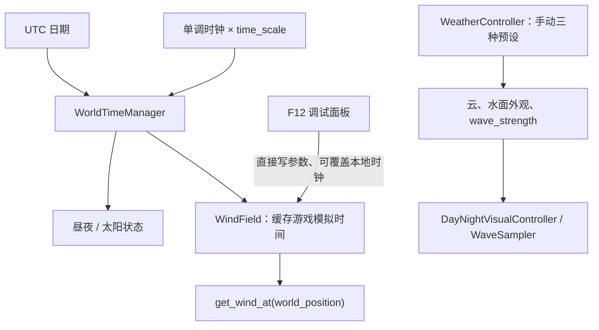

# W2.1 天气系统与全局风场整合架构审计

**审计范围：只读检查项目代码与测试，不修改天气、风场、海浪或船舶系统。**

## 审计结论

当前天气系统与 WindField 是两套并列系统，尚未整合。天气预设控制云、天空、水面外观和浪高；WindField 独立提供可查询的风速矢量。主场景里两者都已加载，但天气控制器没有向 WindField 传递风况，海浪和船只也没有读取 WindField。

本次只读检查，没有修改项目代码，也没有运行测试。

## 1. 现有系统与数据流

| 模块 | 当前职责 | 时间来源 |
|---|---|---|
| [WeatherController](../scripts/weather_controller.gd) | 3 个手动天气预设：晴、多云、阴天；控制云、水面外观和 `wave_strength` | 转场使用引擎 `delta`，即现实经过时间 |
| [CloudWeatherProfiles](../resources/cloud_weather_profiles.gd) | 提供各预设的云量、云密度及云光照参数 | 随 WeatherController 预设切换 |
| [WorldTimeManager](../scripts/world_time_manager.gd) | 推进游戏昼夜、管理日期、倍率、暂停和时间存档 | 单调时钟乘游戏时间倍率；日历日期来自 UTC 转斯德哥尔摩时间 |
| [WindField](../scripts/wind_field.gd) | 按世界位置查询水平风速矢量，叠加确定性的时空阵风 | 读取 WorldTimeManager 的游戏模拟时间 |
| [WaveSampler](../scripts/wave_sampler.gd) | CPU 船体采样与海面 Shader 共用波浪参数和波浪时间 | 用现实 `delta` 推进 |
| [WindFieldDebugPanel](../scripts/wind_field_debug_panel.gd) | F12 风场诊断、参数调整和本地测试时钟 | 面板本地时钟，或 WindField 当前时钟 |

主场景在 [main.tscn](../scenes/main.tscn) 中分别实例化 `WeatherController`、`WindField`、`WindFieldDebugPanel` 和 `DayNightVisualController`。`SunshineCloudsDriverGD` 也有独立的风向配置；它目前不是由全局 WindField 驱动。



**目前没有从 WeatherController 到 WindField 的数据通路，也没有找到船只或海浪查询 WindField 的调用。**WindField 是可用的独立接口，还不是全局天气的实际风力来源。

## 2. 天气系统审计

- 天气不是随机生成的。启动时采用 `initial_weather`，运行中通过快捷键 1、2、3 或脚本调用切换。
- 当前只有 Clear、PartlyCloudy、Overcast 三种视觉预设。
- 没有季节模型、降雨、雷暴、风暴强度、温度、气压、风速或风向天气字段，也没有天气存档。
- 预设之间的视觉参数采用平滑插值，默认约 5 秒完成。测试明确验证：即使游戏时间倍率设为 60 倍，天气视觉转场仍按现实时间推进。
- 天气变化不由游戏时间或季节自动触发。天气切换目前是手动状态选择。

因此，当前 WeatherController 更接近环境外观预设控制器，还不是气象状态模拟器。

## 3. 时间系统与连续性

[WorldTimeManager](../scripts/world_time_manager.gd) 默认倍率为 24 倍，游戏昼夜周期由现实单调时间乘倍率推进；`pause_time()` 只冻结这个昼夜周期。它不会暂停场景树、WeatherController 转场或 WaveSampler 波浪时间。

日期来源需要区分：

- `real_calendar_date` 是实际 UTC 转换成的斯德哥尔摩日期。
- `calendar_date` 默认与实际日期相同，但可被调试日期覆盖。
- 调试日期覆盖不会改变 `real_calendar_date`；已有测试专门检查了这一点。
- 离线重启时，游戏昼夜周期不会补算停机时长，实际日历日期会更新。

相关天气和波浪时间存在三种不同语义：

1. 天气视觉转场按现实 `delta` 推进。
2. WindField 在物理帧读取游戏模拟时间，所以阵风会随 `time_scale` 加速，并在 WorldTimeManager 的昼夜暂停时冻结。
3. WaveSampler 的 `wave_time_seconds` 按现实 `delta` 推进；游戏时间暂停或加速不会同步暂停或加速波浪。

这意味着当前的“暂停”是昼夜时钟暂停，不是整个模拟暂停；同时阵风、天气转场和波浪现在使用不同的时钟规则。后续整合前应明确这些语义，避免误把它们当成同一种暂停或倍率。

### 是否应该分离气候时钟与阵风时钟？

**建议分离，并明确季节日期、天气过程时间与短期阵风时间各自的语义。**

- **气候季节**使用明确的气候日期。当前实际日期 `real_calendar_date` 可以作为默认来源；不要默认使用仅用于显示的调试日期覆盖。若以后需要游戏内季节随存档推进，应增加明确、可存档的气候日期。
- **天气过程演变**可以跟随游戏模拟时间，让天气过程与游戏日历相配合；暂停和加速语义需明确。
- **短期阵风**的“秒”最好代表实际模拟运行的一秒，而不是被昼夜倍率放大的一秒。当前 WindField 将阵风时间直接绑在昼夜模拟秒上，因此 24 倍时间倍率会把阵风过程也加速 24 倍。后续应讨论并提供独立的 gust clock，而不是在本次审计中改动 W1 算法。
- **视觉材质平滑转场**可继续遵循现有按现实秒计时的契约；它与“天气过程在游戏时间中演变”不是同一个时钟概念。

另外，WorldTimeManager 的 `pause_time()` 不代表全局游戏暂停。如果设计要求停船、停波浪、停阵风，应另由真正的全局暂停状态统一控制。

## 4. WindField 审计

WindField 当前在场景中以导出参数提供平均风况：平均风速、气象来向、阵风强度、时间尺度、空间尺度、方向变化和随机种子。它使用 FastNoiseLite 根据种子、位置和模拟时间做无状态采样；同一位置、种子和时间会得到相同结果。坐标约定为 X 东、Y 上、Z 南，返回矢量表示空气流向，输入的角度表示气象来向。

当前能力与缺口：

- 有连续时空阵风和位置查询；高度接口暂时不改变结果。
- WindField 的 `set_mean_wind()`、`set_gust_parameters()` 会立即更改参数，没有外部天气目标的平滑接入接口。
- 风场种子和时间不是单独存档的；不过阵风是由种子与时间决定的，因此固定种子、位置和同一时间可以复现。
- WindField 缓存 WorldTimeManager 的游戏模拟时间；F12 可以把它改为面板本地测试时钟，关闭测试时钟后恢复读取世界时钟。
- 主场景 F12 面板直接修改活动 WindField 的导出参数。隐藏面板不会恢复参数；关闭本地测试时钟只恢复时钟来源，不恢复风速、风向、阵风参数或种子。当前没有气象控制器与它争写的情况，但将来整合后会形成所有权冲突。

## 5. 建议的 W2 整合架构

建议采用用户提出的方向，但把职责落实到当前项目已有模块，不为架构名称强行重构：

```text
Climate Model → WeatherController → WindField → 后续环境消费者
```

- **Climate Model**：未来读取地区、日期和气候资料，提供气候基线或概率分布；不直接生成逐物理帧风速。
- **WeatherController**：保留现有预设及环境外观职责，扩展为活动天气状态的所有者。维护风况目标，并管理风况变化的过渡。
- **WindField**：继续拥有世界位置上的局部风场采样、阵风扰动和最终速度矢量。它接收已解析的天气目标，不自行读取 WeatherController。
- **消费者**：未来船舶在物理更新时查询局部风；海浪接收经过平滑的海况强迫；环境物件按需要查询或接收低频更新。

风况目标建议至少包含：平均风速、气象来向、阵风强度、阵风时间/空间尺度及种子。方向转换只在进入 WindField 时做一次，明确保持“天气数据为来向、查询结果为去向矢量”。

## 6. 最小侵入式实施建议

W2 开发阶段可以按以下最小范围扩展，保留现有表现路径：

1. 为天气状态增加风况目标字段，可先扩展现有预设/资源结构；若字段变多再独立出 `WeatherState` 资源。
2. 让 WeatherController 成为风况目标的唯一所有者，并通过显式引用或信号向风场适配层发布目标。
3. 给 WindField 增加“接收并平滑应用天气目标”的入口；保留现有采样算法和 `get_wind_at()` 接口。
4. 明确并注入单独的 gust clock；不要让 WindField 自己查 WeatherController。
5. 在 `main.tscn` 明确连接依赖，避免隐式全局查找成为长期接口。
6. 海浪暂不接入风场。本阶段用户明确禁止实施联动。

建议后续涉及文件：`scripts/weather_controller.gd`、`scripts/wind_field.gd`、`scenes/main.tscn`，可能新增 `resources/weather_state.gd` 或气候配置资源，以及新的天气—风场集成测试。W2.1 审计未实施这些改动。

## 7. F12 覆盖与恢复机制

当前 F12 是直接编辑活动风场，不是隔离的测试覆盖。未来天气控制器成为风况唯一所有者后，建议：

- 将调试值保存在独立的临时 `debug_override`，只覆盖 WindField 的运行输出，不回写天气预设或气候资源。
- 打开调试覆盖时明确显示覆盖状态；关闭时移除覆盖并重新应用当前天气控制器的最新目标，避免恢复到面板打开时的旧快照。
- 测试时钟只覆盖风场测试时钟；关闭测试时钟后回到正式风场时钟。
- 面板关闭、场景退出、恢复默认都要执行清理。
- 调试值不自动写入正式天气存档。

这能避免 WeatherController 和调试面板同时改写同一组 WindField 参数。

## 8. 暂停、加速与存档建议

WorldTimeManager 会将昼夜时间、倍率、暂停状态和日历状态存入 `user://world_time_state.json`，并自动保存；它不会保存 WeatherController 状态或 WindField 参数。

未来若要求存档后恢复天气连续性，天气存档至少要考虑：

- 当前天气状态及其随机种子；
- 天气状态过渡的起点、目标和进度或权威时间戳；
- 气候日期/地区选择；
- WindField 种子及 gust clock 时间基准；
- 明确离线期间天气是冻结、按游戏时间补进，还是按实际日期重新生成。

由于当前阵风是无状态采样，不需要保存 FastNoiseLite 内部状态；保存决定采样结果的种子与权威时间即可。当前天气预设启动后会重新按 `initial_weather` 初始化，没有天气断点恢复机制。

## 9. W2.2 北欧气候数据接口

本轮没有下载或检查外部气候数据。建议未来先定义离线 `ClimateProfile` 数据格式，包含地区标识、坐标/空间分辨率、月份或日期范围、风速分布、风向频率、阵风统计、数据来源、版本和许可信息。

气候模型根据地区与气候日期生成天气目标或统计先验，由 WeatherController 选择并平滑应用；WindField 再把天气基线扩展为局部连续风场。气候资料不应直接依赖 WindField 的单点查询，也不应在运行时请求网络。

## 10. 海浪后续接入建议

当前 WeatherController 会改变 WaveSampler 的 `wave_strength`，但 WaveSampler 的波浪方向、频率、相位和速度仍来自固定 `SeaWaveSettings`，没有风向或 WindField 输入。

后续可由天气/海况层按较低频率，把平滑后的风速、风向、持续时间或 fetch 转换成海况目标，再更新共享的波浪参数。应继续保证 CPU 船体采样与海面 Shader 使用同一组方向、强度和波浪时间；不要让 Shader 每顶点直接查询 WindField。本阶段没有实施海浪联动。

## 检查依据与状态

审阅了 `weather_controller.gd`、`cloud_weather_profiles.gd/.tres`、`world_time_manager.gd`、`world_time_state.gd`、`wind_field.gd`、`wind_field_debug_panel.gd`、`wave_sampler.gd`、`main.tscn` 及相关测试。测试代码中已有天气转场按现实时间推进、世界时间倍率/离线恢复、WindField 确定性和连续性等检查；本轮没有运行测试，因此不报告测试通过结果。

**审计结论：**W2 的主要集成风险不是 WindField 采样算法，而是时钟语义不一致、F12 直接修改正式风场，以及未来天气与调试面板的参数所有权冲突。先确定这些契约，再接入气候数据，会避免天气控制器、风场和海浪各自维护一套不一致的状态。
