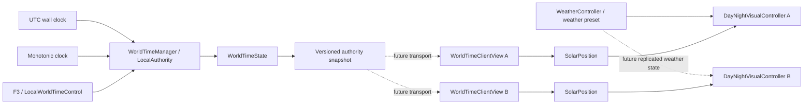

# World time networking acceptance

This document records the current single-process architecture and the boundary
intended for a later small shared-world server. It does not add a network
transport or RPC layer.

## Current architecture



`WorldTimeManager` remains the only authority-side writer. It advances the day
cycle from a monotonic clock and refreshes the real Stockholm calendar from UTC.
`WorldTimeState` contains serializable data only. `WorldTimeClientView` is an
independent, read-only presentation clock; it consumes copied snapshots and
accepts unscaled real elapsed time from its host. `SolarPosition` maps the view's
display date and cycle phase to a local sun direction. No client view holds a
reference to the authority state.

Today the F3 panel is wired to `LocalWorldTimeControl`, and
`DayNightVisualController` reads the local `WorldTimeManager` autoload. The
client view is validated in isolation but is not yet wired into a network client
scene. The visual controller's time source is therefore one of the explicit
integration points for a future client build. `WeatherController` currently
owns local weather presets and transition state; its state is not part of the
world-time snapshot and must be replicated separately for all clients to share
the same weather.

## Authority snapshot format

Snapshots are dictionaries serialized as JSON-compatible values. A current
snapshot contains the `WorldTimeState` fields plus transport metadata:

```json
{
  "snapshot_kind": "world_time_authority",
  "snapshot_schema_version": 1,
  "schema_version": 2,
  "authority_source": "Local",
  "authority_session_id": "local-...",
  "authority_snapshot_sequence": 42,
  "calendar_date": {"year": 2026, "month": 7, "day": 15},
  "real_calendar_date": {"year": 2026, "month": 7, "day": 15},
  "day_cycle_index": 0,
  "cycle_seconds": 43200.0,
  "time_scale": 24.0,
  "paused": false,
  "state_revision": 3,
  "authority_control_revision": 2,
  "revision_reason": "time_scale_set",
  "calendar_override_enabled": false,
  "calendar_override_date": {},
  "authoritative_timestamp_utc": 1784113200.0,
  "authority_sync_anchor": {
    "clock": "utc_unix_seconds",
    "authoritative_timestamp_utc": 1784113200.0,
    "day_cycle_index": 0,
    "cycle_seconds": 43200.0,
    "time_scale": 24.0,
    "paused": false,
    "state_revision": 3,
    "authority_control_revision": 2,
    "authority_snapshot_sequence": 42
  }
}
```

The example values illustrate the shape; timestamps and revisions are runtime
values. The process-local `monotonic_anchor_usec` is deliberately removed from
wire snapshots. The UTC anchor is the timestamp associated with the cycle phase
and settings in that sample. A future transport should attach an RTT-derived
one-way delay estimate before calling `apply_authority_snapshot()`.

`authority_snapshot_sequence` orders samples within a session, including when
the operating system wall clock is adjusted. `state_revision` orders semantic
changes and natural day-cycle wraps. `authority_control_revision` advances only
for pause/rate/date/phase controls, so a client still detects a missed
administrator jump even if a natural cycle wrap happens before the next packet.
`revision_reason` is diagnostic and identifies the latest change. A new server boot must establish
a new authenticated transport epoch; packets from an earlier connection epoch
must be discarded by that transport/session layer.

## Client prediction and correction

`WorldTimeClientView.apply_authority_snapshot(snapshot, estimated_one_way_delay_seconds)`
validates the schema, copies nested date/history dictionaries, and predicts the
view forward by the measured packet delay using the snapshot's pause and rate.
`advance(real_elapsed_seconds)` then uses real, unscaled elapsed time. The view
updates the real Stockholm date from the server UTC anchor while keeping the
optional calendar override separate. Solar calculations use `calendar_date`;
weather data must use `real_calendar_date` / the authoritative real UTC time.

- A lower revision or an older/duplicate sequence in the same authority session
  is rejected.
- Small phase errors up to 2 seconds are corrected over 0.75 real seconds.
- Larger errors, session changes, and a higher `authority_control_revision`
  apply immediately.
- Natural wraps can be corrected smoothly when the cycle index remains aligned.
- The client view has no pause, scale, cycle-time, or date mutation API.

The delay parameter is a transport input, not inferred from the client wall
clock. Production synchronization still needs a ping/RTT estimator and server
clock discipline. UTC is portable and useful for calendar prediction, but an
OS clock correction at the server can move its calendar estimate; the monotonic
clock remains the source for cycle progression.

## Persistence and restart behavior

`user://world_time_state.json` remains the local JSON persistence location. The
current state format is schema 2. Schema 1 saves are migrated with explicit
defaults for fields that did not exist (revision reason, recent local cycle
history, and other optional metadata). Core cycle fields must exist and be
finite; unsupported schemas or invalid values are rejected with a warning and
the manager initializes its local defaults. A rejected save is not silently
treated as a valid authoritative state.

On restart, the manager resets the monotonic anchor and does not advance the day
cycle for offline time. It refreshes `real_calendar_date` from current UTC;
the administrator override flag/date persists separately. Thus the display
override does not alter the real time supplied to weather/data providers.

## Headless boundary

The authority manager, state, local authority clock, solar math, and client view
use GDScript data/time APIs only. They do not reference cameras, the game
window, `WorldEnvironment`, `RenderingDevice`, ocean shaders, or SunshineClouds.
The visual controller remains on the presentation side. A headless server can
instantiate the time core without loading the game's visual main scene; this
task validates the core in headless mode, not a full dedicated-server boot
profile for every visual plugin in the main scene.

## Regression commands and current results

```sh
godot --headless --path . --script res://tests/test_world_time_manager.gd
godot --headless --path . --script res://tests/test_world_time_admin_controls.gd
godot --headless --path . --script res://tests/test_world_time_client_sync.gd
godot --headless --path . --script res://tests/test_day_night_cycle.gd
godot --headless --path . --editor --quit
godot --headless --path . --quit-after 5
git diff --check
```

Executed on Godot 4.7.2 Headless:

- `test_world_time_manager.gd`: passed, 70 checks, including schema 1 save
  migration and snapshot anchor round-trip.
- `test_world_time_client_sync.gd`: passed, 45 checks with two separately
  instantiated client views and independently copied state.
- `test_world_time_admin_controls.gd`: passed, 22 checks.
- `test_day_night_cycle.gd`: passed, 119 checks.
- `godot --headless --path . --editor --quit`: exit code 0; script classes and
  project files scanned. Godot printed one ObjectDB instance leak warning at
  editor exit; its source was not isolated in this task.
- `godot --headless --path . --quit-after 5`: exit code 0; the formal main scene
  loaded, and local bathymetry data reported as loaded.
- `git diff --check`: passed with no whitespace errors.

No FPS claim is part of this data-only architecture task.

## Minimal future server migration

1. Run `WorldTimeManager` in a dedicated headless authority scene and keep its
   monotonic/UTC clock providers injectable.
2. Replace `LocalAuthority` with a server authority adapter; server-side calls
   remain the only way to change rate, pause, date override, or cycle phase.
3. Publish versioned snapshots at a modest fixed cadence and immediately after
   semantic revisions. Preserve session ID, sequence, revision, and anchor.
4. Add authenticated admin commands; validate authorization and ranges on the
   server. Never trust the F3 visibility state or a client-supplied role.
5. Add a client transport adapter that applies snapshots to `WorldTimeClientView`
   and supplies RTT-based delay and unscaled monotonic elapsed time.
6. Change the client visual controller to consume a read-only time-view port
   instead of the autoload. Keep its local/server source out of shader logic.
7. Give weather state its own server snapshot and continue using real UTC for
   real-world weather/data providers; replicate weather separately from the
   accelerated day-cycle time.
8. Define authority-epoch reconnect rules and server clock discipline before
   allowing packets from a new boot/session to supersede an active client view.
9. Use a pinned IANA time-zone database if historical dates or future changes to
   Europe/Stockholm statutory DST rules must be supported; the current helper
   implements the modern EU CET/CEST transition rule, not the full tzdb.

## Known migration risks

- Wall-clock timestamp and client clocks can be skewed; server time/RTT offset
  estimation is still required for precise delivery compensation.
- Snapshot authentication, encryption, packet-size limits, and replay/session
  validation are not implemented.
- `state_revision` and sequence are process-scoped. A transport handshake must
  bind packets to an authority session epoch after restart/reconnect.
- Daily cycle ordinal history is local game state and is capped at 45 dates;
  decide whether the eventual server needs a longer audit history.
- Current Europe/Stockholm DST logic is not a general-purpose timezone library.
