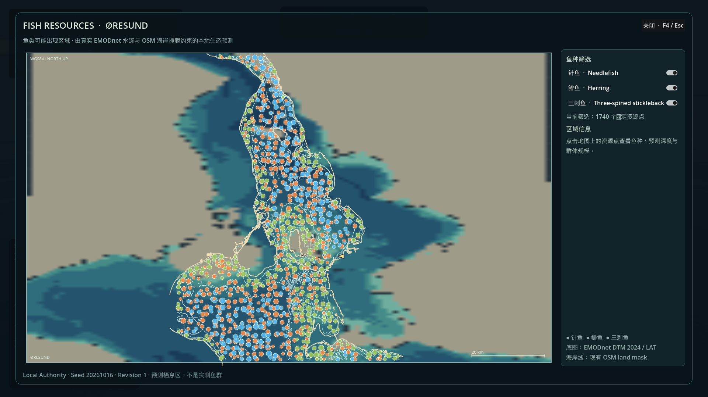
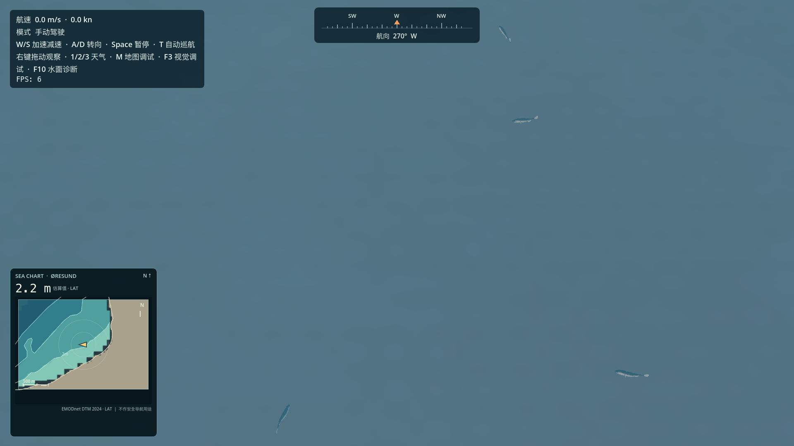
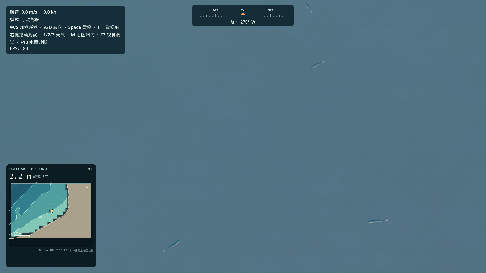
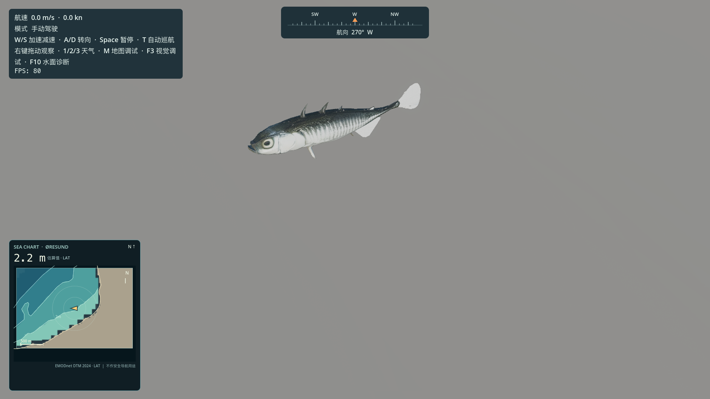
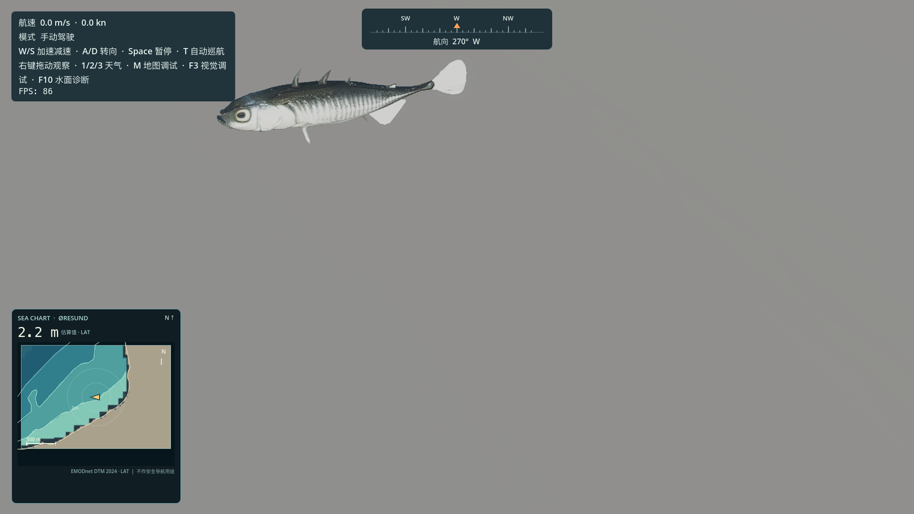

# Fish resources implementation report

Date: 2026-10-16  
Project: Godot 4.7.2, Forward+, Apple M2 Pro / Metal

## Model optimization

The source GLBs contain a single render mesh, one material and a base-color texture. Inspection found no skeletal rig or usable animation. The meshes were reduced to 2,400 triangles each, kept as standard GLB geometry, and their base-color maps were resized to 512 px and embedded as JPEG. The old normal and metallic/roughness maps were removed from the optimized materials; the fish use a dielectric rough surface. No Draco, Meshopt, KTX2 or extra decoder is required.

| Model | Original size | Optimized size | Reduction | Original triangles | Optimized triangles |
|---|---:|---:|---:|---:|---:|
| needlefish | 28,916,316 B (27.57 MiB) | 137,440 B (134.2 KiB) | 99.525% | 50,000 | 2,400 |
| herring | 27,679,112 B (26.40 MiB) | 139,348 B (136.1 KiB) | 99.497% | 49,970 | 2,400 |
| three-spined stickleback | 37,145,072 B (35.43 MiB) | 158,564 B (154.8 KiB) | 99.573% | 50,000 | 2,400 |

The optimized assets imported in Godot as `PackedScene`s with a renderable mesh and base-color texture. Importer-required JPEG sidecar files are kept beside the GLBs; removing them made Godot's importer report a missing external texture, so they are part of the asset set. Recoverable source GLB backups are at `/private/tmp/fish_glb_originals/` and are outside the project/export tree. Six no-longer-referenced 4K source PNG maps from the needlefish and herring were also copied to `/private/tmp/fish_glb_originals/source-textures/` and removed from `assets/fishes`; that removes 54,143,415 B (51.63 MiB) of unused source maps from project/runtime resources while preserving them outside the project.

## Architecture

```text
EMODnet DTM + OSM land mask + GeoReference
                    │
                    ▼
       FishResourceManager (world API)
                    │
            FishAuthorityAdapter
               ┌────┴─────┐
               ▼          ▼
       FishLocalAuthority  future server adapter
               │
       serializable school snapshots
          ┌────┴─────────────┐
          ▼                  ▼
 FishSchoolRenderer     FishResourceMap (F4)
 MultiMesh + local      client-only UI and map
 swimming animation
```

`FishResourceManager` owns the resource query/snapshot API, but delegates authority to an adapter. The current `FishLocalAuthority` creates deterministic school resources from world seed `20261016`, layout version 2 and 700 m geographic cells. It tests candidate positions against the existing EMODnet depth grid and OSM land mask. The fish renderer and map consume snapshots from the same API; neither creates independent map or fish positions. Population reductions route through the active adapter. The base adapter rejects client-side resource changes by default.

Initial resource generation took 484.6 ms in the headless logic test. The later 8-second school update advances up to 96 schools per frame; the tested batch completed over 19 frames, with a measured worst budgeted frame of 1.71 ms. Snapshots have schema and layout versions and support serialization/restoration. No network transport or persistent save file is implemented.

The map uses the project GeoReference (WGS84 local ENU: X east, Z south), EMODnet DTM 2024/LAT depth raster, existing OSM land mask and existing shoreline/contour features. Its predicted fish markers come exclusively from `FishResourceManager`. There was no pre-existing F4 menu in the inspected main scene, so this task adds the F4 overlay; the existing M geographic debug controls are untouched.

## Habitat and movement rules

These ranges and spawn weights are game suitability tuning, not fish survey data. Existing reliable environmental inputs are limited to bathymetry, coastline/land validity and deterministic procedural eelgrass patch weights. The project does not currently provide dependable temperature, salinity, current, seasonal or observed fisheries data.

| Species | Game depth band | Vertical layer | Movement and resource behavior |
|---|---:|---|---|
| Needlefish | 2–42 m; preferred 4–19 m | Near surface | Small groups of 3–10; 1.1–2.6 m/s; forward-biased cruise, occasional turn/burst and client-only flee response near the boat. |
| Herring | 8–53 m; preferred 17–43 m | Midwater | Larger groups of 35–96; 0.35–0.9 m/s; local separation/alignment/cohesion uses a 2 m neighbor grid, with client-side schooling and turn states. |
| Three-spined stickleback | 0.5–9 m; preferred 1–4.5 m | Near bottom | Small groups of 4–14; 0.07–0.28 m/s; idle/cruise/turn/burst states and a stronger procedural eelgrass habitat weight. The eelgrass association is a proxy, not an ecological survey result. |

The authority migrates resource-school anchors slowly and deterministically, validating each target against the same bathymetry before moving. The renderer keeps individual offsets, steering and behavior state local to the client. It updates movement at 0.16 s intervals; the GLB meshes themselves have no skeleton, so a low-cost vertex shader bends the rear body and tail using each fish's stable phase, speed variation and body-wave amplitude. Fish are drawn in three species MultiMesh batches, with no per-fish scene node or shadow casting. A shared wave-height sample is used per school and DTM validity/depth is cached in 4 m world cells for nearby individuals.

## F4 map and controls

- Press **F4** to open or close the resource map; **Esc** and the close button also close it.
- Toggle Needlefish, Herring and Three-spined stickleback separately.
- Click or hover a marker to read species, habitat description, predicted depth, population band and simulated population.
- The map labels its entire data layer as a **predicted habitat/resource map**, not detected fish or survey observations. There is no exploration/sonar state yet.
- Map points aggregate visually at the current scale; the sidebar count reflects the filtered authoritative resource points.
- The boat position and heading use the current main-scene boat node and existing GeoReference.

The first map raster build took 75.3 ms of measured slice CPU work over 12,672 pixels, with a maximum individual slice of 3.9 ms. The full wall wait was 6.1 s in the scripted capture because it waits on rendered frames and startup work; it did not execute the whole raster calculation in one frame. The automated headless test also recorded an unrelated 88.5 ms worst frame wait while the raster was being built, so map-open hitching still merits checking on the user's normal interactive session.

## Verification and performance

`godot --headless --path . --script res://tests/test_fish_resources.gd` completed with `failures=0`. It verified deterministic generation/snapshot restore, supported layout version checks, valid water/land filtering and depth suitability, species filters, GLB import/render resources, F4 open/close and map-manager data source, incremental raster completion, three MultiMesh batches, and client fish positions between sampled surface and seabed.

The graphical A/B benchmark used Godot 4.7.2 Forward+/Metal on the plugged-in M2 Pro at 1920×1080. It selected the densest actual resource cluster in a 1,200 m radius: school anchor `herring_v2_1_29`, 12 schools and 550 logical fish at chart depth 23.32 m. Each condition used a 1 s warm-up and three 3 s measurement repeats. The table shows the mean of repeat averages; p95/p99 are the mean of each repeat's percentile; worst is the maximum across repeats.

| Condition | Mean FPS | Mean frame | Mean P95 | Mean P99 | Worst frame | Avg draw calls | Visible fish / triangles |
|---|---:|---:|---:|---:|---:|---:|---:|
| Renderer off | 120.68 | 8.29 ms | 11.79 ms | 13.22 ms | 14.77 ms | 96 | 0 / 0 |
| Renderer on, body animation off | 118.41 | 8.45 ms | 12.85 ms | 17.31 ms | 23.24 ms | 98 | 221 / 530,400 |
| Renderer on, body animation on | 116.71 | 8.57 ms | 13.05 ms | 17.97 ms | 21.13 ms | 98 | 221 / 530,400 |
| Animation on, visible-fish cap 700 | 117.26 | 8.53 ms | 12.95 ms | 18.36 ms | 22.30 ms | 98 | 232 / 556,800 |

The renderer cap of 700 did not produce 700 visible fish: this actual cluster and species allocation rendered 232. GPU-only timing is not exposed by this test, so all frame values are whole-engine timing. The fish renderer added two draw calls in this scene. Initial single-pass profiling showed 22–31 ms update spikes around 221–232 fish. Sharing one wave solve per school and caching DTM samples in 4 m cells reduced repeat-reported renderer update times to about 9.6 ms with animation disabled, 11.0 ms with animation enabled and 12.0 ms at the 700 cap. This `fish_update_ms` field is the renderer's most recent update measured near the end of each repeat, not an average over every frame. There is still a movement-update spike about every 0.16 s; test a frame-budgeted movement queue if larger visible populations become a target.

The FPS difference from renderer-off to renderer-on is small in this run but not zero; results vary by repeat. No GPU time was available. The initial screenshot HUD showed instantaneous values varying widely and is not used as a performance claim.

## Screenshots

F4 predicted-resource map:



Nearby school at the regular third-person camera framing (two moments):





Close diagnostic framing used to inspect the compressed stickleback mesh and swim deformation:





The close diagnostic camera is intentionally zoomed in; it is not a normal sailing composition. At the startup position, the manager finds one nearby valid stickleback school with 5 fish, and no nearby needlefish or herring. Thus these screenshots do not prove that all three species are visually present from the ordinary boat camera.

## Known limitations and risks

1. `assets/boats/base_boat.fbx` is currently a Git LFS pointer rather than the model bytes. The main scene still loads the ocean, systems, fish and map, but the boat hull is missing and the scene emits existing `Boat.tscn` child-path warnings. Normal boat-view acceptance could not be completed. Fetch the repository's LFS asset separately before judging normal sailing screenshots; this task did not alter that file.
2. Existing water transparency is configured for 0–6 m. Herring predictions in deeper water are valid world resources but are not visible from above through the current opaque deep-water surface. The water shader was intentionally left untouched.
3. Fish locations are deterministic ecological predictions based on current local environmental data, not observed populations. Temperature, salinity, current and seasonal migration are not available.
4. The model reduction target is met, but normal maps and metallic/roughness maps were removed, so close-up material detail is simpler than the source.
5. Automated and graphical Godot shutdown still emits RenderingDevice RID leak warnings for pipeline/compute/shader/texture resources. The warnings also appear at scripted application exit and were not isolated to a fish resource; no unrelated rendering lifecycle refactor was attempted.
6. The graphical benchmark/capture emits the pre-existing missing-boat LFS errors. Headless tests can validate fish logic and asset loading but cannot provide GPU timing.

## Main files

- `scripts/fish_authority_adapter.gd`, `scripts/fish_local_authority.gd`, `scripts/fish_resource_manager.gd`, `scripts/fish_school_state.gd`
- `scripts/fish_species_profile.gd`, `resources/fish_species/*.tres`
- `scripts/fish_school_renderer.gd`, `shaders/fish_swim.gdshader`
- `scripts/fish_resource_map.gd`, `scripts/fish_resource_map_canvas.gd`
- `scenes/main.tscn`
- `assets/fishes/*.glb`, importer-required embedded-texture JPEG sidecars and `.import` files
- `tests/test_fish_resources.gd`, `tools/capture_fish_resources.gd`, `tools/benchmark_fish_resources.gd`
- `docs/fish_resources/performance.txt` and the screenshots above

Future server migration is limited to providing a server-backed `FishAuthorityAdapter` that supplies versioned school snapshots and validates population-change requests. The renderer and F4 map can keep their current APIs. Do not synchronize per-fish vertices or tail animation; those remain client-side visuals.
