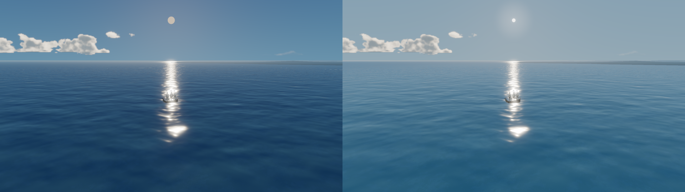
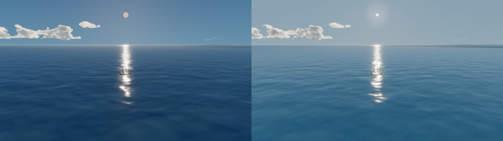
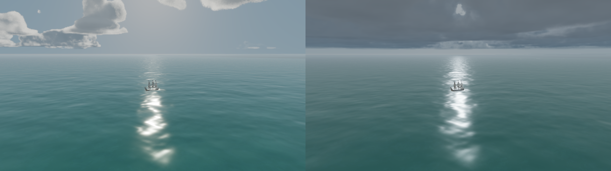

# 海面周期性白线与晴天太阳微调

测试环境：Godot 4.7.2 stable、Forward+ / Metal 3.2、Apple M2 Pro；主截图 1920×1080、High、VSync 关闭。截图由项目主场景固定镜头采集。

## 结论

周期性白短线来自远景海面网格在 Gerstner 顶点位移衰减区的几何插值误差。原远景面每侧只有少数顶点，跨越仍在衰减的位移区域时，面片插值无法跟上邻接 LOD 的波面。关闭镜面反射会让白线不明显，但纯色发光材质在保留波浪位移时仍能看到接缝；禁用波浪后接缝消失。因此根因是网格过渡与位移不匹配，不是单纯的太阳高光、雾或海岸地形。

修复在海洋环形 LOD 与远景平面之间加入细分过渡网格。过渡网格从原海洋半宽 336 m 延伸到 1,840 m，覆盖 Shader 的 Gerstner 衰减终点 1,800 m 并留有边距；沿向外方向最多约 32 m 一段。原有海面 Shader、波浪参数和 WaveSampler 未改。High 档该环约 26,112 个顶点、51,136 个三角形，增加一个静态 MeshInstance / Draw Call；不增加渲染 Pass，也不按帧重建网格。修复后 20 秒时间序列不再看到修复前那种成排、反复出现的短线；纯色波浪诊断中仍有个别细线状痕迹，因此把结果限定为主要瑕疵已消除，尚不能宣称每个孤立痕迹都已消失。

晴天海面高光只把天气预设中的 `water_specular` 从 0.18 降至 0.08；近景 roughness 仍为 0.075。固定镜头截图的中央反光区域中，亮度超过 95% 的像素占比从 4.47% 降至 3.92%（约减少 12%）。这是克制的高光收敛，仍有太阳反射路径和波面闪光；最亮的白色部分及船体落在反光路径时的发白仍可见。

天空太阳由项目自定义 Sky Shader 绘制：暖白色 HDR 圆盘与方向光方向对齐，圆盘角半径 0.42°、边缘柔化 0.07°、核心辐亮度 3.4；5.5°范围的柔和角度光晕强度 0.22。复用已有 Environment Glow（强度 0.28、阈值 1.35），未提高 DirectionalLight3D 能量、未改太阳方向或全局曝光。阴天预设的圆盘和光晕显著减弱。

## 诊断与截图

图 A 左为修复前 20 秒采样中白线明显的一帧，右为修复后 20 秒固定镜头采样。修复后的采样未见原先周期性短白线。纯色波浪模式、禁用波浪、隐藏地形以及逐组显示 LOD 环的截图也在本目录。



核心单帧：[修复前](A0_normal_baseline_peak.png) · [修复后](A6_wave_boundary_repair_after_20s.png) · [修复后 20 秒时间序列](A6_wave_boundary_repair_timeline.png)

诊断证据：[禁用镜面高光](A1_specular_disabled_peak.png) · [纯色材质且保留波浪，修复前](A2_constant_color_waves_peak.png) · [纯色材质且保留波浪，修复后](A7_constant_color_with_waves_peak.png) · [关闭波浪](A4_waves_disabled.png) · [LOD 边界着色](A3_lod_shell_visualization.png) · [低 LOD 修复后](A10_low_lod_after_repair.png) · [只显示近 LOD](A11_near_lods_only.png) · [只显示过渡环](A12_transition_only.png) · [只显示中远景环](A13_mid_only.png) · [只显示最远网格](A14_far_only.png)

图 B 左为原 ProceduralSky 太阳，右为新圆盘、光晕和最终水面高光设置。



候选比较：[原水面高光 0.18](B4_sunny_sun_and_reflection_after.png) · [最终 0.08](B12_sunny_sun_and_reflection_final.png) · [候选 0.12](B7_reflection_lower_specular.png) · [候选 0.10 / roughness 0.12](B9_reflection_soft_candidate.png) · [候选 0.06](B11_reflection_specular_006.png)

天气回归中，多云仍较柔和，阴天转为灰蓝云幕，阴天没有明显的晴天太阳盘。左侧多云，右侧阴天：



单帧天气截图：[多云](B5_partly_cloudy_after.png) · [阴天](B6_overcast_after.png)

诊断原图、测量 JSON 和运行脚本都保存在本目录及 `tools/` 中：`diagnostics_report.json`、`final_diagnostics.json`、`performance_baseline.json`、`performance_after.json`。

## 性能与运行验证

一次固定场景测量包含 120 帧预热、600 个帧间隔样本。修改前存档为 45.24 FPS、平均帧间隔 22.10 ms、中位数 21.59 ms、P95 28.85 ms；最终运行测得 60.00 FPS、平均帧间隔 16.67 ms、中位数 16.46 ms、P95 22.57 ms。设备、分辨率、High、VSync 关闭一致，但两次实际帧率差异较大；首次 benchmark 脚本没有在 QualityManager 初始化后重新确认帧率限制，因此不能把 FPS 上升归因于本次改动。最终测量明确记录了 `Engine.max_fps = 0` 与 VSync 关闭。Godot 未提供本测试所需的可靠 GPU 时间；本次没有声称 GPU 时间或稳定帧率改善。

捕获脚本均通过真实 Metal 渲染主场景生成截图；退出时仍出现 Sunshine Clouds 资源的 RenderingDevice RID 泄漏警告，和此前测试相同。它出现在诊断进程退出阶段，不影响截图生成，但本次未定位插件清理行为。

可重跑：

```sh
godot --path . --script res://tools/capture_ocean_sun_final_diagnostics.gd
godot --path . --script res://tools/measure_ocean_sun_performance.gd -- res://docs/ocean_sun_polish/performance_after.json
```

## 已知问题

- 地平线仍可见一条稳定的细亮/暗边界；它没有呈现原白色短线的周期性，根因未在本轮确认。修复后纯色波浪截图仍有个别短线状痕迹，需要后续结合用户实际运行画面确认是否属于同一瑕疵。
- 太阳反射的最亮斑块仍会接近白色；当前处理降低了高光数量/面积但没有完全压掉白色光柱感。进一步压低 specular 收益已开始变小（0.08 与 0.06 的亮像素占比差距很小），因此保留较安全的 0.08。
- 当前性能对照受运行时帧率状态影响，不足以给出改动带来的 FPS 因果结论。
