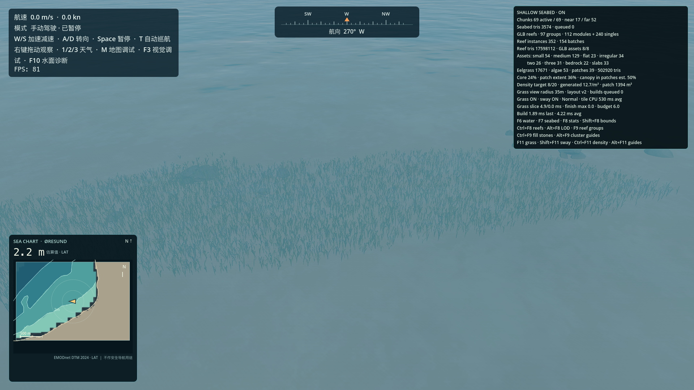
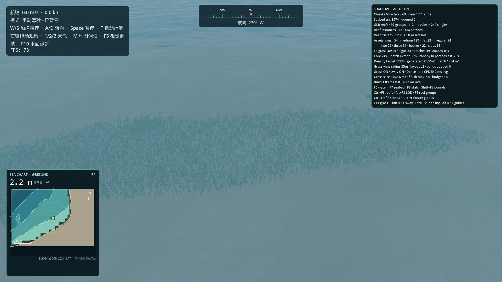
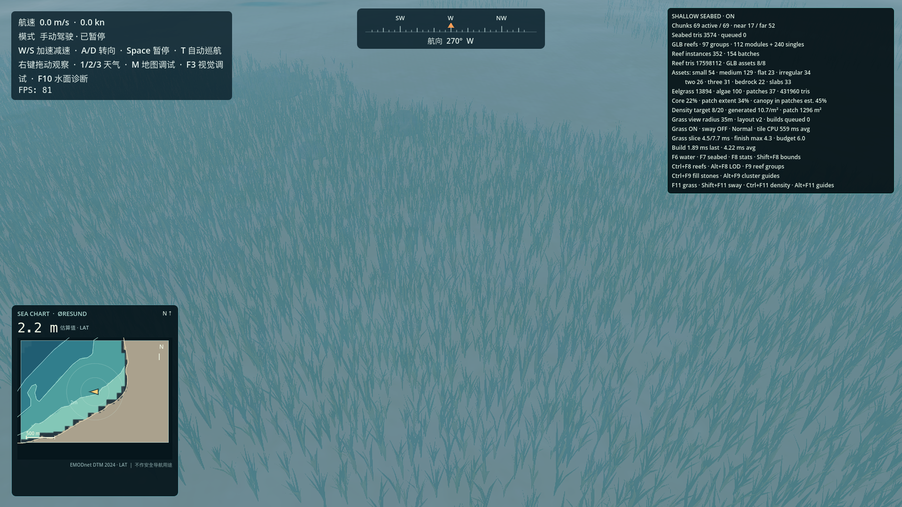
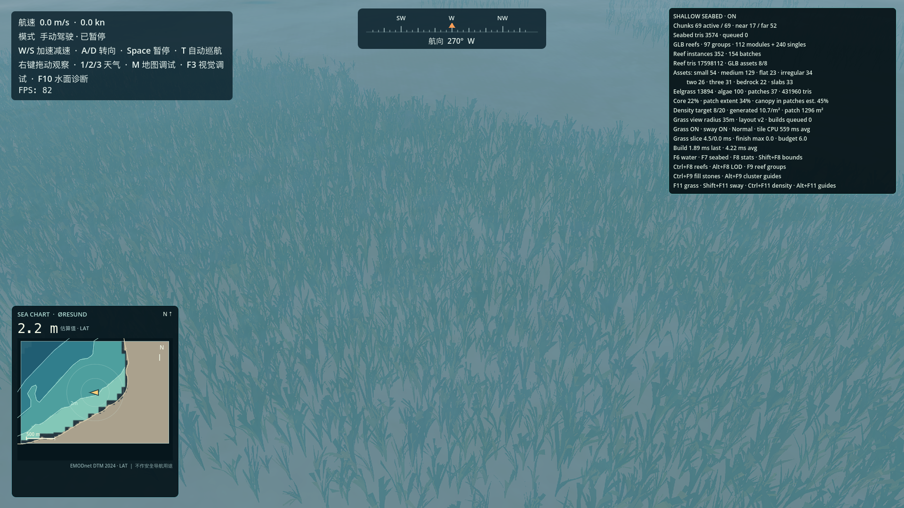
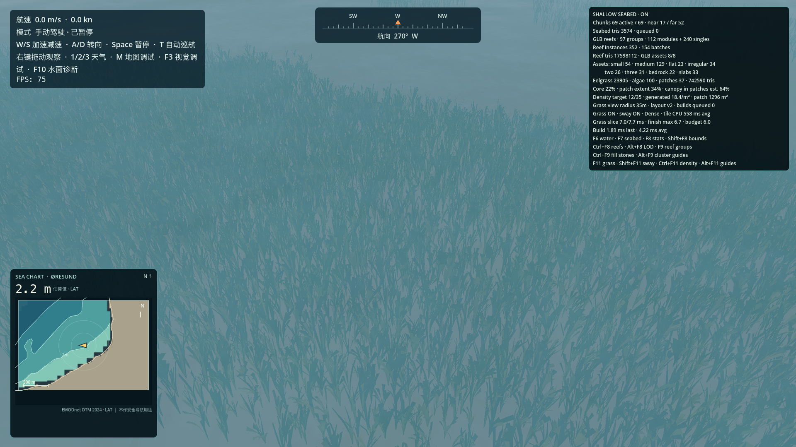
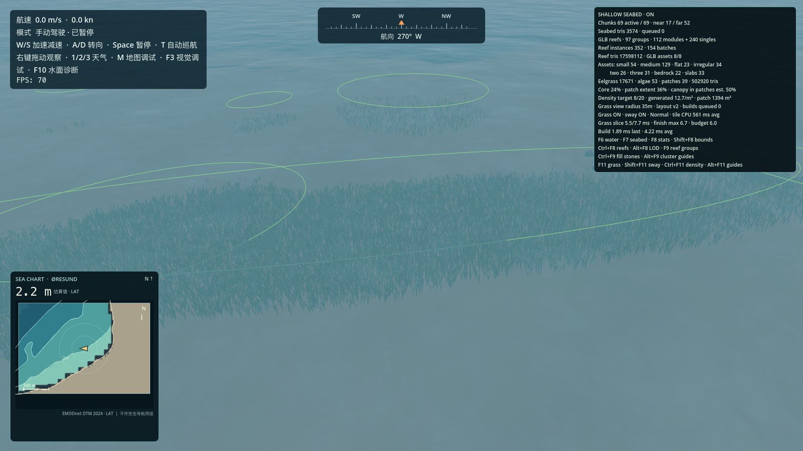

# Shallow Seagrass Art Upgrade

Godot 4.7.2 / Forward+ / Apple M2 Pro · 1920×1080 · July clear midday · Malmö start 2.24 m LAT · performance capture run after the laptop was plugged in.
The development checkout contains `assets/boats/base_boat.fbx` as a Git LFS pointer, so the stern camera framing is representative but the boat mesh is missing in these captures.

The mesh silhouette, vertex colors and vertex-stage sway were upgraded. GPS placement, ecology patch layout, layout seed/version, coverage and density targets were left unchanged. Eelgrass mesh style version is `2`.

End-of-run stats snapshot (after moving through the top-down, close-up, reef-transition, and debug views; active tiles follow the camera): `{"active_chunks":69,"algae_instances":53,"asset_instances":{"reef_layered_slabs":33,"reef_low_bedrock":22,"reef_three_rocks":31,"reef_two_rocks":26,"rock_flat":23,"rock_irregular":34,"rock_medium_round":129,"rock_small_round":54},"average_chunk_build_ms":4.21831884057971,"eelgrass_instances":17671,"enabled":true,"far_lod_chunks":52,"glb_assets_loaded":8,"last_chunk_build_ms":1.885,"loaded_chunks":69,"loaded_triangles":3574,"module_envelope_m3":1352.61031512451,"module_envelope_share":0.771899971067722,"module_instances":112,"near_lod_chunks":17,"pending_tiles":0,"reef_batches":154,"reef_clusters":97,"reef_triangles":17598112,"rock_instances":352,"seagrass_average_build_ms":561.302380952381,"seagrass_batches":22,"seagrass_builds_pending":0,"seagrass_density_preset":1,"seagrass_enabled":true,"seagrass_estimated_canopy_coverage_percent":50.2160925308409,"seagrass_estimated_core_area_m2":937.4293,"seagrass_estimated_meadow_coverage_percent":24.3572222389091,"seagrass_estimated_patch_extent_percent":36.229838104106,"seagrass_generated_density_per_patch_m2":12.6731322997271,"seagrass_generation_budget_ms":6.0,"seagrass_instances":17724,"seagrass_last_build_ms":1156.875,"seagrass_last_finish_ms":5.323,"seagrass_last_slice_ms":5.539,"seagrass_layout_version":2,"seagrass_maximum_finish_ms":6.688,"seagrass_maximum_slice_ms":7.725,"seagrass_mesh_style_version":2,"seagrass_patch_area_m2":1394.3672,"seagrass_patches":39,"seagrass_sway_enabled":true,"seagrass_target_core_density_per_m2":20.0,"seagrass_target_edge_density_per_m2":8.0,"seagrass_triangles":502920,"seagrass_visible_radius_m":35.0,"single_envelope_m3":399.702634510047,"single_instances":240}`

## Shape and visual comparison

| Before | After |
| --- | --- |
|  |  |

The updated ribbon keeps a stable-width body, narrows only near its tip, and starts from a loose fan crown. The near mesh uses shared segment-row vertices (about 40% fewer vertices for the same triangles than the old duplicated-row representation); far LOD uses about 33% fewer. Colors remain muted gray-green/olive, with slight per-leaf variation. Root motion is weighted to zero; two slow low-cost flow waves act mainly on upper blades.

## Captures

| View | Image |
| --- | --- |
| Normal density, stern-oblique camera |  |
| Normal density, sway off |  |
| Normal density, sway on |  |
| Dense density, sway on |  |
| Dense close-up, Normal static / Normal sway / Dense sway |    |
| Sway snapshots | [t0](sway_closeup_t0.png) · [t1](sway_closeup_t1.png) · [t2](sway_closeup_t2.png) |
| Top-down distribution |  |
| Eelgrass patch close-up |  |
| Reef transition |  |
| Patch guides and stats |  |
| Night light response |  |

Steady-state A/B performance is in `performance.txt`; generation-phase frame measurements are in `generation_performance.txt`. It uses two fixed camera profiles (stern-oblique and dense close-up); each profile holds GPS, camera, time, weather, resolution and warm-up constant across modes, with three 180-frame repeats. The current base-boat LFS resource is missing, so the camera can frame the meadow but cannot show the actual hull.

Canopy percentage is an area estimate using a fixed projected footprint per tuft; it is not measured from rendered pixels. Patch coverage and density remain artistic approximations, not local ecological survey data.
