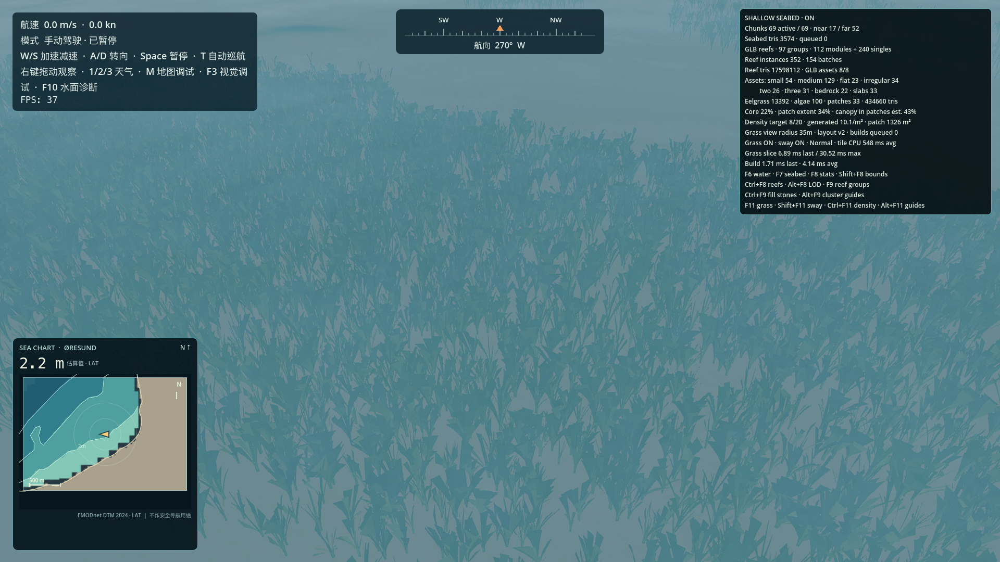
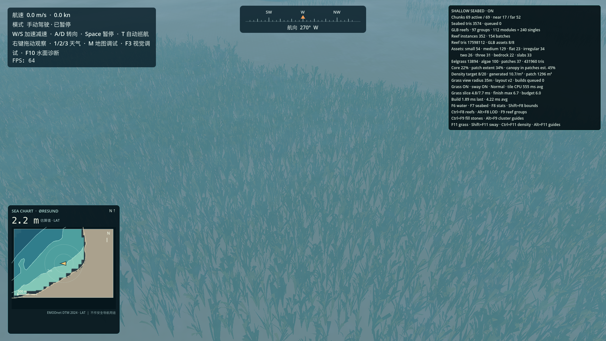
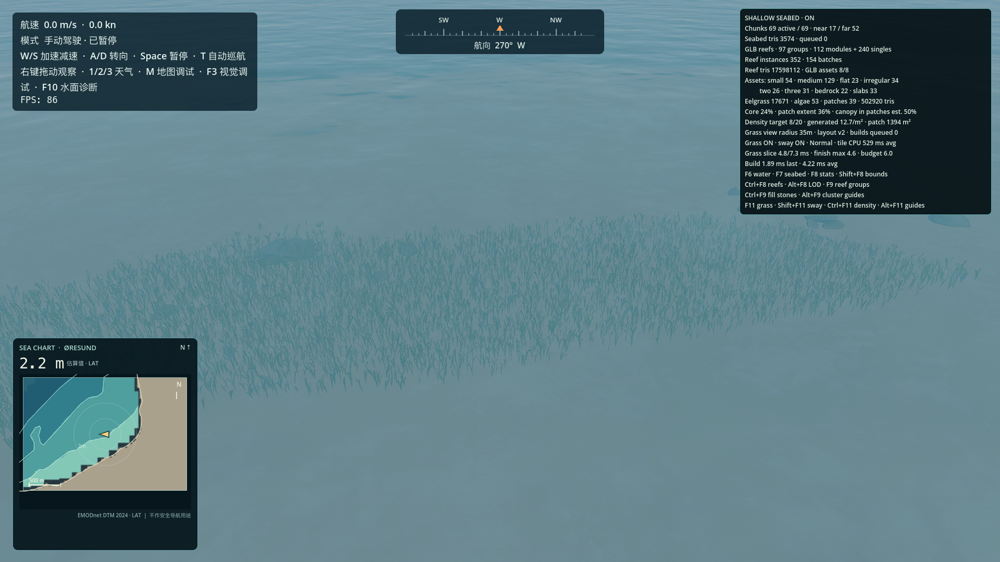
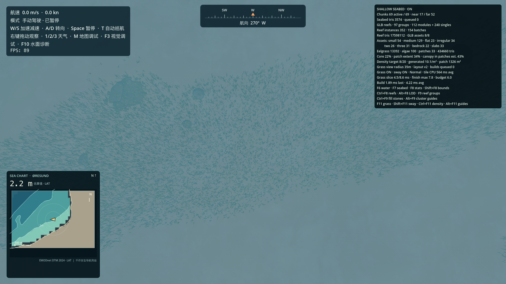
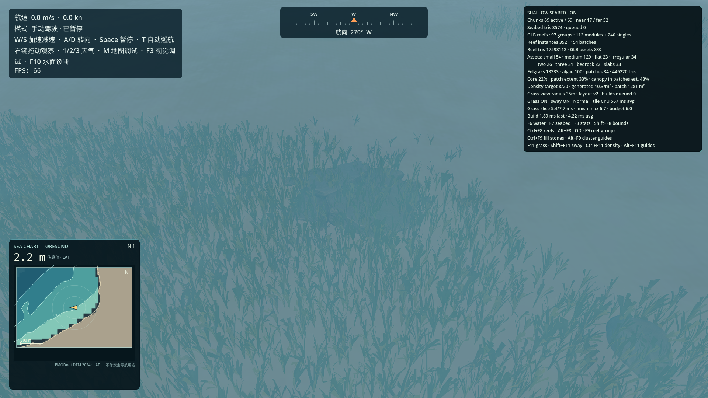
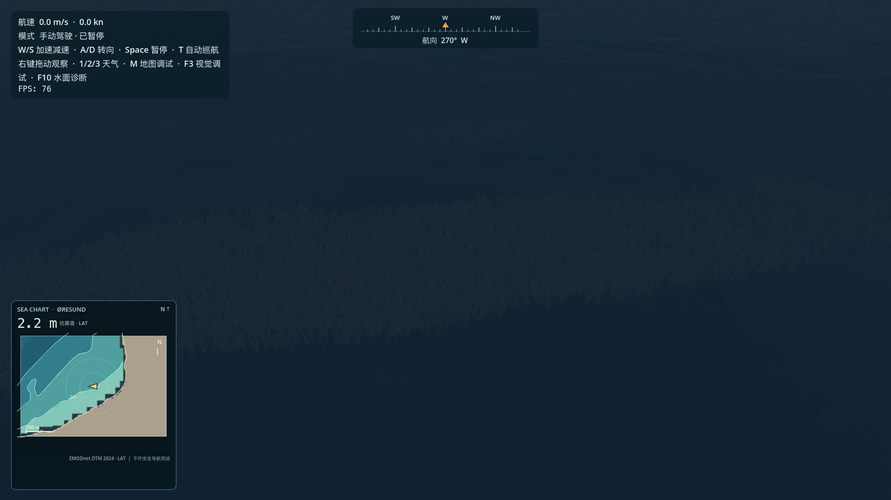

# 浅海海草美术与性能优化报告

日期：2026-10-16  
引擎：Godot 4.7.2 / Forward+ / Metal 3.2  
设备：Apple M2 Pro MacBook，1920×1080，运行时已接电源。系统没有记录电源遥测。  
主场景时间：2026-07-15 12:00，晴天，Malmö 起点约 2.24 m LAT。

## 修改范围

- 改善了程序化鳗草叶片的轮廓：根部较窄，主体宽度更稳定，只在末端柔和收尖；各叶片从松散扇形根冠伸出，增加静态弯曲和轻微扭转。
- 海草颜色改为低饱和灰绿、橄榄绿、暗黄绿和少量褐绿，并保留逐叶亮度差异。未使用自发光或透明叶片。
- 叶片 Mesh 在相邻叶段间共享顶点。近景每个植株维持 50 个三角形、60 个顶点；旧表示方式约 100 个重复顶点，顶点数减少约 40%，三角形数不变。远 LOD 顶点数减少约 33%。
- GPU 摆动继续在顶点阶段执行：根部固定，位移随叶高平方增长；使用两项低频波形和实例相位。摆动更慢、更柔和，取消了整株的垂直浮动。关闭动画后静态弯曲仍保留。
- 为减少动态加载时单帧工作，把固定候选行数改成 64 个候选点一段、默认每帧 6 ms 预算、最多 256 段；完成扫描后独立提交区块 MultiMesh，并记录扫描与提交耗时。

海草生态布局版本仍为 `2`，种子 `771903`，GPS 位置、覆盖区域、斑块规则、候选格、Normal/Dense 目标密度和礁石均未改变。只增加了独立的 `seagrass_mesh_style_version=2`。

## 视觉记录

| 内容 | 截图 |
| --- | --- |
| 修改前近景 |  |
| 修改后近景 |  |
| 船尾构图斜视 |  |
| 俯视草甸 |  |
| 礁石与海草过渡 |  |
| 夜晚光照响应 |  |

动画同镜头时序图：[`t0`](sway_closeup_t0.png) · [`t1`](sway_closeup_t1.png) · [`t2`](sway_closeup_t2.png)。运动幅度刻意较小，截图能看到叶尖位置细微变化；不是视频级动画验收。

当前工作区的 `assets/boats/base_boat.fbx` 是 134 字节 Git LFS 指针。主场景虽然正常加载海面、海床和海草，但船体 Mesh 丢失；因此截图是预期船尾相机位置，不能作为包含真实船体的实际船尾视觉验收。近景照相机已定位到最近的海草 MultiMesh 实例，距离约 0.10 m。

## 稳态 A/B 性能

接上电源后，在同一 GPS、时间、天气、分辨率和预热条件下分别固定船尾斜视与海草近景两种镜头。每个镜头的每种状态采样 3 次，每次 180 帧。FPS 栏是 `Engine.get_frames_per_second()` 采样均值；平均帧时间、P95、P99 为三次结果的平均，最差帧为三次观察到的最大值。帧时间是 `process_frame` 墙钟测量，不是 GPU 时间戳。

### 船尾斜视镜头

| 状态 | Engine FPS | 海草丛 / 三角形 | Draw Calls / 总场景 primitives | 平均帧时间 | 平均 P95 / P99 | 三次中的最差单帧 |
| --- | ---: | ---: | ---: | ---: | ---: | ---: |
| OFF | 85.0 | 0 / 0 | 173 / 607,076 | 10.96 ms | 24.68 / 31.66 ms | 34.41 ms |
| Normal，摆动关闭 | 82.2 | 17,724 / 502,920 | 201 / 1,012,728 | 11.65 ms | 22.89 / 26.38 ms | 33.76 ms |
| Normal，摆动开启 | 80.2 | 17,724 / 502,920 | 201 / 1,012,726 | 11.18 ms | 21.69 / 30.79 ms | 33.46 ms |
| Dense，摆动开启 | 75.5 | 30,588 / 866,880 | 201 / 1,304,554 | 12.18 ms | 23.36 / 30.08 ms | 31.16 ms |

### 海草近景镜头

| 状态 | Engine FPS | 海草丛 / 三角形 | Draw Calls / 总场景 primitives | 平均帧时间 | 平均 P95 / P99 | 三次中的最差单帧 |
| --- | ---: | ---: | ---: | ---: | ---: | ---: |
| OFF | 78.0 | 0 / 0 | 184 / 1,870,500 | 12.60 ms | 22.30 / 28.75 ms | 32.08 ms |
| Normal，摆动关闭 | 70.2 | 13,994 / 431,960 | 202 / 2,214,472 | 12.87 ms | 19.57 / 27.71 ms | 30.69 ms |
| Normal，摆动开启 | 68.9 | 13,994 / 431,960 | 202 / 2,214,470 | 13.40 ms | 21.09 / 27.66 ms | 31.19 ms |
| Dense，摆动开启 | 68.2 | 24,005 / 742,590 | 202 / 2,465,600 | 13.91 ms | 21.78 / 28.64 ms | 30.55 ms |

近景 OFF 到 Dense 的平均墙钟帧时间增加约 1.31 ms；船尾镜头增加约 1.23 ms。P95/P99 和重复样本有明显波动，不能据此得出稳定 FPS 增益或把全部成本归因于海草。Draw Calls 在海草开启后增加 18–28 个，场景总 primitives 随密度增加。当前运行未提供可靠 GPU 时间戳，因此这里只能报告 CPU 侧墙钟数据，不能将其解释为 GPU 渲染时间。

原始重复数据：[`performance.txt`](performance.txt)。

## 分帧生成测量

| 镜头 / 生成 | 完成时间 | 完成帧数 | 最大采样分片 | 最差整帧 | 最大 MultiMesh 提交 |
| --- | ---: | ---: | ---: | ---: | ---: |
| 船尾 / Normal | 4.20 s | 342 | 7.36 ms | 31.89 ms | 6.69 ms |
| 船尾 / Dense | 4.57 s | 355 | 8.58 ms | 31.11 ms | 6.69 ms |
| 近景 / Normal | 4.59 s | 344 | 7.70 ms | 28.21 ms | 6.69 ms |
| 近景 / Dense | 4.55 s | 354 | 7.73 ms | 29.24 ms | 6.69 ms |

6 ms 预算只在每段 64 个候选点的工作完成后检查，因此单段会略超预算；MultiMesh 提交也单独发生，最高约 6.69 ms。生成期间仍出现约 28–32 ms 的整帧峰值，不能归因于海草单一系统，也没有证明所有加载尖峰都已消失。相较旧固定行数方式，候选采样分片从历史约 24–27 ms 降到约 7–9 ms，但总完成时间约 4.2–4.6 s。原始捕获在 [`generation_performance.txt`](generation_performance.txt)。

## 验证与限制

- 图形场景捕获：通过。Shader 正常编译；晴天、夜景和三档比较图均生成。
- Mesh 检查：近/远 8 个变体均有一个有效表面、有效索引和单位法线；近景减少重复顶点约 40%，远 LOD 约 33%。
- 稳定性测试：通过。离开 Malmö 区域、卸载并返回后，起始区块签名仍为 `2:771903:338172255:10677:42`。
- 密度未变：捕获中 Normal 为 17,671 丛鳗草 + 53 丛附着藻；Dense 为 30,535 丛鳗草 + 53 丛藻类。
- 生成期间最大整帧仍约 32 ms；GPU 帧时间不可用，性能改善只能确认到 CPU 侧候选扫描分片下降，不能声称渲染开销或 FPS 已明显改善。
- Godot 退出时出现既有 RenderingDevice RID 泄漏警告；本轮未能将其归因于海草，也未做无关重构。
- 船体资源缺失使真实船尾含船体画面无法验收；恢复 Git LFS 资产后需要在游戏中人工复核。
